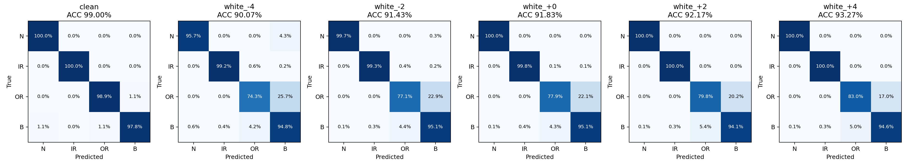
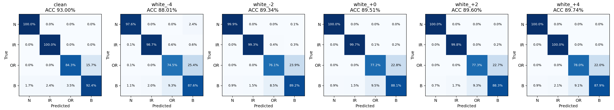
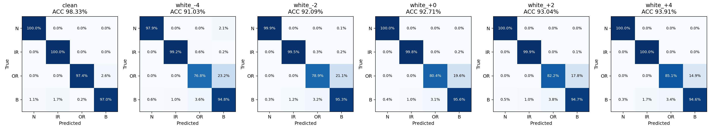
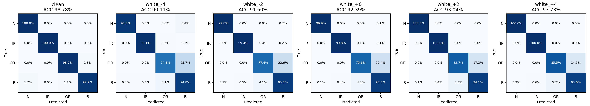
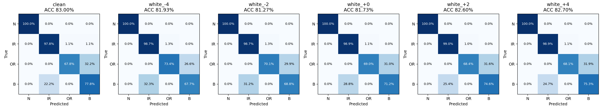

# CWRU 48 kHz非配对白噪声混合训练

训练按窗口出现次数独立进行Bernoulli(0.5)选择。加噪时连续均匀采样SNR，范围−4至4 dB，只注入加性高斯白噪声。每步32份输入，对整个混合批次计算一次平均CE，标签平滑0.05。没有0.5干净CE加0.5噪声CE，也不拼接第二份输入。

同一原窗口可能在有放回抽样中再次出现，随后重新随机决定是否加噪。不是固定替换50%的唯一窗口，也不保证每批恰好一半。两个分支始终观察同一波形，物理特征实时重新提取。归一化位于注噪之后，物理标准化仅拟合对应干净训练子集。

## 实验协议

48 kHz驱动端单振动通道，24000点不重叠窗口。0/1 HP训练，2 HP验证，3 HP测试。保留原窗口划分。训练全样本287，10%/20%/50%为29/58/144。训练子集与纯干净版相同。小样本保留原200窗口验证集，不等同于相同总标注预算。全部从头训练，无q及OR/B频谱修正。

验证固定干净和−4、−2、0、2、4 dB条件，每档一个固定白噪声实例。按类别/记录平衡的验证NLL选模，权重为干净0.5，每档噪声0.1。这是选模评分，不是训练损失。最多600更新，至少200，150更新无改善后停止。全33个模型冻结后才计算本轮测试预测。

测试各类支持数N20、IR60、OR60、B60，共200。各加噪条件覆盖全部测试窗口，采用5个固定噪声种子，所有方法和训练预算共享波形。同一随机高斯方向用于不同SNR。噪声重复不构成新增独立窗口。此前测试曝光仍存在。

SNR使用去均值干净信号功率与高斯噪声期望功率之比。有限长随机噪声的实现SNR略有波动，不逐条强行归一化噪声，以保持高斯采样。实际值见条件成本及增强审计文件。

## 测试ACC

先在每个模型内平均5次噪声评价，再统计模型均值±样本标准差，单位%。全样本3个模型；小样本3个子集×3种子。标准差不能解释为独立轴承泛化的置信区间。

|模型|训练比例|clean|white_-4|white_-2|white_+0|white_+2|white_+4|
|---|---:|---:|---:|---:|---:|---:|---:|
|fusion|100%|99.00 ± 0.87|90.07 ± 1.65|91.43 ± 1.90|91.83 ± 1.37|92.17 ± 1.34|93.27 ± 1.34|
|fusion|10%|93.00 ± 2.54|88.01 ± 1.50|89.34 ± 1.92|89.51 ± 2.33|89.60 ± 2.26|89.74 ± 2.37|
|fusion|20%|98.33 ± 1.25|91.03 ± 2.38|92.09 ± 2.34|92.71 ± 2.17|93.04 ± 2.70|93.91 ± 2.56|
|fusion|50%|98.78 ± 0.91|90.11 ± 1.79|91.60 ± 1.74|92.39 ± 1.76|93.04 ± 2.00|93.73 ± 2.04|
|data_only|100%|83.00 ± 2.18|81.93 ± 0.96|81.27 ± 0.75|81.73 ± 1.10|82.60 ± 1.66|82.70 ± 1.91|

### fusion 100%

### fusion 10%

### fusion 20%

### fusion 50%

### data_only 100%

矩阵逐行归一化，每行100%，对角线为类别召回率。原始计数在confusion_*.npz，逐次预测在predictions。指标按窗口数加权，不将普通ACC称作均衡ACC。

## 计算复杂度

|模型|训练比例|推理ms/样本|训练s/轮|峰值MiB|参数K|
|---|---:|---:|---:|---:|---:|
|data_only|100%|2.182|0.710|1198.9|33.964|
|fusion|10%|6.741|0.087|1199.2|53.068|
|fusion|20%|6.581|0.174|1199.2|53.068|
|fusion|50%|6.695|0.433|1199.2|53.068|
|fusion|100%|6.230|0.781|1199.2|53.068|

GPU与精度见benchmark_protocol.json。推理批量1，预热10，重复50，CUDA同步墙钟时间，包含实时归一化、完整物理特征提取与网络，排除磁盘解码和H2D。数据单分支不计算物理特征。训练批量32，前5轮后完整抽样轮均值，包含加噪与在线物理提取，排除验证。显存为PyTorch峰值已分配MiB。每轮是有放回抽样轮，不保证遍历全部窗口。
训练物理提取成本逐轮记录在training.csv的live_feature_seconds，验证及测试固定条件预计算成本另列于*_condition_preparation.csv，不隐藏在缓存中。

所有训练批次的实际加噪比例为49.98%。逐模型SNR范围、均值、标准差与实现偏差见augmentation_audit.csv。

完整物理融合模块对照仅在全样本开展，同时改变信息来源、参数量与融合结构，不能独立证明物理机理。仅评估合成白噪声−4至4 dB，不能推广到其他噪声或现场环境。旧配对增强及四方法比较协议不同，不纳入本版公平对比。

## 核验与一次性计算成本

干净窗口物理特征准备共0.574秒，用于拟合训练子集标准化及干净评价。固定含噪验证条件准备共1.085秒，固定含噪测试条件准备共4.008秒。这些一次性阶段与逐轮在线物理提取成本分开报告，均保留原始计时CSV。

计时硬件为NVIDIA GeForce RTX 5060 Laptop GPU，编码器BF16，其余FP32。人工生成固定测试噪声的成本列入条件准备时间，不列入部署推理延迟。40个原始数据文件哈希核验通过。

33个模型、858组测试预测的指标和混淆矩阵已核验。对全部33个模型额外检查了8个原始测试窗口在干净和−4 dB条件下的独立推理入口，最大概率差为1.83e-05，类别预测一致。全样本两组对照的共同训练更新前缀具有相同窗口、加噪掩码及SNR。3154个历史结果文件哈希保持一致。
