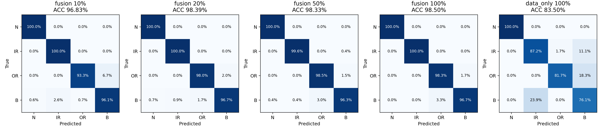

# CWRU 48 kHz纯原始数据实验

2026-10-12按用户要求，训练、验证与测试均停用人工加噪。单份干净输入、单份交叉熵；不使用干净/加噪配对。模型结构不变，无q、无OR/B修正。该版替代当前原实验设置，历史增强结果独立保留，不直接混合比较。

## 协议

保持原记录划分、窗口、训练预算和抽样规则。全样本287窗口；小样本10%、20%、50%分别29、58、144窗口。对应训练子集与历史原实验完全相同，标准化只拟合对应干净训练子集。全部从头训练。验证仅使用原始信号，按类别/记录平衡NLL选模。测试原200窗口，N20、IR60、OR60、B60。

30个融合模型及3个全样本数据单分支模型全部冻结后才进行本轮测试。以前的测试曝光历史不因此消失。本次未重新训练四个方法比较，旧增强比较不能作为本版公平对照。

## 干净测试结果

表格为窗口ACC均值±样本标准差，单位%。小样本含3个子集×3个模型种子；全样本3个模型种子。标准差不是独立轴承的泛化置信区间。

|模型|训练比例|ACC|均衡ACC|宏F1|
|---|---:|---:|---:|---:|
|data_only|100%|83.50 ± 4.44|86.25|86.28|
|fusion|10%|96.83 ± 1.22|97.36|97.22|
|fusion|20%|98.39 ± 0.74|98.66|98.48|
|fusion|50%|98.33 ± 0.25|98.61|98.52|
|fusion|100%|98.50 ± 0.00|98.75|98.75|

每行100%，对角线为该类召回率。多模型预测只作重复评价，不增加独立测试窗口。原始计数保存在confusion_*.npz。

## 计算复杂度

|模型|训练比例|延迟ms/样本|训练s/轮|峰值训练MiB|参数K|
|---|---:|---:|---:|---:|---:|
|data_only|100%|2.332|0.638|1198.9|33.964|
|fusion|10%|6.420|0.072|1199.2|53.068|
|fusion|20%|6.590|0.145|1199.2|53.068|
|fusion|50%|6.456|0.362|1199.2|53.068|
|fusion|100%|6.837|0.648|1199.2|53.068|

RTX5060 Laptop，编码器BF16其余FP32。推理批量1、预热10、重复50，CUDA同步墙钟计时，包括实时归一化、完整212维提取及网络，排除磁盘/MAT解码/传输。数据单分支不计算物理特征。训练时间为前5轮后完整轮均值，排除验证，干净特征预计算单独计时。显存为PyTorch峰值已分配MiB。
一次性干净特征提取总成本0.658秒，其中训练0.565秒，验证与测试另列于feature_preparation.csv，不含MAT读取。

没有噪声测试，因此本版不能支持抗噪性结论。完整模块对照同时改变输入信息、参数量和融合结构，不能独立证明物理机理。
