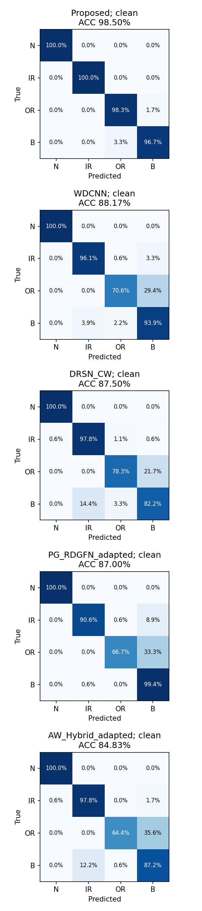
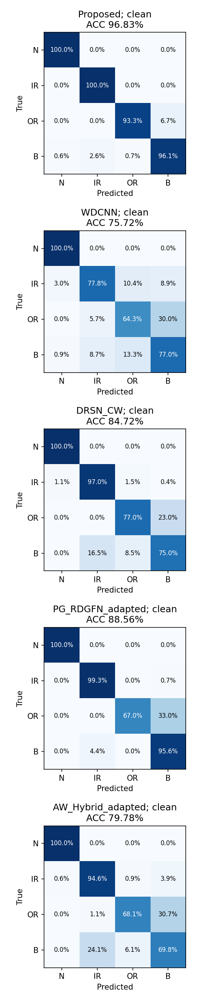
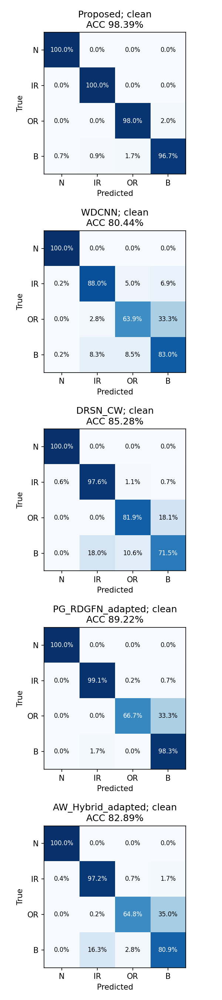
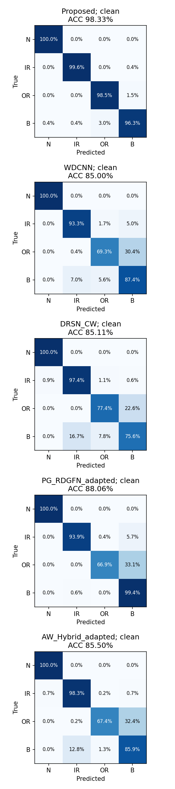
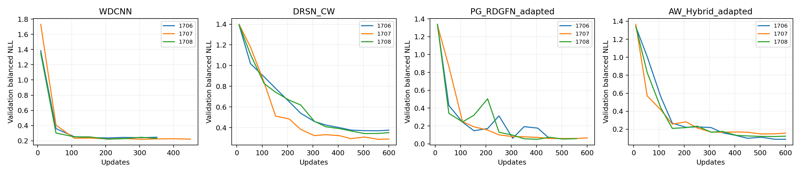
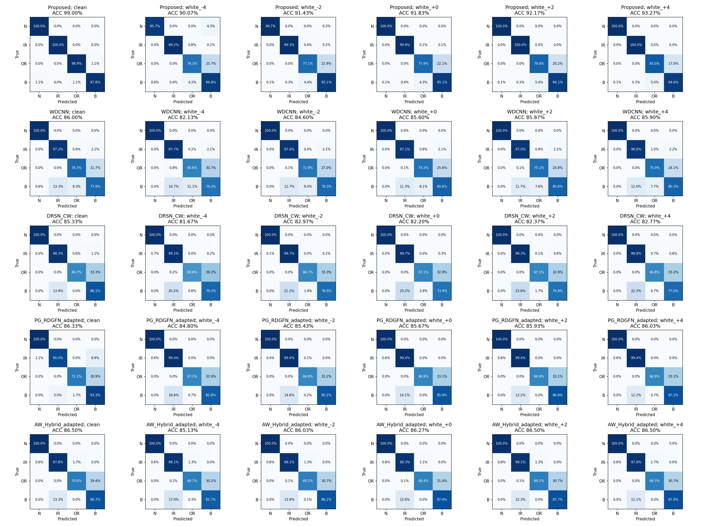
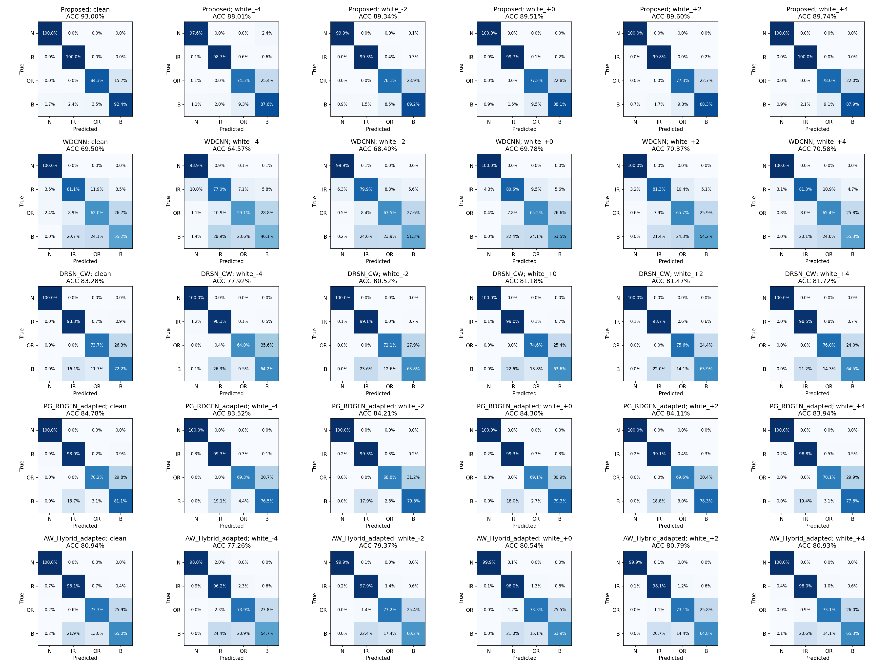
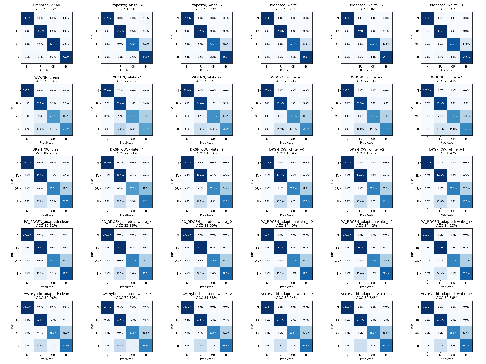
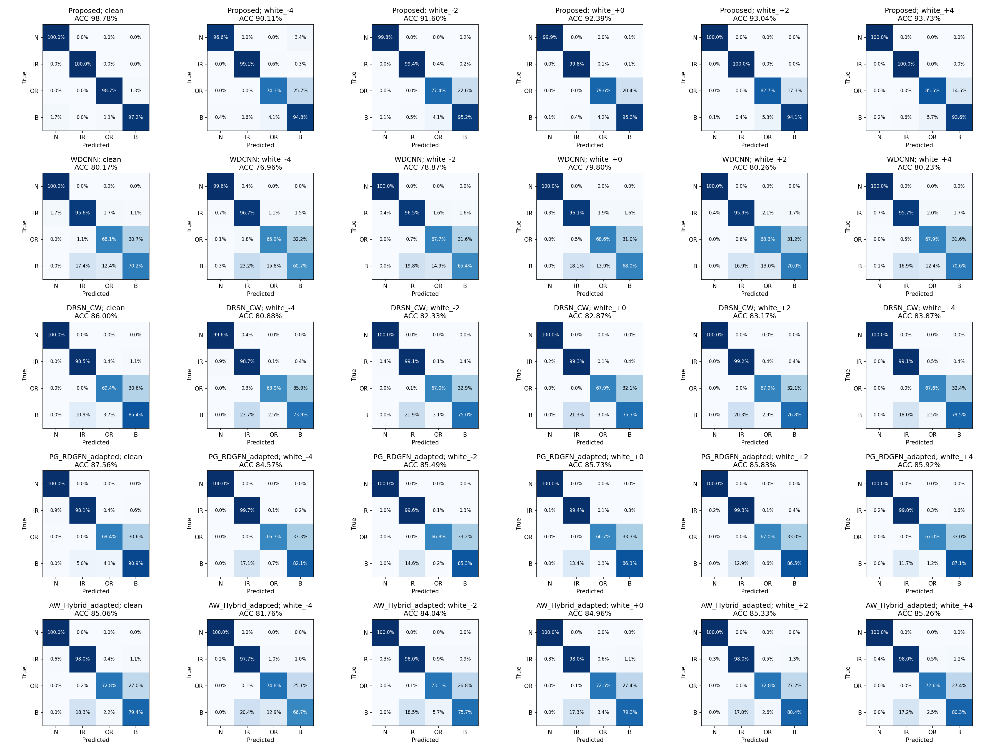
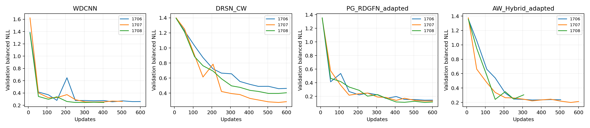

# 当前两套协议的四方法公平比较

本轮分别针对纯干净和非配对AWGN混合协议，从头训练四种比较方法，共240个模型。提出模型直接读取当天两套冻结结果，未重训或覆盖。完整协议见源码matched/PROTOCOL.md。

相同基础窗口、训练子集、分层抽样、批量32、600更新上限、优化器和验证选模规则。AWGN训练掩码与SNR的共同更新前缀逐项核验，验证和测试噪声波形哈希与原实验一致。PG保留自身辅助分类及门控约束，其他方法仅主分类CE，不使用干净/噪声配对。

两种近期方法属于方法适配，不能称官方实现或精确复现。共同预算不保证所有模型达到最优。测试集此前已曝光，本轮不是独立确认性验证。

训练287窗口，小样本10%/20%/50%分别29/58/144。验证200窗口，测试200窗口，N20、IR60、OR60、B60。固定验证集的标注数量不从小样本预算中隐去。全样本3种子，小样本3子集×3种子。噪声重复不是新增独立测试窗口。

## 主要结果

以下为全样本窗口ACC均值±样本标准差，单位%。纯干净列来自纯干净训练组，另外两列来自AWGN混合训练组。

|方法|纯干净组测试|AWGN组干净测试|AWGN组−4 dB测试|AWGN组下降百分点|
|---|---:|---:|---:|---:|
|本方法|98.50 ± 0.00|99.00 ± 0.87|90.07 ± 1.65|8.93|
|WDCNN|88.17 ± 1.04|86.00 ± 2.60|82.13 ± 1.59|3.87|
|DRSN-CW|87.50 ± 6.56|85.33 ± 1.26|81.67 ± 1.26|3.67|
|PG-RDGFN-adapted|87.00 ± 3.91|86.33 ± 3.88|84.80 ± 3.65|1.53|
|AW-Hybrid-adapted|84.83 ± 6.79|86.50 ± 2.18|85.13 ± 0.85|1.37|

本方法在本轮设置下的含噪绝对准确率较高，但不代表受噪声影响最小。AWGN组全样本从干净99.00%降至−4 dB的90.07%，下降8.93个百分点；AW-Hybrid-adapted下降1.37个百分点。较低起点的模型可能下降更小。因此，结果支持当前条件下较高的含噪诊断准确率，不能支持最小性能退化或物理分支天然不受噪声影响。

效率也存在代价。本方法约53.068K参数，多于DRSN-CW的11.484K；全样本AWGN推理约6.294 ms，慢于WDCNN、PG和AW混合模型，快于本实现的DRSN-CW。峰值训练显存1199.2 MiB高于本轮四个对照。不能把参数较少写成整体复杂度最低。精度和缓存差异见后文。

纯干净与AWGN两组同时改变训练观测和验证选模目标，两组之间的差值不能单独解释为噪声增强的因果效果。方法差异也不能单独归于门控或物理机理。固定600更新与统一超参数可能对不同模型有不同影响，本轮不等于各方法充分调优后的最佳性能。

## clean_only

数值为窗口ACC均值±模型间样本标准差，单位%。含噪条件在每个模型内先平均5次重复，干净条件只评价一次。小样本的9组包含交叉重复结构，标准差不代表独立轴承泛化的不确定性。

|训练比例|方法|clean|
|---:|---|---:|
|100%|Proposed|98.50 ± 0.00|
|100%|WDCNN|88.17 ± 1.04|
|100%|DRSN_CW|87.50 ± 6.56|
|100%|PG_RDGFN_adapted|87.00 ± 3.91|
|100%|AW_Hybrid_adapted|84.83 ± 6.79|
|10%|Proposed|96.83 ± 1.22|
|10%|WDCNN|75.72 ± 3.16|
|10%|DRSN_CW|84.72 ± 3.97|
|10%|PG_RDGFN_adapted|88.56 ± 0.98|
|10%|AW_Hybrid_adapted|79.78 ± 3.65|
|20%|Proposed|98.39 ± 0.74|
|20%|WDCNN|80.44 ± 2.35|
|20%|DRSN_CW|85.28 ± 3.40|
|20%|PG_RDGFN_adapted|89.22 ± 0.51|
|20%|AW_Hybrid_adapted|82.89 ± 3.42|
|50%|Proposed|98.33 ± 0.25|
|50%|WDCNN|85.00 ± 1.48|
|50%|DRSN_CW|85.11 ± 4.14|
|50%|PG_RDGFN_adapted|88.06 ± 2.99|
|50%|AW_Hybrid_adapted|85.50 ± 3.71|

均衡ACC及宏F1见metrics_combined.csv和summary.csv，配对差值见paired_differences.csv，仅作描述。

### 比例混淆矩阵

各行100%，对角线为类别召回率。标题ACC与表格同源，原始逐次计数保存在confusion_*.npz。支持数始终为N20、IR60、OR60、B60。

100%训练预算

10%训练预算

20%训练预算

50%训练预算

### 计算复杂度

|训练比例|方法|推理ms/样本|训练s/轮|峰值显存MiB|参数K|一次拟合s|
|---:|---|---:|---:|---:|---:|---:|
|100%|Proposed|6.375|0.648|1199.2|53.068|0.000|
|100%|WDCNN|1.179|0.063|72.1|322.704|0.000|
|100%|DRSN_CW|8.129|0.363|360.7|11.484|0.000|
|100%|PG_RDGFN_adapted|3.305|0.186|264.7|208.329|0.081|
|100%|AW_Hybrid_adapted|2.270|0.095|167.2|93.349|0.000|
|10%|Proposed|6.513|0.072|1199.2|53.068|0.000|
|10%|WDCNN|1.168|0.008|72.1|322.704|0.000|
|10%|DRSN_CW|8.401|0.043|360.7|11.484|0.000|
|10%|PG_RDGFN_adapted|3.427|0.022|264.5|208.329|0.005|
|10%|AW_Hybrid_adapted|2.220|0.011|167.2|93.349|0.000|
|20%|Proposed|6.456|0.145|1199.2|53.068|0.000|
|20%|WDCNN|1.143|0.015|72.1|322.704|0.000|
|20%|DRSN_CW|8.226|0.086|360.7|11.484|0.000|
|20%|PG_RDGFN_adapted|3.350|0.043|265.1|208.329|0.007|
|20%|AW_Hybrid_adapted|2.166|0.023|167.2|93.349|0.000|
|50%|Proposed|6.522|0.362|1199.2|53.068|0.000|
|50%|WDCNN|1.136|0.036|72.1|322.704|0.000|
|50%|DRSN_CW|8.184|0.211|360.7|11.484|0.000|
|50%|PG_RDGFN_adapted|3.427|0.106|264.6|208.329|0.014|
|50%|AW_Hybrid_adapted|2.259|0.055|167.2|93.349|0.000|

同一GPU同步计时，batch1，预热10次、重复50次，包括实时归一化、完整特征及网络，排除磁盘/MAT解码/H2D。GPU、软件版本见benchmark_protocol.json。比较方法FP32，提出模型编码器BF16其余FP32，速度差不能完全归于结构。训练秒/轮来自第5轮后完整抽样轮，排除验证；峰值为PyTorch已分配MiB。总训练及验证时间见complexity_runs.csv。

提出模型训练使用缓存物理特征，一次训练集提取0.565秒，全部角色提取0.658秒，详见原feature_preparation.csv。比较方法实时计算自身特征，PG对应子集拟合另列。缓存方式不同，不能仅按此训练秒/轮排序端到端训练效率。

本组120模型中35个训练到600更新上限。选中更新及验证NLL见selected_updates.csv，逐轮验证曲线见下图，不把固定预算结果称为各方法最优性能。

## awgn_mixed

数值为窗口ACC均值±模型间样本标准差，单位%。含噪条件在每个模型内先平均5次重复，干净条件只评价一次。小样本的9组包含交叉重复结构，标准差不代表独立轴承泛化的不确定性。

|训练比例|方法|clean|white_-4|white_-2|white_+0|white_+2|white_+4|
|---:|---|---:|---:|---:|---:|---:|---:|
|100%|Proposed|99.00 ± 0.87|90.07 ± 1.65|91.43 ± 1.90|91.83 ± 1.37|92.17 ± 1.34|93.27 ± 1.34|
|100%|WDCNN|86.00 ± 2.60|82.13 ± 1.59|84.60 ± 1.15|85.60 ± 1.18|85.87 ± 0.67|85.90 ± 0.40|
|100%|DRSN_CW|85.33 ± 1.26|81.67 ± 1.26|82.97 ± 0.76|82.20 ± 0.75|82.37 ± 1.82|82.77 ± 2.11|
|100%|PG_RDGFN_adapted|86.33 ± 3.88|84.80 ± 3.65|85.43 ± 3.54|85.67 ± 3.45|85.93 ± 3.16|86.03 ± 3.01|
|100%|AW_Hybrid_adapted|86.50 ± 2.18|85.13 ± 0.85|86.03 ± 1.46|86.27 ± 2.32|86.50 ± 2.18|86.50 ± 2.27|
|10%|Proposed|93.00 ± 2.54|88.01 ± 1.50|89.34 ± 1.92|89.51 ± 2.33|89.60 ± 2.26|89.74 ± 2.37|
|10%|WDCNN|69.50 ± 3.72|64.57 ± 2.71|68.40 ± 3.01|69.78 ± 3.41|70.37 ± 3.78|70.58 ± 3.98|
|10%|DRSN_CW|83.28 ± 4.84|77.92 ± 1.69|80.52 ± 2.29|81.18 ± 2.28|81.47 ± 2.55|81.72 ± 2.64|
|10%|PG_RDGFN_adapted|84.78 ± 2.46|83.52 ± 2.34|84.21 ± 2.47|84.30 ± 2.83|84.11 ± 2.75|83.94 ± 2.55|
|10%|AW_Hybrid_adapted|80.94 ± 5.99|77.26 ± 5.33|79.37 ± 6.02|80.54 ± 6.12|80.79 ± 6.09|80.93 ± 6.00|
|20%|Proposed|98.33 ± 1.25|91.03 ± 2.38|92.09 ± 2.34|92.71 ± 2.17|93.04 ± 2.70|93.91 ± 2.56|
|20%|WDCNN|75.50 ± 3.14|72.21 ± 3.57|75.84 ± 2.50|76.88 ± 2.30|77.18 ± 2.56|76.94 ± 2.66|
|20%|DRSN_CW|82.28 ± 4.20|79.08 ± 5.14|81.30 ± 3.06|81.29 ± 2.29|81.54 ± 2.81|81.92 ± 3.64|
|20%|PG_RDGFN_adapted|86.11 ± 2.19|82.36 ± 3.18|83.90 ± 2.23|84.40 ± 1.92|84.42 ± 2.08|84.23 ± 2.36|
|20%|AW_Hybrid_adapted|82.06 ± 4.72|79.82 ± 3.18|81.68 ± 3.03|82.24 ± 3.22|82.34 ± 3.68|82.56 ± 3.94|
|50%|Proposed|98.78 ± 0.91|90.11 ± 1.79|91.60 ± 1.74|92.39 ± 1.76|93.04 ± 2.00|93.73 ± 2.04|
|50%|WDCNN|80.17 ± 2.37|76.96 ± 1.39|78.87 ± 1.46|79.80 ± 1.65|80.26 ± 1.83|80.23 ± 1.75|
|50%|DRSN_CW|86.00 ± 3.64|80.88 ± 2.05|82.33 ± 1.54|82.87 ± 1.75|83.17 ± 2.05|83.87 ± 2.25|
|50%|PG_RDGFN_adapted|87.56 ± 2.28|84.57 ± 2.20|85.49 ± 2.29|85.73 ± 2.20|85.83 ± 2.35|85.92 ± 2.34|
|50%|AW_Hybrid_adapted|85.06 ± 2.04|81.76 ± 2.88|84.04 ± 1.99|84.96 ± 1.84|85.33 ± 1.74|85.26 ± 1.73|

均衡ACC及宏F1见metrics_combined.csv和summary.csv，配对差值见paired_differences.csv，仅作描述。

### 比例混淆矩阵

各行100%，对角线为类别召回率。标题ACC与表格同源，原始逐次计数保存在confusion_*.npz。支持数始终为N20、IR60、OR60、B60。

100%训练预算

10%训练预算

20%训练预算

50%训练预算

### 计算复杂度

|训练比例|方法|推理ms/样本|训练s/轮|峰值显存MiB|参数K|一次拟合s|
|---:|---|---:|---:|---:|---:|---:|
|100%|Proposed|6.294|0.781|1199.2|53.068|0.000|
|100%|WDCNN|1.128|0.152|72.1|322.704|0.000|
|100%|DRSN_CW|8.089|0.457|360.7|11.484|0.000|
|100%|PG_RDGFN_adapted|3.345|0.277|264.7|208.329|0.029|
|100%|AW_Hybrid_adapted|2.209|0.186|167.2|93.349|0.000|
|10%|Proposed|6.296|0.087|1199.2|53.068|0.000|
|10%|WDCNN|1.148|0.018|72.1|322.704|0.000|
|10%|DRSN_CW|8.252|0.052|360.7|11.484|0.000|
|10%|PG_RDGFN_adapted|3.309|0.031|264.5|208.329|0.005|
|10%|AW_Hybrid_adapted|2.266|0.021|167.2|93.349|0.000|
|20%|Proposed|6.319|0.174|1199.2|53.068|0.000|
|20%|WDCNN|1.132|0.036|72.1|322.704|0.000|
|20%|DRSN_CW|8.148|0.106|360.7|11.484|0.000|
|20%|PG_RDGFN_adapted|3.328|0.064|265.1|208.329|0.006|
|20%|AW_Hybrid_adapted|2.303|0.044|167.2|93.349|0.000|
|50%|Proposed|6.487|0.433|1199.2|53.068|0.000|
|50%|WDCNN|1.126|0.085|72.1|322.704|0.000|
|50%|DRSN_CW|8.238|0.254|360.7|11.484|0.000|
|50%|PG_RDGFN_adapted|3.336|0.153|264.6|208.329|0.015|
|50%|AW_Hybrid_adapted|2.282|0.102|167.2|93.349|0.000|

同一GPU同步计时，batch1，预热10次、重复50次，包括实时归一化、完整特征及网络，排除磁盘/MAT解码/H2D。GPU、软件版本见benchmark_protocol.json。比较方法FP32，提出模型编码器BF16其余FP32，速度差不能完全归于结构。训练秒/轮来自第5轮后完整抽样轮，排除验证；峰值为PyTorch已分配MiB。总训练及验证时间见complexity_runs.csv。

本组提出模型与比较方法训练均在线计算特征，现有模型训练物理提取时间保留在原training.csv；本轮PG训练拟合另列，不隐藏预处理成本。

本组120模型中57个训练到600更新上限。选中更新及验证NLL见selected_updates.csv，逐轮验证曲线见下图，不把固定预算结果称为各方法最优性能。

## 解释边界

本实验比较各方法在固定数据和预算下的整体表现。不同参数量、辅助目标、RPM输入及精度设置仍需在解释中保留，不把差异单独解释为物理机理或门控效果。不根据测试结果补调模型。白噪声结果只适用于当前合成噪声及SNR范围，不推广到现场干扰。

## 核验与冻结

240个新模型、3240组测试预测曾完成独立检查。每个模型检查8个测试窗口，纯干净组检查干净条件，AWGN组检查干净与−4 dB条件，共360次概率对照。完整训练抽样顺序也曾重新生成核对。

实验结果已经冻结，不重复覆盖。
