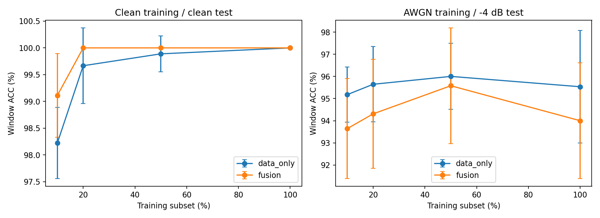
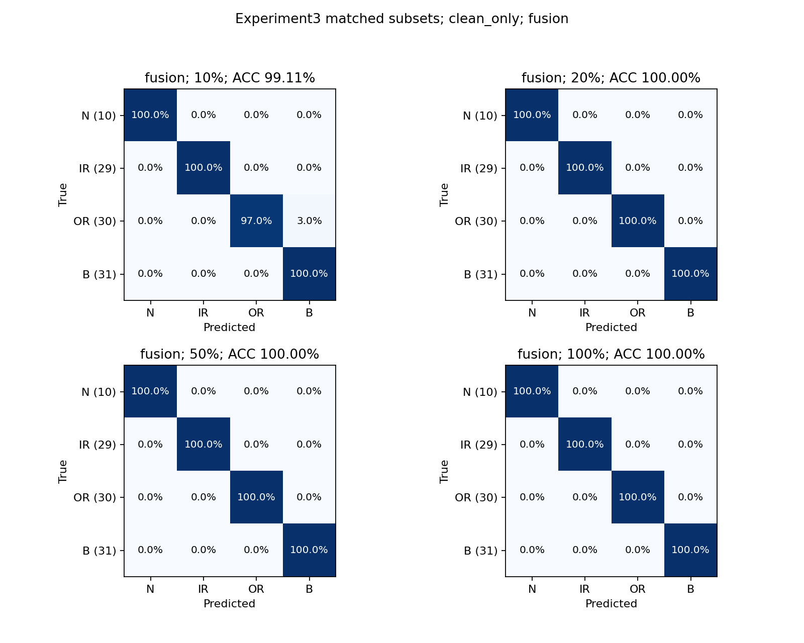
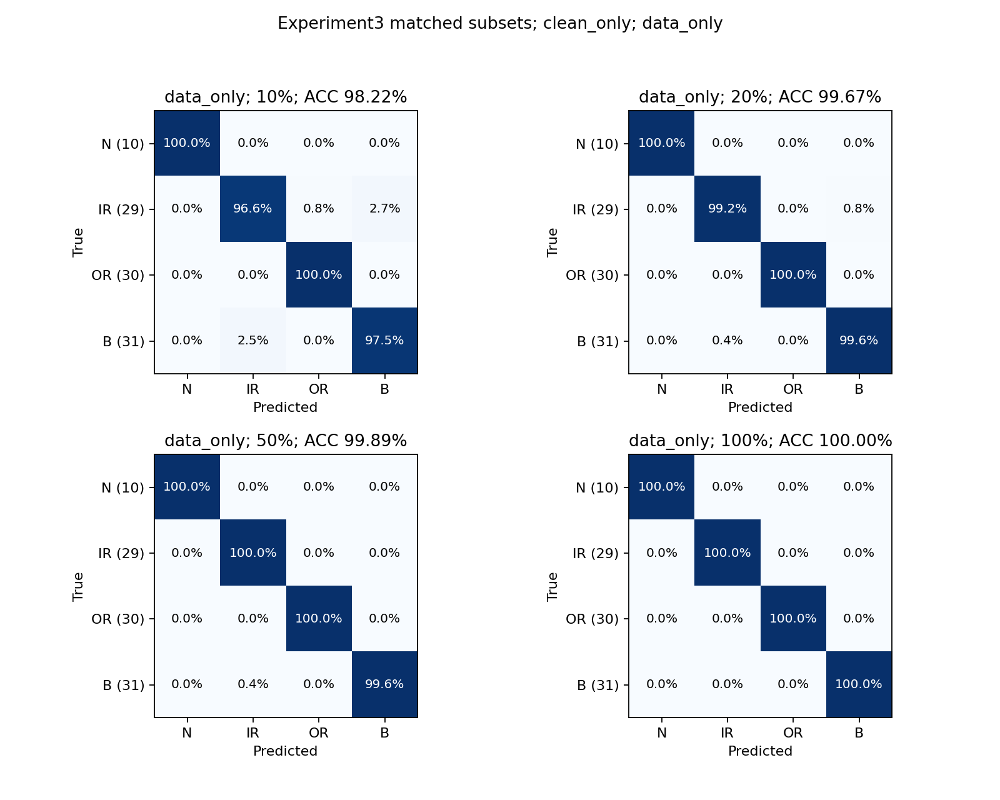
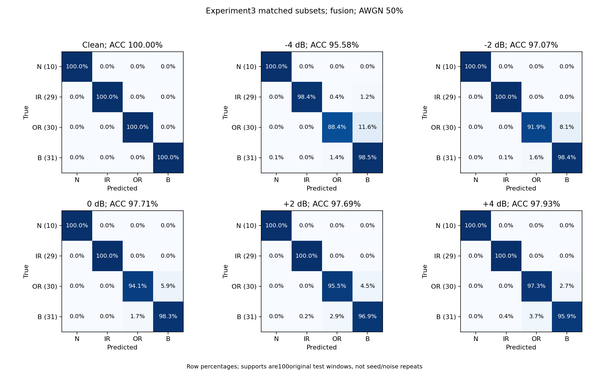
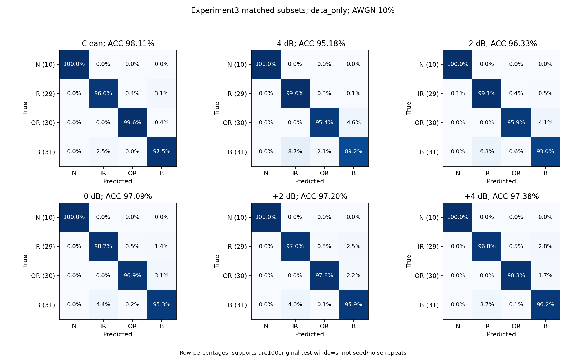

# 实验3 数据单分支小样本补充与配对比较

已完成54个随机初始化数据单分支模型，729组新增逐次指标。原66模型及891组指标只读复用，合并展示120模型、1620组逐次指标、56组汇总混淆计数。没有重新训练或重新测试原融合模型。

同预算对照匹配原始训练子集、100验证窗、100测试窗、抽样与噪声规则、优化器、最多600更新和早停选模规则。实际停止更新数可因模型不同而不同，不声称实际训练更新总量完全一致。原结果曝光后才补充对照，不属于新的独立确认性评价。

## 窗口准确率

每档小样本3子集×3训练种子；全样本3训练种子。先平均模型内5噪声实例，再报告组合均值与样本标准差。9组合不是9个独立数据集，标准差不是独立轴承置信区间。

|协议|比例|模型|干净ACC (%)|−4 dB ACC (%)|
|---|---:|---|---:|---:|
|clean_only|10%|fusion|99.11 ± 0.78|未评价|
|clean_only|10%|data_only|98.22 ± 0.67|未评价|
|clean_only|20%|fusion|100.00 ± 0.00|未评价|
|clean_only|20%|data_only|99.67 ± 0.71|未评价|
|clean_only|50%|fusion|100.00 ± 0.00|未评价|
|clean_only|50%|data_only|99.89 ± 0.33|未评价|
|clean_only|100%|fusion|100.00 ± 0.00|未评价|
|clean_only|100%|data_only|100.00 ± 0.00|未评价|
|awgn_mixed|10%|fusion|99.00 ± 0.87|93.64 ± 2.26|
|awgn_mixed|10%|data_only|98.11 ± 0.93|95.18 ± 1.24|
|awgn_mixed|20%|fusion|99.89 ± 0.33|94.31 ± 2.45|
|awgn_mixed|20%|data_only|99.00 ± 1.32|95.64 ± 1.70|
|awgn_mixed|50%|fusion|100.00 ± 0.00|95.58 ± 2.61|
|awgn_mixed|50%|data_only|99.00 ± 2.00|96.00 ± 1.49|
|awgn_mixed|100%|fusion|100.00 ± 0.00|94.00 ± 2.62|
|awgn_mixed|100%|data_only|99.33 ± 1.15|95.53 ± 2.54|

完整噪声条件、均衡准确率、宏F1与逐类召回见combined_summary.csv。配对差值为融合减去单分支，见paired_model_differences.csv，子集内种子平均见paired_subset_means.csv，不筛有利组合。

## 数据与解释边界

[逐文件用量及实际训练子集](DATA_USAGE.md)。各档额外使用100标注验证窗，不能将48训练窗称作全部标注预算48。训练测试共享记录，不作为跨负载、跨记录或独立轴承泛化证据。原始OR014_3事后排除及历史测试曝光仍存在。

新增同预算对照使得比较两模型在当前固定划分下的样本预算表现成为可能，但不自动证明物理特征的因果机制。两模型同时改变信息、结构和参数量，不能推广到其他数据集、故障试件和现场噪声。

## 计算开销

新运行硬件NVIDIA GeForce RTX 5060 Laptop GPU，PyTorch 2.11.0+cu128，编码器BF16其余FP32。推理batch1、预热10重复50，归一化加网络，排除磁盘/H2D；数据单分支不提取物理特征。训练batch32，训练总/轮均时间、验证前向、峰值allocated显存分列。新旧运行时间不混为同次独立计时。

|index|protocol|method|ratio|run|parameters|latency_ms|train_seconds_per_epoch|total_train_seconds|peak_gpu_mib|validation_forward_seconds|
|---|---|---|---|---|---|---|---|---|---|---|
|0|awgn_mixed|data_only|0.1|supplement|33964.0|3.2665|0.165|49.4858|1195.5825|6.1402|
|1|awgn_mixed|data_only|0.2|supplement|33964.0|3.1532|0.2397|47.9444|1195.5825|5.9215|
|2|awgn_mixed|data_only|0.5|supplement|33964.0|3.2837|0.6398|47.9874|1195.5825|5.9623|
|3|awgn_mixed|data_only|1.0|original|33964.0|2.4947|1.2102|48.4079|1195.5825|6.0288|
|4|awgn_mixed|fusion|0.1|original|53068.0|7.2968|0.1769|53.0604|1196.2573|7.8109|
|5|awgn_mixed|fusion|0.2|original|53068.0|7.5897|0.2659|53.177|1196.2573|7.8268|
|6|awgn_mixed|fusion|0.5|original|53068.0|8.6667|0.7086|53.1454|1196.2573|7.8102|
|7|awgn_mixed|fusion|1.0|original|53068.0|7.4668|1.3344|53.3749|1196.2573|7.8095|
|8|clean_only|data_only|0.1|supplement|33964.0|3.3153|0.1437|43.1138|1195.5825|1.0437|
|9|clean_only|data_only|0.2|supplement|33964.0|3.2939|0.2155|43.098|1195.5825|1.0478|
|10|clean_only|data_only|0.5|supplement|33964.0|3.307|0.5684|42.63|1195.5825|1.0385|
|11|clean_only|data_only|1.0|original|33964.0|2.5822|1.0767|43.0664|1195.5825|1.0427|
|12|clean_only|fusion|0.1|original|53068.0|7.47|0.1555|41.9049|1196.2573|1.2051|
|13|clean_only|fusion|0.2|original|53068.0|7.3752|0.2337|43.3453|1196.2573|1.22|
|14|clean_only|fusion|0.5|original|53068.0|7.569|0.6229|42.563|1196.2573|1.1976|
|15|clean_only|fusion|1.0|original|53068.0|7.35|1.1707|43.3117|1196.2573|1.6246|

[原实验3报告](../experiment_3/REPORT.md) · [固定补充协议](PROTOCOL.md)

## 图表

