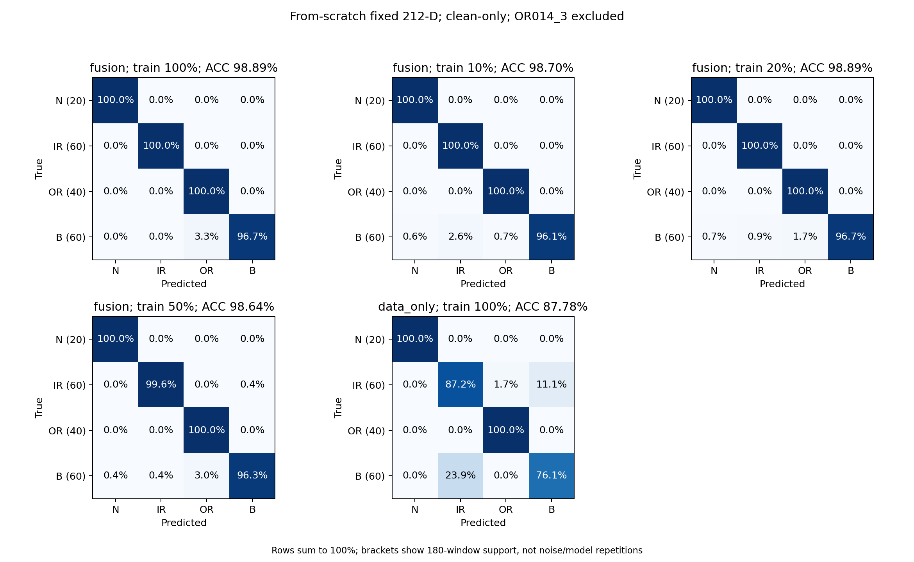
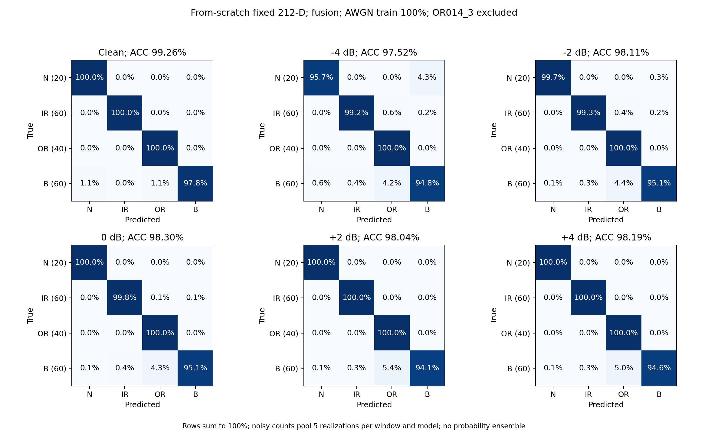
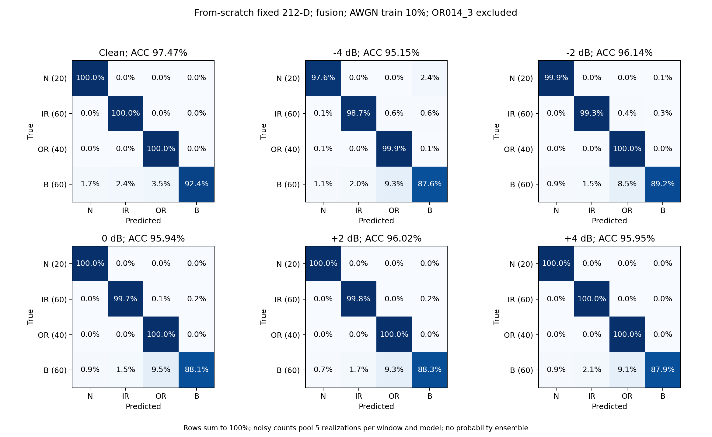
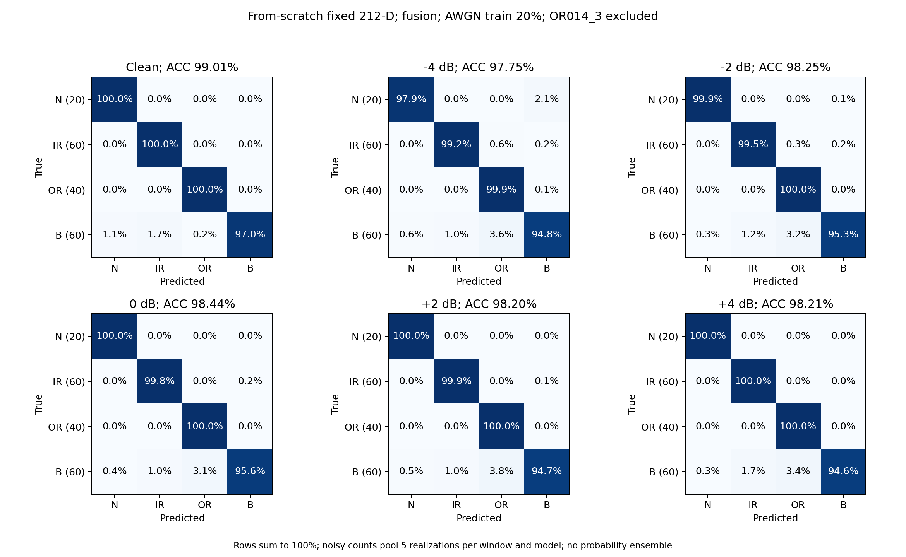
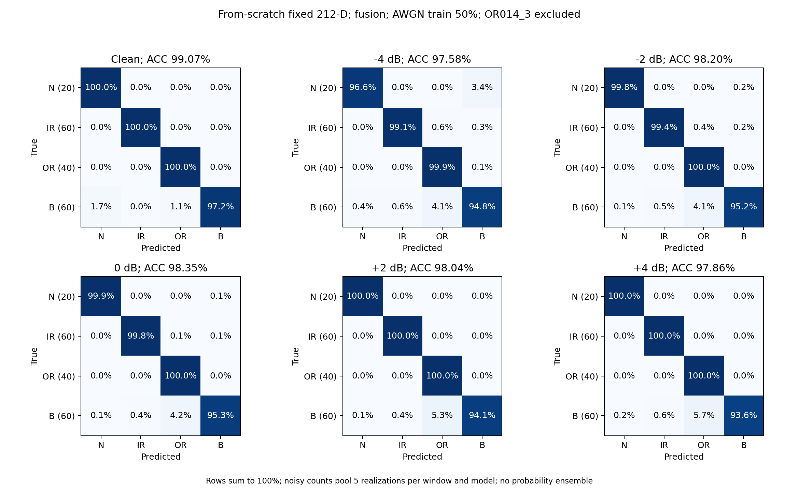
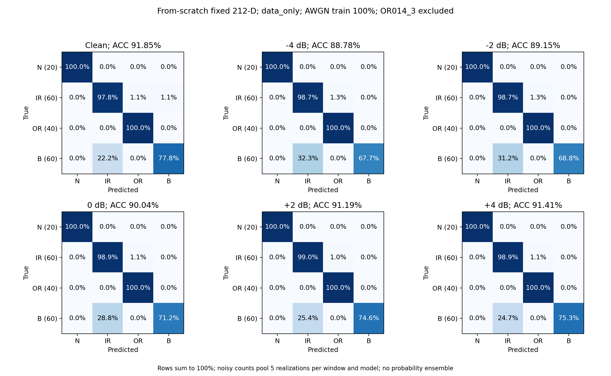

# 排除OR014_3后从头训练的固定212维实验

本轮从头训练66个模型。没有使用旧模型权重、预训练或原预测筛选来代替训练。原完整200窗口实验与其比较模型保持冻结。

训练0/1HP共287窗口，验证2HP共200窗口保持不变，仅从3HP测试集中排除OR014_3的20窗口。测试180窗口，Normal20、IR60、OR40、B60。OR014_0/1/2保留。

融合模型包含全样本及各类10%、20%、50%训练窗口，分别287、29、58、144。全样本3种子，小样本每比例3子集乘3种子。单数据分支依旧只做全样本3种子。干净与非配对AWGN两套协议各33模型。

AWGN每次窗口出现时独立50%保持干净，否则连续均匀采样U[-4,4]dB加性高斯白噪声。每批32观测、一次CE，双分支使用同一观测。纯干净组训练、验证及测试均不人工加噪。验证选模规则不变。全部模型完成验证选模后统一测试。

测试噪声先按原200窗口顺序生成，再只保留180窗口，因此其余窗口的噪声方向与原协议一致。每档5实例。不是重新挑选有利噪声，不将重复观测当作独立窗口。

## 测试结果

先在每个模型内平均噪声重复，再报告模型间均值和样本标准差。标准差不是独立轴承泛化的置信区间。小样本仍使用200个带标签验证窗口。

### clean_only，窗口ACC（%）

|模型|训练比例|clean|
|---|---:|---:|
|fusion|100%|98.89 ± 0.00|
|fusion|10%|98.70 ± 1.30|
|fusion|20%|98.89 ± 0.48|
|fusion|50%|98.64 ± 0.40|
|data_only|100%|87.78 ± 0.56|

### awgn_mixed，窗口ACC（%）

|模型|训练比例|clean|white_-4|white_-2|white_+0|white_+2|white_+4|
|---|---:|---:|---:|---:|---:|---:|---:|
|fusion|100%|99.26 ± 0.32|97.52 ± 1.70|98.11 ± 2.15|98.30 ± 1.58|98.04 ± 1.74|98.19 ± 1.62|
|fusion|10%|97.47 ± 1.78|95.15 ± 1.96|96.14 ± 1.95|95.94 ± 2.14|96.02 ± 1.81|95.95 ± 1.76|
|fusion|20%|99.01 ± 1.07|97.75 ± 1.99|98.25 ± 1.61|98.44 ± 1.31|98.20 ± 1.50|98.21 ± 1.23|
|fusion|50%|99.07 ± 0.79|97.58 ± 1.23|98.20 ± 1.07|98.35 ± 1.02|98.04 ± 1.40|97.86 ± 1.37|
|data_only|100%|91.85 ± 3.06|88.78 ± 0.40|89.15 ± 0.72|90.04 ± 1.56|91.19 ± 2.48|91.41 ± 2.66|

均衡ACC、宏F1和四类召回率见summary.csv，逐次结果见metrics.csv与class_metrics.csv。比例混淆矩阵按真实类别逐行归一化，括号为原始窗口支持数。原始累计计数见confusion_counts.npz。

## 计算复杂度

|协议|模型|训练比例|推理ms/样本|训练s/轮|峰值MiB|参数K|训练子集拟合s|
|---|---|---:|---:|---:|---:|---:|---:|
|awgn_mixed|data_only|100%|3.099|0.736|1195.6|33.964|0.011|
|awgn_mixed|fusion|10%|9.456|0.091|1196.3|53.068|0.007|
|awgn_mixed|fusion|20%|9.362|0.178|1196.3|53.068|0.012|
|awgn_mixed|fusion|50%|9.204|0.451|1196.3|53.068|0.032|
|awgn_mixed|fusion|100%|9.266|0.827|1196.3|53.068|0.063|
|clean_only|data_only|100%|3.208|0.640|1195.6|33.964|0.012|
|clean_only|fusion|10%|9.663|0.078|1196.3|53.068|0.178|
|clean_only|fusion|20%|9.732|0.157|1196.3|53.068|0.194|
|clean_only|fusion|50%|9.620|0.400|1196.3|53.068|0.212|
|clean_only|fusion|100%|9.810|0.703|1196.3|53.068|1.246|

硬件NVIDIA GeForce RTX 5060 Laptop GPU，精度BF16 encoder on CUDA, remainder FP32。推理批量1，10次预热、50次重复，包含归一化、在线物理特征及网络，排除磁盘和H2D。训练批量32，计时包含在线提取、增强和反向，排除验证。训练子集标准化拟合另列。峰值为PyTorch已分配MiB。
本轮训练和推理均在线提取物理特征。旧纯干净实验缓存物理特征，旧训练时间还排除了预热轮，不能仅按秒/轮直接比较端到端训练效率。

## 混淆矩阵

## 解释边界

OR014_3的排除依据来自既有测试结果，因此即使重新训练，仍属于事后测试组成敏感性实验，不能替代完整200窗口主结果，不能恢复独立确认性质。训练和验证信息没有改变，指标变化不能单独解释为模型能力改善。
融合与单数据分支同时改变输入信息、参数量和融合结构，不能单独证明物理因果机理。AWGN结论限于当前合成白噪声与SNR范围。

[固定协议](PROTOCOL.md)