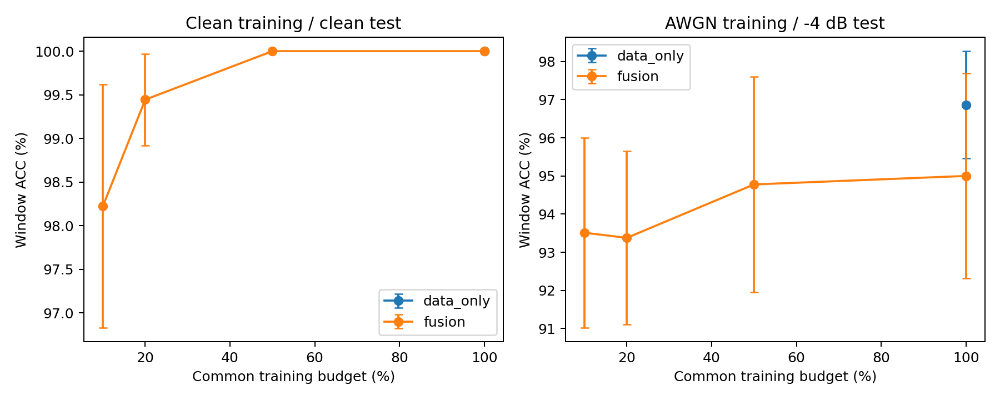
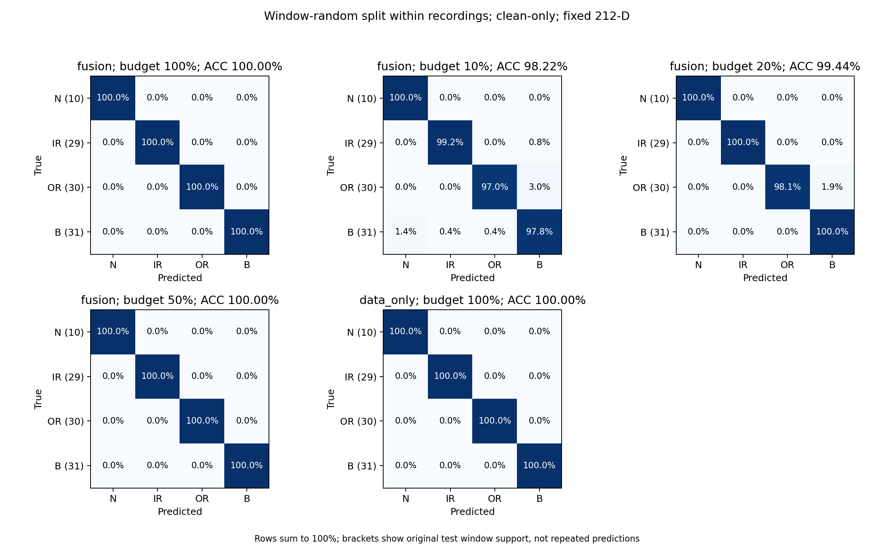
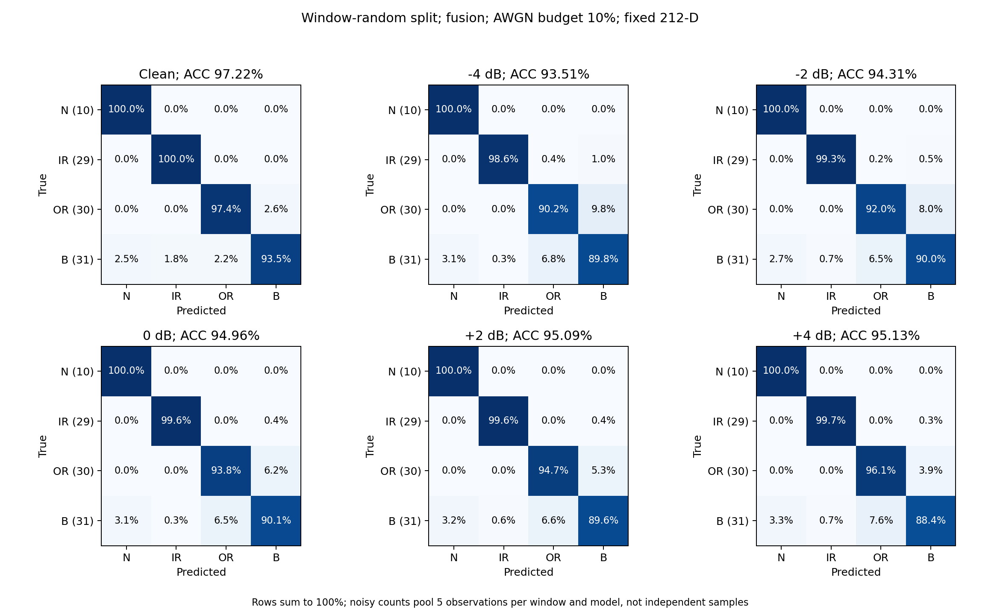
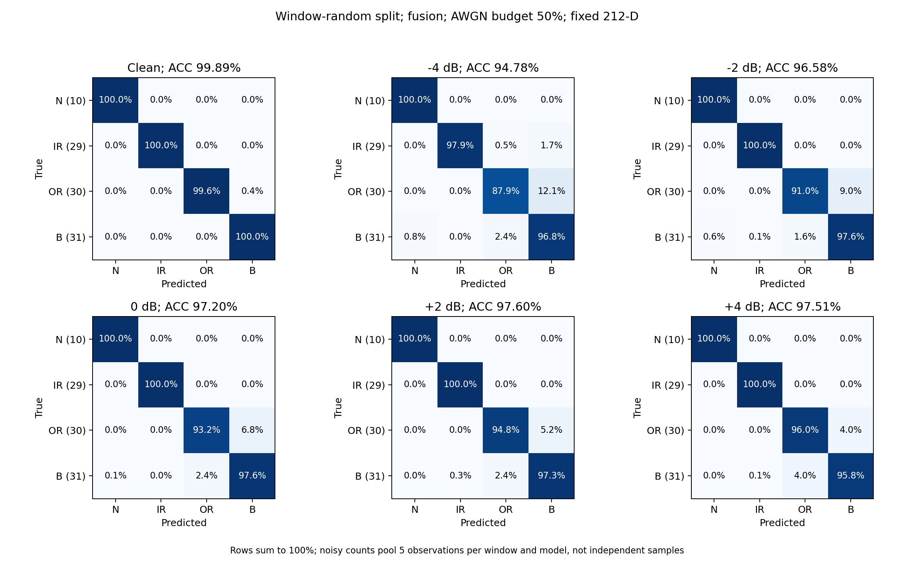
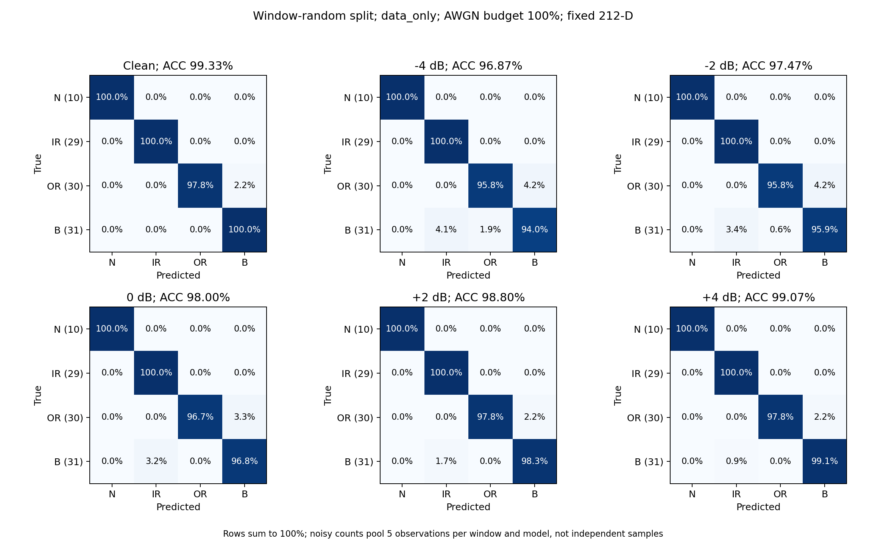

# 随机窗口划分的共同训练预算实验

本轮完成66个随机初始化模型、891组逐次指标、35组汇总混淆矩阵。全部模型完成验证选模后统一测试，不加载旧权重或概率代替训练。

**本支线评价同记录分布内的随机窗口识别，不能作为跨负载、跨记录或独立轴承泛化证据。**

## 划分与标签预算

每条记录先切24000点无重叠窗口，再以固定种子20261018按70%/15%/15%随机分配。OR014_3整条排除，剩39条记录、667窗口。候选训练467，共同最大训练预算287、验证100、测试100。

各类实际窗口数

|role|N|IR|OR|B|
|---|---|---|---|---|
|train|49|138|133|147|
|validation|11|30|27|32|
|test|10|29|30|31|

各负载实际窗口数

|role|0|1|2|3|
|---|---|---|---|---|
|train|64|137|140|126|
|validation|14|29|30|27|
|test|14|29|30|27|

原负载划分角色与新角色的对应数量。原角色仅用于披露历史曝光，不用于本轮分配。

|role|test|train|validation|
|---|---|---|---|
|train|126|201|140|
|validation|27|43|30|
|test|27|43|30|

候选训练与测试共享38条原始记录。候选训练集中有126个窗口曾属于历史测试集。实际预算子集的共享记录和曝光数见selected_windows.csv。历史测试曝光不因重新划分消失。

IR014_0只有2个完整窗口，本轮1个训练、1个验证、0个测试。该记录不能同时覆盖三个集合，未复制或补齐窗口。其他记录的取整及零头平衡见record_allocation.csv。各集合没有相同窗口编号，原采样区间不重叠，但同记录、邻近窗口仍可能高度相关。

融合模型训练预算如下，验证窗口预算另列，不属于共同预算比例。

|共同预算比例|训练窗口|额外标注验证窗口|
|---|---:|---:|
|100%|287|100|
|10%|29|100|
|20%|58|100|
|50%|144|100|

## 模型与观测协议

本轮固定600次更新，每50次更新验证，共12次选模机会，不提前停止。原按负载冻结结果验证200窗且允许提前停止，本轮验证100窗，因此只匹配训练窗口及类别配额，不称全部训练条件已匹配。与原467窗随机划分结果相比，还改变停止规则和验证时点，差异不能只归因于训练数量。小样本没有同预算数据单分支，不证明物理分支提高样本效率。

模型采用原固定212维完整融合网络，53068参数，无质量q、无类别定向修正。数据单分支33964参数。融合模型共同最大预算及其10%、20%、50%从头训练，数据单分支仅共同最大预算。100%指287窗共同预算，不是467窗候选全集。各档29/58/144/287窗，类别配额与原按负载实验一致。全样本3种子，小样本每比例3子集乘3种子。标准化仅拟合对应新训练子集。

纯干净协议训练、验证与测试均不人工加噪。AWGN每次窗口出现独立50%干净，否则SNR连续U[-4,4]dB；同一观测供两个分支，单批一次CE。AWGN验证干净权重0.5、五档各0.1。测试各噪声档5实例，按本轮测试窗口顺序生成，不能直接复用旧180窗口概率或声称噪声波形相同。

## 测试结果

窗口ACC均值±模型间样本标准差，单位%。先在每模型内平均噪声重复，再跨种子和子集汇总。小样本9个组合不是9个独立数据集，标准差不是独立轴承泛化置信区间。

### clean_only

|模型|共同预算比例|clean|
|---|---:|---:|
|fusion|100%|100.00 ± 0.00|
|fusion|10%|98.22 ± 1.39|
|fusion|20%|99.44 ± 0.53|
|fusion|50%|100.00 ± 0.00|
|data_only|100%|100.00 ± 0.00|

### awgn_mixed

|模型|共同预算比例|clean|white_-4|white_-2|white_+0|white_+2|white_+4|
|---|---:|---:|---:|---:|---:|---:|---:|
|fusion|100%|100.00 ± 0.00|95.00 ± 2.69|96.87 ± 2.00|97.93 ± 2.73|97.87 ± 2.32|97.80 ± 3.14|
|fusion|10%|97.22 ± 2.44|93.51 ± 2.49|94.31 ± 2.74|94.96 ± 2.87|95.09 ± 2.96|95.13 ± 3.16|
|fusion|20%|99.22 ± 0.83|93.38 ± 2.28|94.67 ± 2.08|95.53 ± 2.33|95.87 ± 2.24|96.22 ± 2.44|
|fusion|50%|99.89 ± 0.33|94.78 ± 2.83|96.58 ± 2.33|97.20 ± 2.66|97.60 ± 2.76|97.51 ± 2.91|
|data_only|100%|99.33 ± 1.15|96.87 ± 1.40|97.47 ± 1.53|98.00 ± 1.40|98.80 ± 1.06|99.07 ± 1.10|

均衡ACC、宏F1、各类召回率见summary.csv与class_metrics.csv。原始逐次预测与混淆计数保留；汇总矩阵逐真实类别归一化，不把噪声重复当新增窗口。

## 计算开销

硬件NVIDIA GeForce RTX 5060 Laptop GPU，PyTorch 2.11.0+cu128，CPU线程2，精度BF16 encoder on CUDA, remainder FP32。训练batch32，含在线物理提取、增强和反向，排除验证。全部实际轮计时含首轮与可能不完整末轮；总训练时间、拟合与验证前向耗时另列complexity.csv。峰值为allocated显存。

推理batch1、10预热、50重复，CUDA同步墙钟，包括归一化、在线完整物理提取和网络，排除磁盘/MAT解码/H2D。不用缓存隐藏提取成本，不与旧缓存或排除预热轮的训练时间直接排序。

|协议|模型|比例|推理ms|训练s/轮|峰值MiB|参数K|拟合s|
|---|---|---:|---:|---:|---:|---:|---:|
|awgn_mixed|data_only|100%|2.994|0.738|1195.6|33.964|0.010|
|awgn_mixed|fusion|10%|8.795|0.088|1196.3|53.068|0.007|
|awgn_mixed|fusion|20%|8.764|0.177|1196.3|53.068|0.012|
|awgn_mixed|fusion|50%|8.833|0.450|1196.3|53.068|0.032|
|awgn_mixed|fusion|100%|9.174|0.793|1196.3|53.068|0.056|
|clean_only|data_only|100%|3.075|0.643|1195.6|33.964|0.011|
|clean_only|fusion|10%|9.319|0.078|1196.3|53.068|0.151|
|clean_only|fusion|20%|9.971|0.156|1196.3|53.068|0.161|
|clean_only|fusion|50%|9.925|0.389|1196.3|53.068|0.182|
|clean_only|fusion|100%|9.591|0.695|1196.3|53.068|0.965|

## 图表

## 解释边界

该划分允许多数原始记录及0至3HP同时出现在三个集合。没有重复采样点只保证窗口不重叠，不能保证记录独立。较高准确率只说明本随机窗口协议下识别良好，不能转述为跨负载问题已解决。

与原按负载实验同时改变训练数、验证数、测试组成和负载覆盖。准确率差不能单独解释为模型进步或某一种信息共享机制的因果效果，不作独立确认性SOTA比较。新测试100窗口，类别不平衡，支持数及记录依赖须与指标一起报告。

本轮只有一个预先固定划分种子，不代表划分不确定性已充分评估。OR014_3事后排除及历史测试曝光继续存在。融合对照改变信息来源、参数量和结构，不能单独证明物理因果机理；两训练协议还改变验证目标，差异不是纯粹噪声增强因果效果。白噪声结论只限当前合成条件。

[固定协议](PROTOCOL.md)