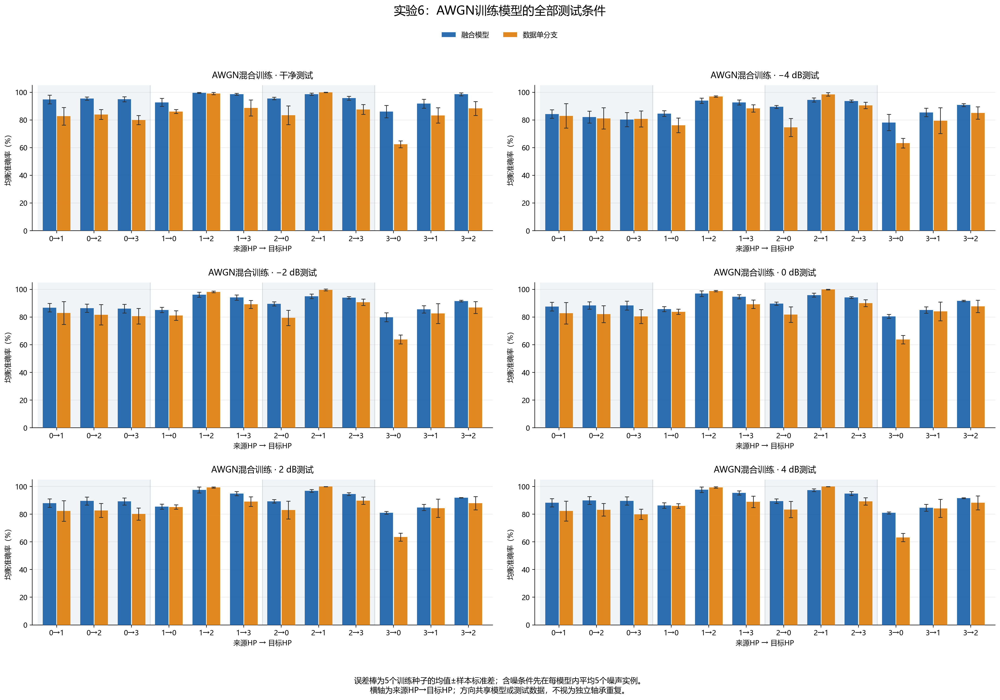
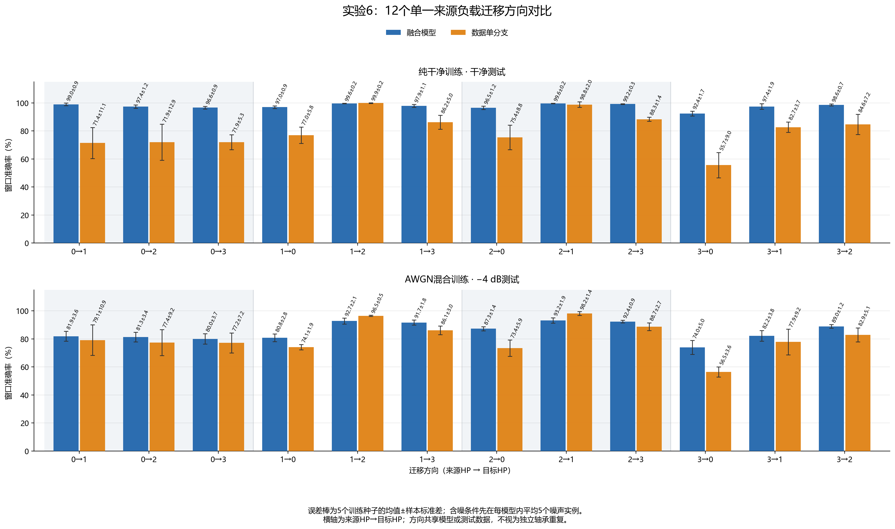
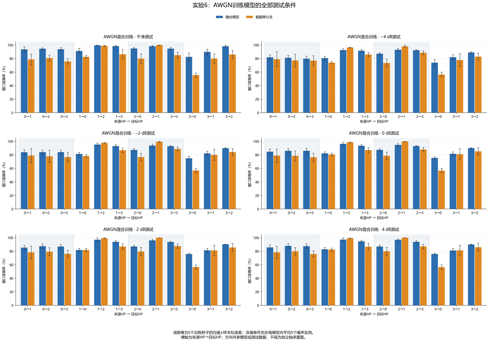

# 实验6 12方向均值与标准差对比图

只读取原实验6的per_seed_direction.csv作图，没有重新训练、推理或计时，原模型与结果不变。原始统计逐项匹配per_direction_summary.csv。

每方向5个训练种子1706至1710，误差棒为均值加减样本标准差，ddof=1。含噪数据已先在每模型内平均5个噪声实例，不将其作为25个独立种子。均衡准确率是四类召回率的算术平均，窗口准确率按各类实际测试数量计算，不混用。

图中来源负载依次为0/1/2/3HP，每组内目标负载递增。均值与标准差都乘100，标准差单位为百分点。均值加标准差可超过100%，这是描述性误差棒，不是准确率预测区间，不截断误差棒。

主图对比纯干净训练的干净测试及AWGN训练的−4dB测试。另提供AWGN训练后干净及全部五噪声档。12方向共享来源模型和目标数据，不作为12个独立轴承重复；样本标准差描述训练随机性，不是独立轴承泛化置信区间。固定一次训练子集与验证划分的局限继续保留。

各来源73训练窗，验证19/39/40/40，测试92/195/200/200，全部40记录，无小样本。两模型同方向使用相同数据和600更新，跨来源验证预算未匹配。

[均值和标准差数值表](direction_mean_std.csv) · [原实验6正式报告](../experiment_6/REPORT.md)

## 均衡准确率

[主图PDF](balanced_acc_overview.pdf)

[全部条件PDF](balanced_acc_awgn_all_conditions.pdf)

## 窗口准确率

[主图PDF](acc_overview.pdf)

[全部条件PDF](acc_awgn_all_conditions.pdf)