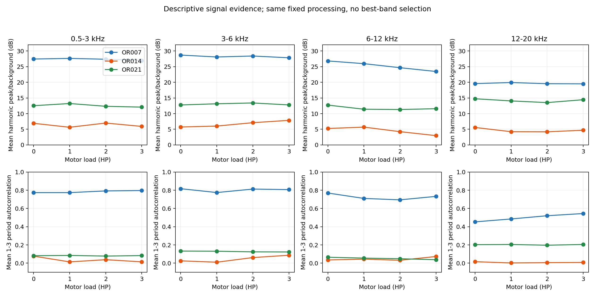
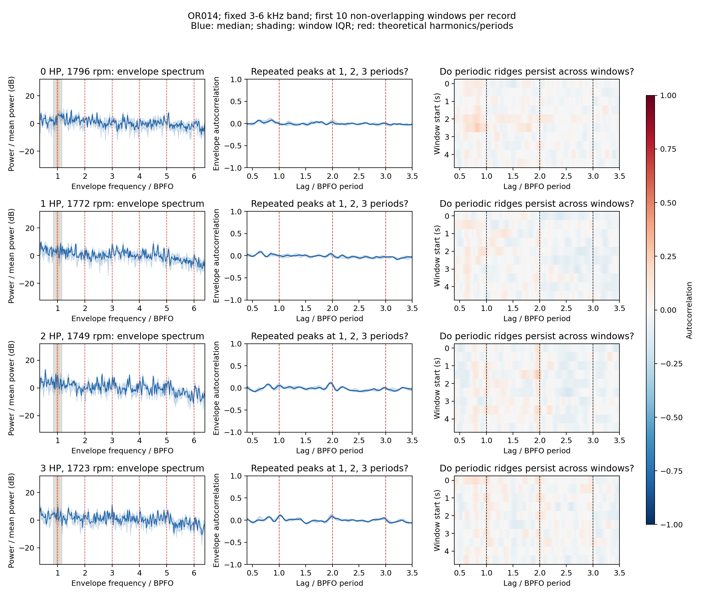
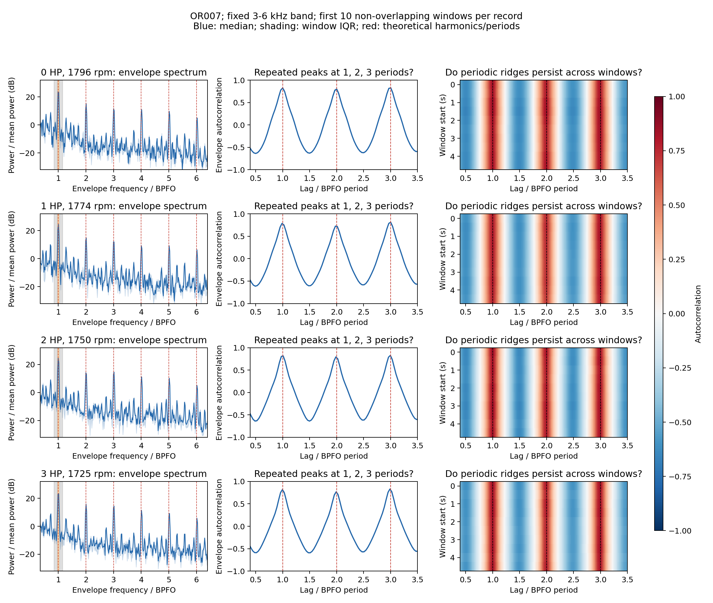
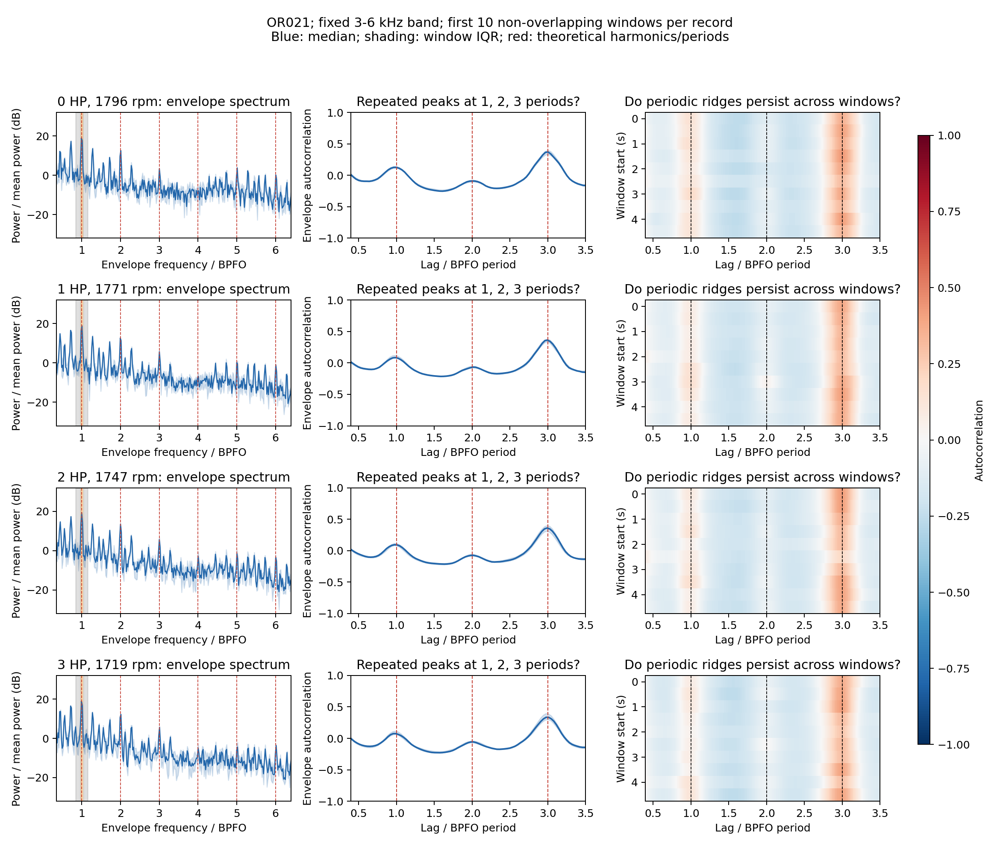

# CWRU四类信号的故障峰背景与周期结构可视化

本目录统一收录正常、内圈、外圈与滚动体的干净信号分析。这里只合并已有报告与文件，不重新计算，不改变图表、统计数值或模型。

- [外圈分析](#外圈分析)包含OR007、OR014、OR021在0至3HP下的谱峰和周期结构。
- [正常、内圈与滚动体分析](#正常内圈与滚动体分析)包含对应参考频率的证据，以及四类时域波形对照。

外圈数值表使用harmonic_peak_background.csv、window_metrics.csv、quality_summary.csv，参数见settings.json。其他类别的四份同类文件统一增加other_classes_前缀。两组原始数值表分别保留，未跨类别汇总或补齐缺失字段。IR014仅分析前1秒，其余记录通常分析前5秒。滚动体的BSF和2BSF使用同一批信号，不能计作两份独立样本。详细设置与解释边界见下文。

## 外圈分析

## 故障峰背景与周期结构可视化

本分析只读OR007、OR014、OR021在0至3HP下的12条记录，每条取前10个0.5秒不重叠窗口，即同样的前5秒。不训练模型，不改变任何冻结实验或原始数据，不向分类器新增质量输入。

### 图怎样阅读

每个evidence_overview图有四行，对应0至3HP。左列是带通包络谱，红线为BPFO的前六阶谐波，橙色为第一阶峰搜索区，灰色为其局部背景区；其余谐波使用相同规则。中列是去均值包络自相关，横轴为理论故障周期的倍数。右列是连续10个窗口的自相关热图，检查理论周期处的高值竖带是否持续存在。所有图共同坐标范围和颜色尺度，蓝线为窗口中位数，阴影为窗口四分位区间，不是置信区间。

主图统一使用事先指定的3至6kHz频带，不能据此声称这是最佳频带。all_bands图展示全部四个既有固定频带，quality_across_loads展示三种故障尺寸在所有频带的描述性统计，避免仅展示最清楚的频带。实际响应可能跨频带，不能依据主图一个频带否定故障。

谱曲线仅按每窗口包络谱平均功率归一化，以便看峰与背景形状。定量PBR按每窗口、每谐波计算，10log10(搜索区峰功率/背景几何均值功率)，与现有谐波特征规则一致。六谐波PBR取平均后，再对10窗口平均。局部背景区排除目标峰及额外2Hz保护区，参数详见settings.json。

自相关以零延迟归一化。定量周期重复为一至三倍理论延迟附近局部最大相关的平均，不是周期稳定性的充分统计量。热图用于观察重复结构是否跨窗口持续。不能把搜索区内最大值大于零单独当作故障证据，也不能把搜索峰的轻微频移直接解释为滑移。

### 证据边界

同一记录中的10个窗口相关，四分位区间仅描述记录内部变化。每个负载只有一条对应记录，不能把窗口当作独立重复来检验负载的因果影响。负载与转速同时改变，频率和延迟按各记录实际转速换算为故障阶次及周期，只部分处理转速差异。当前只分析干净信号，不据此声称人工加噪稳定性。未按分类错误修改参数，不改变OR014_3的实验纳入状态。

详细数值见harmonic_peak_background.csv、window_metrics.csv、quality_summary.csv；所有频带图见各all_bands.png。

### 当前示例的观察

在统一3至6kHz频带内，OR007四负载的六谐波平均峰背景对比约27.8至28.7dB，一至三倍周期平均自相关约0.775至0.817。OR014对应约5.7至7.9dB和0.011至0.087，四个负载的周期证据均明显弱于OR007，并非只在3HP突然变弱。OR021的谐波证据居中，但周期重复程度较低。不能由此将OR021称为无故障，因为周期稳定性只是证据的一个维度。

本例不支持负载越大故障证据越好的单调结论。OR014在3至6kHz频带的谐波对比随负载略增，但其他频带趋势不同。频带、故障尺寸和记录差异必须共同考虑，不能把有限记录对照解释为负载的因果效应。

## 正常、内圈与滚动体分析

## 正常、内圈与滚动体信号可视化

本次补充正常类以及内圈、滚动体的007、014、021三种尺寸，覆盖0至3 HP，共28条不同记录。IR014_0所选通道只有63788点，按记录元数据中的48kHz计算约1.33秒。因此IR014四个负载统一只取前两个0.5秒不重叠窗口，即前1秒；其余记录取前10个窗口，即前5秒。不同记录合计248窗口。没有补齐、复制或重采样来增加窗口数。滚动体同时按BSF和2BSF报告，这两套分析使用同一批信号，不是新增独立样本。只读原始数据，不训练模型，不修改冻结结果，不向模型增加质量指标。

### 阅读规则

主图统一用3至6kHz固定带通。每图四行分别为0至3HP，三列分别为包络谱、包络自相关和连续窗口自相关热图。蓝线是所取窗口的中位数，阴影是四分位区间，不是置信区间。IR014只有两个窗口，其区间不具有稳定的分布估计意义，也不足以评价长期周期稳定性。红线标记参考频率的前六阶谐波或前三个参考周期。橙色及灰色区域分别标记第一阶峰搜索区和局部背景区。所有主图使用相同纵轴、颜色尺度和无量纲横轴范围，但不同参考频率对应的实际Hz和秒不同，IR014热图时间范围也更短。

内圈使用BPFI。滚动体分别使用BSF及2BSF，不能依据哪个图更清楚再只报告那个。正常类没有故障频率，图中shaft仅为转频及其周期，出现周期成分也不能作为故障证据。不同参考下的平均峰背景指标不宜直接作为类别质量排名，特别是正常类和故障类不能用它建立故障阈值。

每类同时提供all_bands图展示全部四个既有固定频带，不按结果选择最佳频带。峰背景比为搜索区最大功率除以局部背景几何均值，再取10log10。周期重复指标是三个理论延迟邻域的最大归一化相关的平均，不能单独证明稀疏冲击，更不能仅据此证明分类器使用了这些证据。

waveforms图额外展示四类时域波形。007、014、021全部展示，每条记录固定显示第一个0.5秒窗口的前0.1秒。先按完整窗口去均值并除以标准差，再绘制，纵轴不是物理加速度，不能比较不同负载的绝对振动强度。每张图使用共同时间轴和幅度轴。

### 证据边界

本分析是干净信号的描述性观察，不支持人工加噪抗噪性结论。不同窗口来自同一记录，不是独立采集重复。各负载的转速、传递特性和记录条件也不同，因此不能将曲线差异直接归因为负载。参考频率依赖元数据中的rpm，rpm_source已保留在数值表中，估计转速的误差也会影响对齐。0.45秒有效包络导致约2.22Hz频率间隔，弱峰、邻近峰以及局部搜索最大值需要谨慎解释。某个固定频带内理论证据弱，不等于该类无故障或整条记录没有可辨识信息。

本次沿用之前外圈可视化的处理规则。增加BSF与2BSF展示是对滚动体理论参考的完整呈现，没有修改训练特征、选择规则或模型。

### 当前图中的观察

在统一3至6kHz频带下，IR007的BPFI附近谐波峰较突出，六阶平均峰背景比在各负载为18.20至21.45dB，前三个周期邻域平均相关为0.339至0.562。图中理论周期附近的相关峰也在多个窗口持续出现。这支持该频带内存在与BPFI一致的重复调制结构，但不是分类器使用该结构的证明。

B类的理论对齐证据并不都强。B007在BSF参考下平均峰背景比为3.39至4.90dB，周期相关接近零；B014在2BSF参考下平均周期相关为0.098至0.152，且后续周期峰和跨窗口一致性弱于IR007。不能将这些差异直接解释为滑移、故障程度或抗噪性差异，其他固定频带也需要同时阅读。

正常类在约四倍转频处有明显包络谱峰，自相关也有稳定周期结构。这说明有周期性本身不足以判断故障，必须同时核对周期对应的频率、谐波分布和其他证据。当前图未确定该正常周期成分的具体激励来源。

### 图表索引

- [Normal_shaft 主图](Normal_shaft_evidence_overview.png)，[全部频带](Normal_shaft_all_bands.png)
- [IR007_BPFI 主图](IR007_BPFI_evidence_overview.png)，[全部频带](IR007_BPFI_all_bands.png)
- [IR014_BPFI 主图](IR014_BPFI_evidence_overview.png)，[全部频带](IR014_BPFI_all_bands.png)
- [IR021_BPFI 主图](IR021_BPFI_evidence_overview.png)，[全部频带](IR021_BPFI_all_bands.png)
- [B007_BSF 主图](B007_BSF_evidence_overview.png)，[全部频带](B007_BSF_all_bands.png)
- [B007_2BSF 主图](B007_2BSF_evidence_overview.png)，[全部频带](B007_2BSF_all_bands.png)
- [B014_BSF 主图](B014_BSF_evidence_overview.png)，[全部频带](B014_BSF_all_bands.png)
- [B014_2BSF 主图](B014_2BSF_evidence_overview.png)，[全部频带](B014_2BSF_all_bands.png)
- [B021_BSF 主图](B021_BSF_evidence_overview.png)，[全部频带](B021_BSF_all_bands.png)
- [B021_2BSF 主图](B021_2BSF_evidence_overview.png)，[全部频带](B021_2BSF_all_bands.png)
- [四类时域波形，007尺寸](waveforms_007.png)
- [四类时域波形，014尺寸](waveforms_014.png)
- [四类时域波形，021尺寸](waveforms_021.png)

详细数值见other_classes_quality_summary.csv、other_classes_window_metrics.csv和other_classes_harmonic_peak_background.csv，处理参数见other_classes_settings.json。
