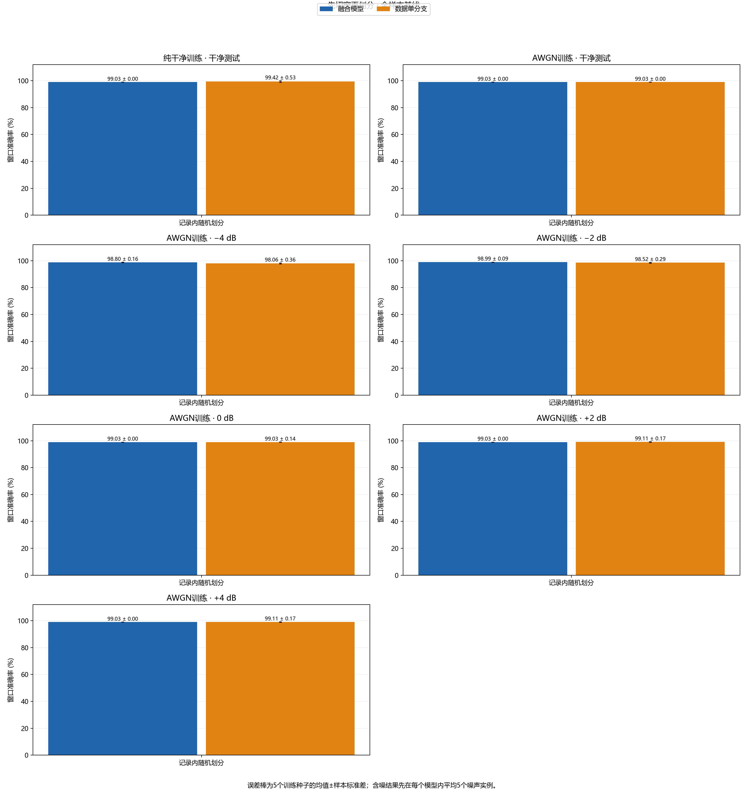
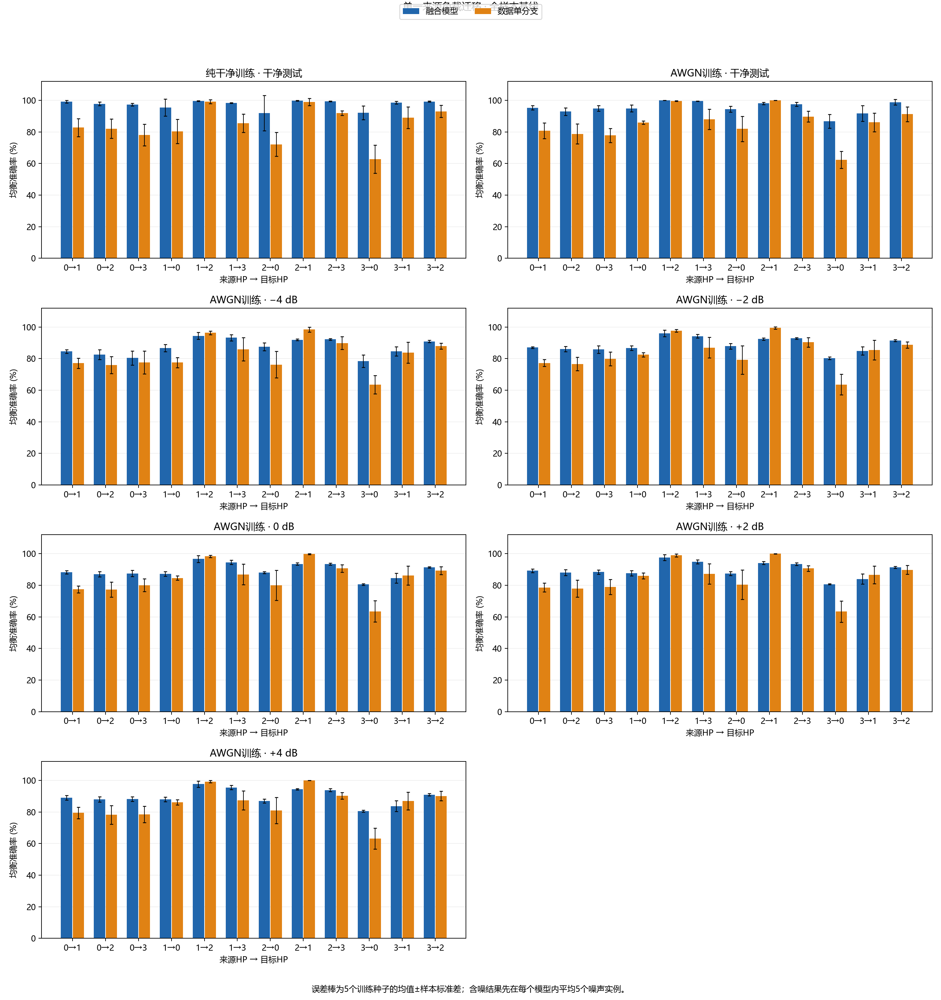
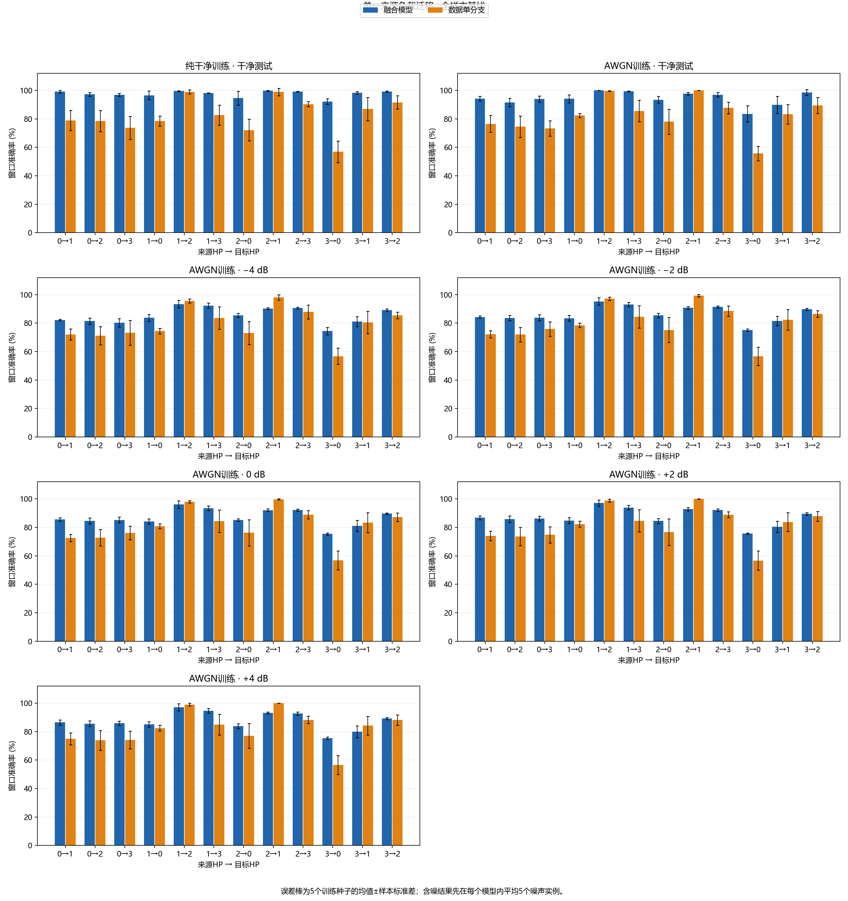

# CWRU_V1 全样本基线

两种数据划分、两套噪声训练协议、融合与数据单分支，各配置5种子。100个随机初始化模型完成选模后统一测试，260组模型目标评价、3510组逐次指标。全部40条记录，无排除、无小样本、无训练预算匹配。尚未开展结构探索。

普通交叉熵，标签平滑0；最多100epoch，每轮验证，连续20轮验证NLL未改善早停，改善阈值1e-6。测试使用最佳验证权重。AdamW与逐epoch余弦学习率，固定划分和种子见[协议](PROTOCOL.md)。

## 数据使用

| split         | role       |   windows |   N |   IR |   OR |   B |
|:--------------|:-----------|----------:|----:|-----:|-----:|----:|
| window_random | train      |       481 |  49 |  138 |  147 | 147 |
| window_random | validation |       103 |  10 |   29 |   32 |  32 |
| window_random | test       |       103 |  11 |   30 |   31 |  31 |
| load_source_0 | train      |        73 |   8 |   17 |   24 |  24 |
| load_source_0 | validation |        19 |   2 |    5 |    6 |   6 |
| load_source_0 | test_hp1   |       195 |  20 |   55 |   60 |  60 |
| load_source_0 | test_hp2   |       200 |  20 |   60 |   60 |  60 |
| load_source_0 | test_hp3   |       200 |  20 |   60 |   60 |  60 |
| load_source_1 | train      |       156 |  16 |   44 |   48 |  48 |
| load_source_1 | validation |        39 |   4 |   11 |   12 |  12 |
| load_source_1 | test_hp0   |        92 |  10 |   22 |   30 |  30 |
| load_source_1 | test_hp2   |       200 |  20 |   60 |   60 |  60 |
| load_source_1 | test_hp3   |       200 |  20 |   60 |   60 |  60 |
| load_source_2 | train      |       160 |  16 |   48 |   48 |  48 |
| load_source_2 | validation |        40 |   4 |   12 |   12 |  12 |
| load_source_2 | test_hp0   |        92 |  10 |   22 |   30 |  30 |
| load_source_2 | test_hp1   |       195 |  20 |   55 |   60 |  60 |
| load_source_2 | test_hp3   |       200 |  20 |   60 |   60 |  60 |
| load_source_3 | train      |       160 |  16 |   48 |   48 |  48 |
| load_source_3 | validation |        40 |   4 |   12 |   12 |  12 |
| load_source_3 | test_hp0   |        92 |  10 |   22 |   30 |  30 |
| load_source_3 | test_hp1   |       195 |  20 |   55 |   60 |  60 |
| load_source_3 | test_hp2   |       200 |  20 |   60 |   60 |  60 |

全样本是训练角色内全部窗口；保持有放回的类别/记录均衡采样，每epoch抽取ceil(N/32)×32份观测，不保证每窗每轮出现一次。训练采样策略未作为新增变量修改。IR014_0仅2窗，记录内划分无法同时进入三集合，实际分配已记录。来源验证数量不相同。完整原始文件来源与各集合数量见[数据说明](DATA_USAGE.md)。

## 均值与样本标准差

主指标均衡准确率，辅助窗口ACC、宏F1与各类召回。先平均每模型5个噪声实例，再计算5训练种子的均值与样本标准差ddof=1；不将噪声实例视为新增种子。表内指标单位为百分数，标准差单位为百分点。

| split         |   source_load_hp |   target_load_hp | protocol   | method    | condition   |   balanced_acc_mean |   balanced_acc_std | balanced_acc_sd_over_0_5pp   |
|:--------------|-----------------:|-----------------:|:-----------|:----------|:------------|--------------------:|-------------------:|:-----------------------------|
| load_transfer |                0 |                1 | awgn_mixed | data_only | clean       |              80.712 |              4.993 | True                         |
| load_transfer |                0 |                1 | awgn_mixed | data_only | white_+0    |              77.438 |              2.16  | True                         |
| load_transfer |                0 |                1 | awgn_mixed | data_only | white_+2    |              78.658 |              2.85  | True                         |
| load_transfer |                0 |                1 | awgn_mixed | data_only | white_+4    |              79.441 |              3.55  | True                         |
| load_transfer |                0 |                1 | awgn_mixed | data_only | white_-2    |              77.245 |              2.146 | True                         |
| load_transfer |                0 |                1 | awgn_mixed | data_only | white_-4    |              77.105 |              3.245 | True                         |
| load_transfer |                0 |                1 | awgn_mixed | fusion    | clean       |              95.333 |              1.363 | True                         |
| load_transfer |                0 |                1 | awgn_mixed | fusion    | white_+0    |              88.227 |              1.047 | True                         |
| load_transfer |                0 |                1 | awgn_mixed | fusion    | white_+2    |              89.215 |              1.072 | True                         |
| load_transfer |                0 |                1 | awgn_mixed | fusion    | white_+4    |              88.983 |              1.47  | True                         |
| load_transfer |                0 |                1 | awgn_mixed | fusion    | white_-2    |              87.023 |              0.59  | True                         |
| load_transfer |                0 |                1 | awgn_mixed | fusion    | white_-4    |              84.614 |              1.147 | True                         |
| load_transfer |                0 |                1 | clean_only | data_only | clean       |              82.727 |              5.682 | True                         |
| load_transfer |                0 |                1 | clean_only | fusion    | clean       |              99.25  |              0.801 | True                         |
| load_transfer |                0 |                2 | awgn_mixed | data_only | clean       |              78.75  |              6.292 | True                         |
| load_transfer |                0 |                2 | awgn_mixed | data_only | white_+0    |              77.333 |              4.82  | True                         |
| load_transfer |                0 |                2 | awgn_mixed | data_only | white_+2    |              78.017 |              5.399 | True                         |
| load_transfer |                0 |                2 | awgn_mixed | data_only | white_+4    |              78.217 |              5.836 | True                         |
| load_transfer |                0 |                2 | awgn_mixed | data_only | white_-2    |              76.617 |              4.231 | True                         |
| load_transfer |                0 |                2 | awgn_mixed | data_only | white_-4    |              75.983 |              5.419 | True                         |
| load_transfer |                0 |                2 | awgn_mixed | fusion    | clean       |              92.917 |              2.375 | True                         |
| load_transfer |                0 |                2 | awgn_mixed | fusion    | white_+0    |              87.1   |              1.694 | True                         |
| load_transfer |                0 |                2 | awgn_mixed | fusion    | white_+2    |              88.15  |              1.887 | True                         |
| load_transfer |                0 |                2 | awgn_mixed | fusion    | white_+4    |              88     |              1.677 | True                         |
| load_transfer |                0 |                2 | awgn_mixed | fusion    | white_-2    |              86.017 |              1.675 | True                         |
| load_transfer |                0 |                2 | awgn_mixed | fusion    | white_-4    |              82.617 |              3.142 | True                         |
| load_transfer |                0 |                2 | clean_only | data_only | clean       |              82.083 |              6.18  | True                         |
| load_transfer |                0 |                2 | clean_only | fusion    | clean       |              97.75  |              1.126 | True                         |
| load_transfer |                0 |                3 | awgn_mixed | data_only | clean       |              77.833 |              4.472 | True                         |
| load_transfer |                0 |                3 | awgn_mixed | data_only | white_+0    |              80.1   |              3.964 | True                         |
| load_transfer |                0 |                3 | awgn_mixed | data_only | white_+2    |              78.983 |              4.726 | True                         |
| load_transfer |                0 |                3 | awgn_mixed | data_only | white_+4    |              78.45  |              5.12  | True                         |
| load_transfer |                0 |                3 | awgn_mixed | data_only | white_-2    |              79.867 |              4.275 | True                         |
| load_transfer |                0 |                3 | awgn_mixed | data_only | white_-4    |              77.683 |              7.237 | True                         |
| load_transfer |                0 |                3 | awgn_mixed | fusion    | clean       |              94.917 |              1.826 | True                         |
| load_transfer |                0 |                3 | awgn_mixed | fusion    | white_+0    |              87.517 |              1.94  | True                         |
| load_transfer |                0 |                3 | awgn_mixed | fusion    | white_+2    |              88.433 |              1.379 | True                         |
| load_transfer |                0 |                3 | awgn_mixed | fusion    | white_+4    |              88.2   |              1.365 | True                         |
| load_transfer |                0 |                3 | awgn_mixed | fusion    | white_-2    |              85.767 |              2.294 | True                         |
| load_transfer |                0 |                3 | awgn_mixed | fusion    | white_-4    |              80.4   |              4.395 | True                         |
| load_transfer |                0 |                3 | clean_only | data_only | clean       |              78.083 |              6.787 | True                         |
| load_transfer |                0 |                3 | clean_only | fusion    | clean       |              97.333 |              0.864 | True                         |
| load_transfer |                1 |                0 | awgn_mixed | data_only | clean       |              85.894 |              1.087 | True                         |
| load_transfer |                1 |                0 | awgn_mixed | data_only | white_+0    |              84.627 |              1.396 | True                         |
| load_transfer |                1 |                0 | awgn_mixed | data_only | white_+2    |              85.994 |              1.771 | True                         |
| load_transfer |                1 |                0 | awgn_mixed | data_only | white_+4    |              86.07  |              1.683 | True                         |
| load_transfer |                1 |                0 | awgn_mixed | data_only | white_-2    |              82.506 |              1.382 | True                         |
| load_transfer |                1 |                0 | awgn_mixed | data_only | white_-4    |              77.506 |              3.281 | True                         |
| load_transfer |                1 |                0 | awgn_mixed | fusion    | clean       |              94.894 |              2.173 | True                         |
| load_transfer |                1 |                0 | awgn_mixed | fusion    | white_+0    |              87.261 |              1.426 | True                         |
| load_transfer |                1 |                0 | awgn_mixed | fusion    | white_+2    |              87.694 |              1.587 | True                         |
| load_transfer |                1 |                0 | awgn_mixed | fusion    | white_+4    |              88.027 |              1.401 | True                         |
| load_transfer |                1 |                0 | awgn_mixed | fusion    | white_-2    |              86.661 |              1.512 | True                         |
| load_transfer |                1 |                0 | awgn_mixed | fusion    | white_-4    |              86.661 |              2.326 | True                         |
| load_transfer |                1 |                0 | clean_only | data_only | clean       |              80.288 |              7.666 | True                         |
| load_transfer |                1 |                0 | clean_only | fusion    | clean       |              95.455 |              5.298 | True                         |
| load_transfer |                1 |                2 | awgn_mixed | data_only | clean       |              99.667 |              0.186 | False                        |
| load_transfer |                1 |                2 | awgn_mixed | data_only | white_+0    |              98.367 |              0.713 | True                         |
| load_transfer |                1 |                2 | awgn_mixed | data_only | white_+2    |              98.983 |              0.898 | True                         |
| load_transfer |                1 |                2 | awgn_mixed | data_only | white_+4    |              99.217 |              0.735 | True                         |
| load_transfer |                1 |                2 | awgn_mixed | data_only | white_-2    |              97.65  |              0.896 | True                         |
| load_transfer |                1 |                2 | awgn_mixed | data_only | white_-4    |              96.333 |              1.15  | True                         |
| load_transfer |                1 |                2 | awgn_mixed | fusion    | clean       |             100     |              0     | False                        |
| load_transfer |                1 |                2 | awgn_mixed | fusion    | white_+0    |              96.717 |              2.155 | True                         |
| load_transfer |                1 |                2 | awgn_mixed | fusion    | white_+2    |              97.633 |              1.806 | True                         |
| load_transfer |                1 |                2 | awgn_mixed | fusion    | white_+4    |              97.633 |              2.038 | True                         |
| load_transfer |                1 |                2 | awgn_mixed | fusion    | white_-2    |              96.05  |              2.088 | True                         |
| load_transfer |                1 |                2 | awgn_mixed | fusion    | white_-4    |              94.45  |              2.186 | True                         |
| load_transfer |                1 |                2 | clean_only | data_only | clean       |              99.167 |              1.179 | True                         |
| load_transfer |                1 |                2 | clean_only | fusion    | clean       |              99.583 |              0.295 | False                        |
| load_transfer |                1 |                3 | awgn_mixed | data_only | clean       |              88     |              6.342 | True                         |
| load_transfer |                1 |                3 | awgn_mixed | data_only | white_+0    |              86.917 |              6.51  | True                         |
| load_transfer |                1 |                3 | awgn_mixed | data_only | white_+2    |              87.183 |              6.431 | True                         |
| load_transfer |                1 |                3 | awgn_mixed | data_only | white_+4    |              87.433 |              5.995 | True                         |
| load_transfer |                1 |                3 | awgn_mixed | data_only | white_-2    |              87     |              6.572 | True                         |
| load_transfer |                1 |                3 | awgn_mixed | data_only | white_-4    |              85.95  |              7.353 | True                         |
| load_transfer |                1 |                3 | awgn_mixed | fusion    | clean       |              99.5   |              0.186 | False                        |
| load_transfer |                1 |                3 | awgn_mixed | fusion    | white_+0    |              94.55  |              1.334 | True                         |
| load_transfer |                1 |                3 | awgn_mixed | fusion    | white_+2    |              94.95  |              1.294 | True                         |
| load_transfer |                1 |                3 | awgn_mixed | fusion    | white_+4    |              95.55  |              1.396 | True                         |
| load_transfer |                1 |                3 | awgn_mixed | fusion    | white_-2    |              94.233 |              1.215 | True                         |
| load_transfer |                1 |                3 | awgn_mixed | fusion    | white_-4    |              93.217 |              1.873 | True                         |
| load_transfer |                1 |                3 | clean_only | data_only | clean       |              85.5   |              5.873 | True                         |
| load_transfer |                1 |                3 | clean_only | fusion    | clean       |              98.417 |              0.186 | False                        |
| load_transfer |                2 |                0 | awgn_mixed | data_only | clean       |              81.955 |              7.955 | True                         |
| load_transfer |                2 |                0 | awgn_mixed | data_only | white_+0    |              80.039 |              9.472 | True                         |
| load_transfer |                2 |                0 | awgn_mixed | data_only | white_+2    |              80.47  |              9.306 | True                         |
| load_transfer |                2 |                0 | awgn_mixed | data_only | white_+4    |              80.967 |              8.259 | True                         |
| load_transfer |                2 |                0 | awgn_mixed | data_only | white_-2    |              79.191 |              9.011 | True                         |
| load_transfer |                2 |                0 | awgn_mixed | data_only | white_-4    |              76.224 |              8.352 | True                         |
| load_transfer |                2 |                0 | awgn_mixed | fusion    | clean       |              94.394 |              1.863 | True                         |
| load_transfer |                2 |                0 | awgn_mixed | fusion    | white_+0    |              88.027 |              0.617 | True                         |
| load_transfer |                2 |                0 | awgn_mixed | fusion    | white_+2    |              87.494 |              1.294 | True                         |
| load_transfer |                2 |                0 | awgn_mixed | fusion    | white_+4    |              87.027 |              1.271 | True                         |
| load_transfer |                2 |                0 | awgn_mixed | fusion    | white_-2    |              87.861 |              1.769 | True                         |
| load_transfer |                2 |                0 | awgn_mixed | fusion    | white_-4    |              87.521 |              2.482 | True                         |
| load_transfer |                2 |                0 | clean_only | data_only | clean       |              72.121 |              7.519 | True                         |
| load_transfer |                2 |                0 | clean_only | fusion    | clean       |              91.894 |             11.18  | True                         |
| load_transfer |                2 |                1 | awgn_mixed | data_only | clean       |             100     |              0     | False                        |
| load_transfer |                2 |                1 | awgn_mixed | data_only | white_+0    |              99.795 |              0.28  | False                        |
| load_transfer |                2 |                1 | awgn_mixed | data_only | white_+2    |              99.983 |              0.037 | False                        |
| load_transfer |                2 |                1 | awgn_mixed | data_only | white_+4    |             100     |              0     | False                        |
| load_transfer |                2 |                1 | awgn_mixed | data_only | white_-2    |              99.473 |              0.706 | True                         |
| load_transfer |                2 |                1 | awgn_mixed | data_only | white_-4    |              98.458 |              1.546 | True                         |
| load_transfer |                2 |                1 | awgn_mixed | fusion    | clean       |              98.083 |              0.697 | True                         |
| load_transfer |                2 |                1 | awgn_mixed | fusion    | white_+0    |              93.533 |              0.767 | True                         |
| load_transfer |                2 |                1 | awgn_mixed | fusion    | white_+2    |              94.1   |              0.919 | True                         |
| load_transfer |                2 |                1 | awgn_mixed | fusion    | white_+4    |              94.433 |              0.462 | False                        |
| load_transfer |                2 |                1 | awgn_mixed | fusion    | white_-2    |              92.459 |              0.708 | True                         |
| load_transfer |                2 |                1 | awgn_mixed | fusion    | white_-4    |              91.961 |              0.5   | False                        |
| load_transfer |                2 |                1 | clean_only | data_only | clean       |              99     |              2.236 | True                         |
| load_transfer |                2 |                1 | clean_only | fusion    | clean       |              99.75  |              0.228 | False                        |
| load_transfer |                2 |                3 | awgn_mixed | data_only | clean       |              89.75  |              3.354 | True                         |
| load_transfer |                2 |                3 | awgn_mixed | data_only | white_+0    |              90.717 |              2.391 | True                         |
| load_transfer |                2 |                3 | awgn_mixed | data_only | white_+2    |              90.683 |              1.735 | True                         |
| load_transfer |                2 |                3 | awgn_mixed | data_only | white_+4    |              90.25  |              2.134 | True                         |
| load_transfer |                2 |                3 | awgn_mixed | data_only | white_-2    |              90.4   |              3.004 | True                         |
| load_transfer |                2 |                3 | awgn_mixed | data_only | white_-4    |              89.883 |              4.046 | True                         |
| load_transfer |                2 |                3 | awgn_mixed | fusion    | clean       |              97.5   |              1.215 | True                         |
| load_transfer |                2 |                3 | awgn_mixed | fusion    | white_+0    |              93.433 |              0.619 | True                         |
| load_transfer |                2 |                3 | awgn_mixed | fusion    | white_+2    |              93.433 |              0.749 | True                         |
| load_transfer |                2 |                3 | awgn_mixed | fusion    | white_+4    |              93.9   |              1.016 | True                         |
| load_transfer |                2 |                3 | awgn_mixed | fusion    | white_-2    |              92.817 |              0.557 | True                         |
| load_transfer |                2 |                3 | awgn_mixed | fusion    | white_-4    |              92.2   |              0.455 | False                        |
| load_transfer |                2 |                3 | clean_only | data_only | clean       |              91.917 |              1.461 | True                         |
| load_transfer |                2 |                3 | clean_only | fusion    | clean       |              99.333 |              0.228 | False                        |
| load_transfer |                3 |                0 | awgn_mixed | data_only | clean       |              62.303 |              5.4   | True                         |
| load_transfer |                3 |                0 | awgn_mixed | data_only | white_+0    |              63.533 |              6.708 | True                         |
| load_transfer |                3 |                0 | awgn_mixed | data_only | white_+2    |              63.394 |              6.776 | True                         |
| load_transfer |                3 |                0 | awgn_mixed | data_only | white_+4    |              63.167 |              6.663 | True                         |
| load_transfer |                3 |                0 | awgn_mixed | data_only | white_-2    |              63.558 |              6.546 | True                         |
| load_transfer |                3 |                0 | awgn_mixed | data_only | white_-4    |              63.558 |              5.758 | True                         |
| load_transfer |                3 |                0 | awgn_mixed | fusion    | clean       |              86.727 |              4.346 | True                         |
| load_transfer |                3 |                0 | awgn_mixed | fusion    | white_+0    |              80.527 |              0.519 | True                         |
| load_transfer |                3 |                0 | awgn_mixed | fusion    | white_+2    |              80.727 |              0.354 | False                        |
| load_transfer |                3 |                0 | awgn_mixed | fusion    | white_+4    |              80.527 |              0.691 | True                         |
| load_transfer |                3 |                0 | awgn_mixed | fusion    | white_-2    |              80.273 |              0.813 | True                         |
| load_transfer |                3 |                0 | awgn_mixed | fusion    | white_-4    |              78.458 |              3.891 | True                         |
| load_transfer |                3 |                0 | clean_only | data_only | clean       |              62.788 |              8.844 | True                         |
| load_transfer |                3 |                0 | clean_only | fusion    | clean       |              92.061 |              4.346 | True                         |
| load_transfer |                3 |                1 | awgn_mixed | data_only | clean       |              86.083 |              5.842 | True                         |
| load_transfer |                3 |                1 | awgn_mixed | data_only | white_+0    |              86.224 |              5.92  | True                         |
| load_transfer |                3 |                1 | awgn_mixed | data_only | white_+2    |              86.627 |              5.609 | True                         |
| load_transfer |                3 |                1 | awgn_mixed | data_only | white_+4    |              86.942 |              5.527 | True                         |
| load_transfer |                3 |                1 | awgn_mixed | data_only | white_-2    |              85.461 |              6.168 | True                         |
| load_transfer |                3 |                1 | awgn_mixed | data_only | white_-4    |              83.853 |              6.62  | True                         |
| load_transfer |                3 |                1 | awgn_mixed | fusion    | clean       |              91.75  |              4.942 | True                         |
| load_transfer |                3 |                1 | awgn_mixed | fusion    | white_+0    |              84.583 |              3.122 | True                         |
| load_transfer |                3 |                1 | awgn_mixed | fusion    | white_+2    |              84.033 |              3.212 | True                         |
| load_transfer |                3 |                1 | awgn_mixed | fusion    | white_+4    |              83.75  |              3.349 | True                         |
| load_transfer |                3 |                1 | awgn_mixed | fusion    | white_-2    |              84.929 |              2.68  | True                         |
| load_transfer |                3 |                1 | awgn_mixed | fusion    | white_-4    |              84.62  |              2.854 | True                         |
| load_transfer |                3 |                1 | clean_only | data_only | clean       |              89.068 |              6.831 | True                         |
| load_transfer |                3 |                1 | clean_only | fusion    | clean       |              98.583 |              0.812 | True                         |
| load_transfer |                3 |                2 | awgn_mixed | data_only | clean       |              91.25  |              4.658 | True                         |
| load_transfer |                3 |                2 | awgn_mixed | data_only | white_+0    |              89.3   |              2.457 | True                         |
| load_transfer |                3 |                2 | awgn_mixed | data_only | white_+2    |              89.817 |              2.797 | True                         |
| load_transfer |                3 |                2 | awgn_mixed | data_only | white_+4    |              90.15  |              3.045 | True                         |
| load_transfer |                3 |                2 | awgn_mixed | data_only | white_-2    |              88.717 |              1.938 | True                         |
| load_transfer |                3 |                2 | awgn_mixed | data_only | white_-4    |              87.9   |              1.926 | True                         |
| load_transfer |                3 |                2 | awgn_mixed | fusion    | clean       |              98.833 |              1.703 | True                         |
| load_transfer |                3 |                2 | awgn_mixed | fusion    | white_+0    |              91.383 |              0.423 | False                        |
| load_transfer |                3 |                2 | awgn_mixed | fusion    | white_+2    |              91.3   |              0.636 | True                         |
| load_transfer |                3 |                2 | awgn_mixed | fusion    | white_+4    |              90.967 |              0.666 | True                         |
| load_transfer |                3 |                2 | awgn_mixed | fusion    | white_-2    |              91.45  |              0.608 | True                         |
| load_transfer |                3 |                2 | awgn_mixed | fusion    | white_-4    |              90.917 |              0.784 | True                         |
| load_transfer |                3 |                2 | clean_only | data_only | clean       |              93     |              3.857 | True                         |
| load_transfer |                3 |                2 | clean_only | fusion    | clean       |              99.25  |              0.349 | False                        |
| window_random |               -1 |               -1 | awgn_mixed | data_only | clean       |              99.167 |              0     | False                        |
| window_random |               -1 |               -1 | awgn_mixed | data_only | white_+0    |              99.167 |              0.118 | False                        |
| window_random |               -1 |               -1 | awgn_mixed | data_only | white_+2    |              99.233 |              0.149 | False                        |
| window_random |               -1 |               -1 | awgn_mixed | data_only | white_+4    |              99.233 |              0.149 | False                        |
| window_random |               -1 |               -1 | awgn_mixed | data_only | white_-2    |              98.743 |              0.25  | False                        |
| window_random |               -1 |               -1 | awgn_mixed | data_only | white_-4    |              98.354 |              0.309 | False                        |
| window_random |               -1 |               -1 | awgn_mixed | fusion    | clean       |              99.167 |              0     | False                        |
| window_random |               -1 |               -1 | awgn_mixed | fusion    | white_+0    |              99.167 |              0     | False                        |
| window_random |               -1 |               -1 | awgn_mixed | fusion    | white_+2    |              99.167 |              0     | False                        |
| window_random |               -1 |               -1 | awgn_mixed | fusion    | white_+4    |              99.167 |              0     | False                        |
| window_random |               -1 |               -1 | awgn_mixed | fusion    | white_-2    |              99.134 |              0.072 | False                        |
| window_random |               -1 |               -1 | awgn_mixed | fusion    | white_-4    |              98.973 |              0.135 | False                        |
| window_random |               -1 |               -1 | clean_only | data_only | clean       |              99.5   |              0.456 | False                        |
| window_random |               -1 |               -1 | clean_only | fusion    | clean       |              99.167 |              0     | False                        |

标准差超过0.5个百分点的配置标记为波动超阈值。本轮只建立基线，不宣布方法提升。后续改进必须与同划分、同协议、同种子的这版基线配对，不能以某个最佳种子作为参照。标准差阈值是用户的探索准则，不等于统计显著性检验。

## 图表

## 计算成本

| method    |   parameters |   conv_linear_macs |   conv_linear_flops |   batch_size |   window_samples | flops_scope                                                                                                    |
|:----------|-------------:|-------------------:|--------------------:|-------------:|-----------------:|:---------------------------------------------------------------------------------------------------------------|
| fusion    |        53068 |          762644352 |          1525288704 |            1 |            24000 | Conv1d and Linear only, multiply+add=2; excludes FFT, physics, activations, reductions, normalization and bias |
| data_only |        33964 |          762625664 |          1525251328 |            1 |            24000 | Conv1d and Linear only, multiply+add=2; excludes FFT, physics, activations, reductions, normalization and bias |

静态FLOPs只计Conv1d和Linear，乘加记2次，不包括FFT物理描述、归一化等，因此不是端到端总FLOPs。单样本延迟包含归一化、在线物理提取和网络，排除磁盘与H2D，预热10次、重复50次、CUDA同步。每个来源模型只测一次，三个目标方向复用该计时。

设备 NVIDIA GeForce RTX 5060 Laptop GPU；CUDA编码器BF16，其余FP32；训练batch32，单样本延迟batch1。训练计时含在线物理提取和反向传播，不含验证及保存。峰值显存为GPU allocated。

| split         | protocol   | method    |   parameters |   epochs_trained |   updates_trained |   best_epoch |   total_train_seconds |   train_seconds_per_epoch |   validation_seconds |   fit_seconds |   peak_gpu_mib |   latency_ms |
|:--------------|:-----------|:----------|-------------:|-----------------:|------------------:|-------------:|----------------------:|--------------------------:|---------------------:|--------------:|---------------:|-------------:|
| load_transfer | awgn_mixed | data_only |        33964 |           100    |            450    |        97.55 |               35.1458 |                    0.3515 |              14.6956 |        0.0029 |        1195.58 |       2.4714 |
| load_transfer | awgn_mixed | fusion    |        53068 |            96.05 |            438.15 |        87.55 |               37.9084 |                    0.3893 |              19.8085 |        0.0275 |        1196.26 |       7.3569 |
| load_transfer | clean_only | data_only |        33964 |           100    |            450    |        99.45 |               30.7253 |                    0.3073 |               2.5123 |        0.0029 |        1195.58 |       2.4369 |
| load_transfer | clean_only | fusion    |        53068 |            93.4  |            424    |        82.45 |               32.0846 |                    0.3405 |               3.3742 |        0.1689 |        1196.26 |       7.1683 |
| window_random | awgn_mixed | data_only |        33964 |           100    |           1600    |        90.2  |              126.238  |                    1.2624 |              45.4142 |        0.0113 |        1195.58 |       2.4563 |
| window_random | awgn_mixed | fusion    |        53068 |           100    |           1600    |        89.4  |              139.995  |                    1.3999 |              59.6921 |        0.1085 |        1196.26 |       7.3923 |
| window_random | clean_only | data_only |        33964 |           100    |           1600    |        98    |              109.115  |                    1.0911 |               7.6908 |        0.0114 |        1195.58 |       2.4202 |
| window_random | clean_only | fusion    |        53068 |            93.2  |           1491.2  |        87.8  |              120.274  |                    1.2923 |              10.4892 |        0.8403 |        1196.26 |       7.2308 |

## 证据边界

只有一次固定数据划分，5种子描述训练随机性，不能估计数据划分不确定性。记录内随机划分的训练测试共享原始记录，只能描述窗口级识别。按负载迁移的来源训练验证共享记录，目标负载留出不等于独立轴承留出。12方向复用来源模型和目标数据，不能作为12个独立轴承重复。两方案训练量及验证量不同，性能差不能只归因于数据划分方式。所有负载存在历史测试曝光，本轮属于探索性基线，不是独立确认性验证。AWGN结论不推广到所有实际噪声。恢复全部记录不消除既往事后排除与测试曝光。

报告对保存预测逐项复算全部3510组指标，未增加模型前向推理。