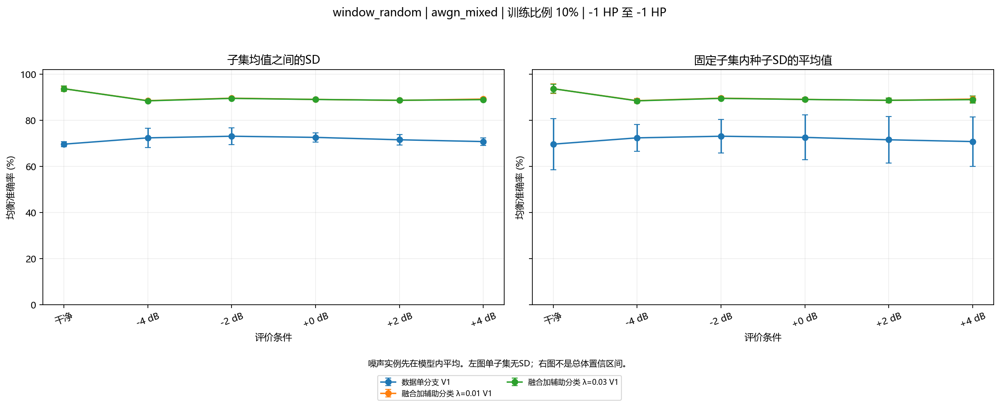
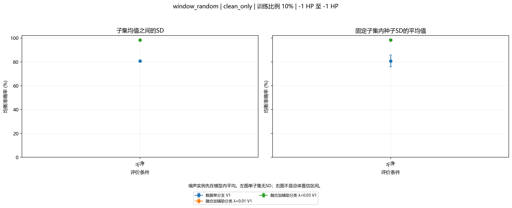
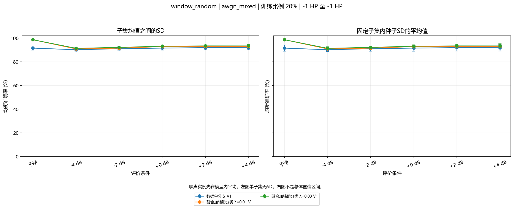
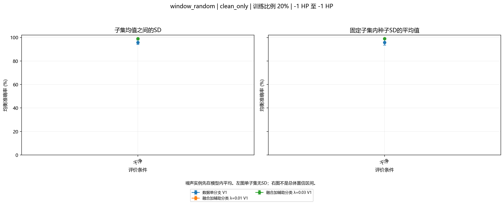
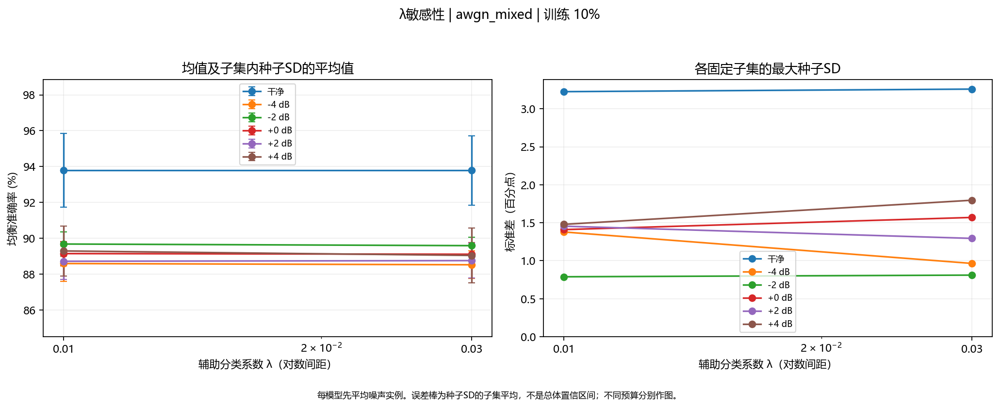
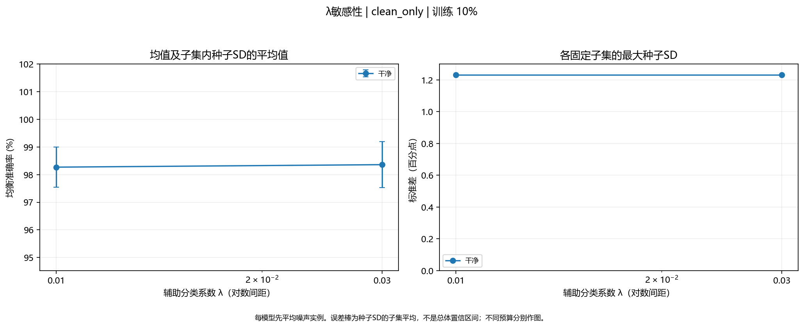
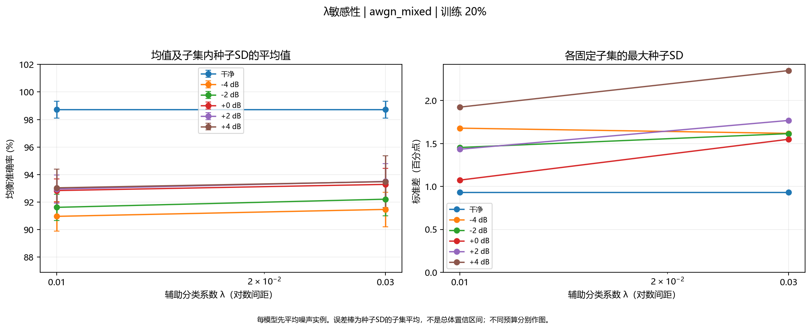
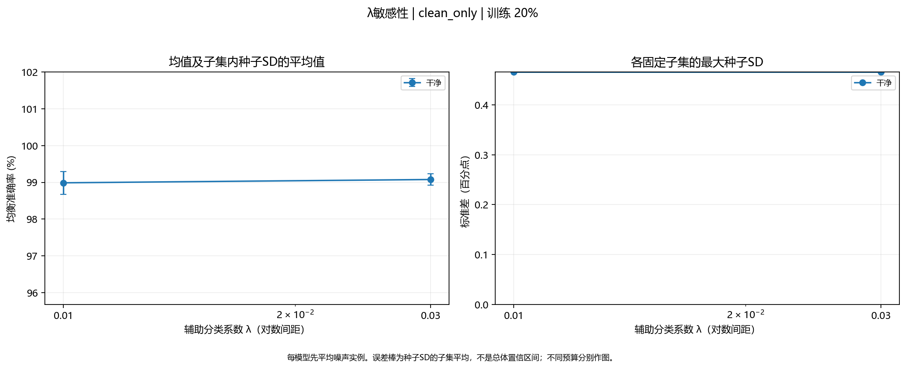

# 两系数阶段性测试报告

本报告由用户明确授权提前测试lambda=0.01、0.03及匹配数据单分支。只锁定本批评价对象和已选权重，全系数网格及后续优化决策尚未完成。本报告不产生系数采用决策。后续训练仍使用预设验证规则，必须披露本次提前测试曝光。

本报告覆盖108个配置模型登记、108个不同权重目录、108组模型目标评价、1458行逐噪声实例指标。配置中未改变干净协议行为的情况会复用同一权重，并包含只读引用的历史模型，不能全部称为新增训练。

本批不选择最优系数，不按测试表现淘汰或增加后续候选。已完成的两系数及对照全部报告。

## 锁定方案

```json
{
  "partial_test": true,
  "cohort_locked": true,
  "decisions_locked": false,
  "locked_at": "2026-10-21T20:41:50.068325+08:00",
  "coefficients": [
    0.01,
    0.03
  ],
  "model_jobs": [
    "m0001",
    "m0002",
    "m0003",
    "m0004",
    "m0005",
    "m0006",
    "m0007",
    "m0008",
    "m0009",
    "m0010",
    "m0011",
    "m0012",
    "m0013",
    "m0014",
    "m0015",
    "m0016",
    "m0017",
    "m0018",
    "m0019",
    "m0020",
    "m0021",
    "m0022",
    "m0023",
    "m0024",
    "m0025",
    "m0026",
    "m0027",
    "m0028",
    "m0029",
    "m0030",
    "m0031",
    "m0032",
    "m0033",
    "m0034",
    "m0035",
    "m0036",
    "m0037",
    "m0038",
    "m0039",
    "m0040",
    "m0041",
    "m0042",
    "m0043",
    "m0044",
    "m0045",
    "m0046",
    "m0047",
    "m0048",
    "m0049",
    "m0050",
    "m0051",
    "m0052",
    "m0053",
    "m0054",
    "m0055",
    "m0056",
    "m0057",
    "m0058",
    "m0059",
    "m0060",
    "m0061",
    "m0062",
    "m0063",
    "m0064",
    "m0065",
    "m0066",
    "m0067",
    "m0068",
    "m0069",
    "m0070",
    "m0071",
    "m0072",
    "m0073",
    "m0074",
    "m0075",
    "m0076",
    "m0077",
    "m0078",
    "m0079",
    "m0080",
    "m0081",
    "m0082",
    "m0083",
    "m0084",
    "m0085",
    "m0086",
    "m0087",
    "m0088",
    "m0089",
    "m0090",
    "m0091",
    "m0092",
    "m0093",
    "m0094",
    "m0095",
    "m0096",
    "m0097",
    "m0098",
    "m0099",
    "m0100",
    "m0101",
    "m0102",
    "m0103",
    "m0104",
    "m0105",
    "m0106",
    "m0107",
    "m0108"
  ],
  "scope": "用户明确要求的两系数提前测试；全网格选择未完成，不根据本次测试选参",
  "decision_rule": "validation_gain_and_preservation_v2_sd_descriptive",
  "historical_test_exposure": true
}
```

## 测试结果

主指标为均衡准确率。噪声实例先在模型内平均，再在固定子集内计算种子均值及样本SD，最后对子集等权平均。subset_mean_sd为子集均值之间的SD；mean_within_subset_seed_sd为各子集种子SD的平均，二者不合并。表中数值为百分数或百分点，一个子集时子集间SD为NaN。

| config_id                                                 | variant       | domain        |   ratio | protocol   |   source_load_hp |   target_load_hp | condition   |   balanced_acc_mean |   subset_mean_sd |   mean_within_subset_seed_sd |   max_within_subset_seed_sd |   subset_count |   min_seed_count |   acc_mean |   recall_OR_mean |   recall_B_mean |
|:----------------------------------------------------------|:--------------|:--------------|--------:|:-----------|-----------------:|-----------------:|:------------|--------------------:|-----------------:|-----------------------------:|----------------------------:|---------------:|-----------------:|-----------:|-----------------:|----------------:|
| baseline_data_v6201_e100_s100_p20                         | baseline_data | window_random |     0.1 | awgn_mixed |               -1 |               -1 | clean       |              69.728 |            1.018 |                       11.14  |                      13.282 |              3 |                3 |     63.646 |           41.935 |          46.237 |
| baseline_data_v6201_e100_s100_p20                         | baseline_data | window_random |     0.1 | awgn_mixed |               -1 |               -1 | white_+0    |              72.667 |            2.013 |                        9.726 |                      12.514 |              3 |                3 |     67.163 |           55.484 |          42.222 |
| baseline_data_v6201_e100_s100_p20                         | baseline_data | window_random |     0.1 | awgn_mixed |               -1 |               -1 | white_+2    |              71.626 |            2.325 |                       10.093 |                      12.395 |              3 |                3 |     65.912 |           48.602 |          45.161 |
| baseline_data_v6201_e100_s100_p20                         | baseline_data | window_random |     0.1 | awgn_mixed |               -1 |               -1 | white_+4    |              70.852 |            1.657 |                       10.769 |                      12.893 |              3 |                3 |     64.984 |           45.018 |          46.022 |
| baseline_data_v6201_e100_s100_p20                         | baseline_data | window_random |     0.1 | awgn_mixed |               -1 |               -1 | white_-2    |              73.168 |            3.686 |                        7.321 |                       8.772 |              3 |                3 |     67.767 |           62.724 |          37.133 |
| baseline_data_v6201_e100_s100_p20                         | baseline_data | window_random |     0.1 | awgn_mixed |               -1 |               -1 | white_-4    |              72.461 |            4.111 |                        5.85  |                       7.267 |              3 |                3 |     66.926 |           68.244 |          29.821 |
| baseline_data_v6201_e100_s100_p20                         | baseline_data | window_random |     0.1 | clean_only |               -1 |               -1 | clean       |              80.783 |            0.835 |                        4.863 |                       7.932 |              3 |                3 |     76.915 |           61.649 |          66.667 |
| baseline_data_v6201_e100_s100_p20                         | baseline_data | window_random |     0.2 | awgn_mixed |               -1 |               -1 | clean       |              91.631 |            1.763 |                        2.677 |                       4.283 |              3 |                3 |     89.968 |           75.986 |          94.982 |
| baseline_data_v6201_e100_s100_p20                         | baseline_data | window_random |     0.2 | awgn_mixed |               -1 |               -1 | white_+0    |              91.63  |            1.814 |                        2.635 |                       3.712 |              3 |                3 |     89.968 |           78.28  |          92.832 |
| baseline_data_v6201_e100_s100_p20                         | baseline_data | window_random |     0.2 | awgn_mixed |               -1 |               -1 | white_+2    |              92.024 |            1.845 |                        2.887 |                       4.158 |              3 |                3 |     90.442 |           78.136 |          94.552 |
| baseline_data_v6201_e100_s100_p20                         | baseline_data | window_random |     0.2 | awgn_mixed |               -1 |               -1 | white_+4    |              91.934 |            1.737 |                        2.779 |                       3.943 |              3 |                3 |     90.334 |           77.348 |          94.982 |
| baseline_data_v6201_e100_s100_p20                         | baseline_data | window_random |     0.2 | awgn_mixed |               -1 |               -1 | white_-2    |              91.111 |            1.758 |                        2.18  |                       3.18  |              3 |                3 |     89.342 |           80.717 |          88.244 |
| baseline_data_v6201_e100_s100_p20                         | baseline_data | window_random |     0.2 | awgn_mixed |               -1 |               -1 | white_-4    |              90.252 |            1.853 |                        1.417 |                       1.869 |              3 |                3 |     88.306 |           86.452 |          78.853 |
| baseline_data_v6201_e100_s100_p20                         | baseline_data | window_random |     0.2 | clean_only |               -1 |               -1 | clean       |              95.845 |            1.893 |                        2.372 |                       3.353 |              3 |                3 |     95.038 |           90.681 |          96.774 |
| data_aux_ce_a0p01_fitclean_headshared_v6201_e100_s100_p20 | data_aux_ce   | window_random |     0.1 | awgn_mixed |               -1 |               -1 | clean       |              93.79  |            0.931 |                        2.055 |                       3.226 |              3 |                3 |     92.557 |           86.022 |          92.473 |
| data_aux_ce_a0p01_fitclean_headshared_v6201_e100_s100_p20 | data_aux_ce   | window_random |     0.1 | awgn_mixed |               -1 |               -1 | white_+0    |              89.145 |            0.447 |                        0.675 |                       1.409 |              3 |                3 |     86.969 |           75.842 |          84.588 |
| data_aux_ce_a0p01_fitclean_headshared_v6201_e100_s100_p20 | data_aux_ce   | window_random |     0.1 | awgn_mixed |               -1 |               -1 | white_+2    |              88.717 |            0.305 |                        1.008 |                       1.455 |              3 |                3 |     86.451 |           76.559 |          81.792 |
| data_aux_ce_a0p01_fitclean_headshared_v6201_e100_s100_p20 | data_aux_ce   | window_random |     0.1 | awgn_mixed |               -1 |               -1 | white_+4    |              89.292 |            0.604 |                        1.398 |                       1.478 |              3 |                3 |     87.141 |           79.283 |          81.219 |
| data_aux_ce_a0p01_fitclean_headshared_v6201_e100_s100_p20 | data_aux_ce   | window_random |     0.1 | awgn_mixed |               -1 |               -1 | white_-2    |              89.679 |            0.241 |                        0.674 |                       0.788 |              3 |                3 |     87.616 |           74.767 |          88.244 |
| data_aux_ce_a0p01_fitclean_headshared_v6201_e100_s100_p20 | data_aux_ce   | window_random |     0.1 | awgn_mixed |               -1 |               -1 | white_-4    |              88.59  |            0.114 |                        0.984 |                       1.378 |              3 |                3 |     86.408 |           72.832 |          88.674 |
| data_aux_ce_a0p01_fitclean_headshared_v6201_e100_s100_p20 | data_aux_ce   | window_random |     0.1 | clean_only |               -1 |               -1 | clean       |              98.271 |            0.56  |                        0.721 |                       1.232 |              3 |                3 |     97.95  |           98.925 |          97.491 |
| data_aux_ce_a0p01_fitclean_headshared_v6201_e100_s100_p20 | data_aux_ce   | window_random |     0.2 | awgn_mixed |               -1 |               -1 | clean       |              98.719 |            0.155 |                        0.621 |                       0.931 |              3 |                3 |     98.49  |           99.283 |          98.925 |
| data_aux_ce_a0p01_fitclean_headshared_v6201_e100_s100_p20 | data_aux_ce   | window_random |     0.2 | awgn_mixed |               -1 |               -1 | white_+0    |              92.84  |            0.671 |                        0.848 |                       1.074 |              3 |                3 |     91.413 |           82.509 |          92.258 |
| data_aux_ce_a0p01_fitclean_headshared_v6201_e100_s100_p20 | data_aux_ce   | window_random |     0.2 | awgn_mixed |               -1 |               -1 | white_+2    |              92.948 |            1.105 |                        1.02  |                       1.434 |              3 |                3 |     91.543 |           85.09  |          90.036 |
| data_aux_ce_a0p01_fitclean_headshared_v6201_e100_s100_p20 | data_aux_ce   | window_random |     0.2 | awgn_mixed |               -1 |               -1 | white_+4    |              93.038 |            1.499 |                        1.355 |                       1.924 |              3 |                3 |     91.65  |           89.104 |          86.38  |
| data_aux_ce_a0p01_fitclean_headshared_v6201_e100_s100_p20 | data_aux_ce   | window_random |     0.2 | awgn_mixed |               -1 |               -1 | white_-2    |              91.619 |            0.642 |                        0.947 |                       1.454 |              3 |                3 |     89.946 |           77.419 |          92.688 |
| data_aux_ce_a0p01_fitclean_headshared_v6201_e100_s100_p20 | data_aux_ce   | window_random |     0.2 | awgn_mixed |               -1 |               -1 | white_-4    |              90.965 |            0.433 |                        1.063 |                       1.679 |              3 |                3 |     89.169 |           74.839 |          93.835 |
| data_aux_ce_a0p01_fitclean_headshared_v6201_e100_s100_p20 | data_aux_ce   | window_random |     0.2 | clean_only |               -1 |               -1 | clean       |              98.987 |            0.155 |                        0.31  |                       0.466 |              3 |                3 |     98.813 |          100     |          99.283 |
| data_aux_ce_a0p03_fitclean_headshared_v6201_e100_s100_p20 | data_aux_ce   | window_random |     0.1 | awgn_mixed |               -1 |               -1 | clean       |              93.79  |            1.172 |                        1.934 |                       3.259 |              3 |                3 |     92.557 |           86.022 |          92.473 |
| data_aux_ce_a0p03_fitclean_headshared_v6201_e100_s100_p20 | data_aux_ce   | window_random |     0.1 | awgn_mixed |               -1 |               -1 | white_+0    |              89.109 |            0.467 |                        0.658 |                       1.569 |              3 |                3 |     86.926 |           75.627 |          84.659 |
| data_aux_ce_a0p03_fitclean_headshared_v6201_e100_s100_p20 | data_aux_ce   | window_random |     0.1 | awgn_mixed |               -1 |               -1 | white_+2    |              88.754 |            0.134 |                        0.977 |                       1.294 |              3 |                3 |     86.494 |           76.272 |          82.151 |
| data_aux_ce_a0p03_fitclean_headshared_v6201_e100_s100_p20 | data_aux_ce   | window_random |     0.1 | awgn_mixed |               -1 |               -1 | white_+4    |              89.041 |            0.407 |                        1.53  |                       1.796 |              3 |                3 |     86.839 |           78.638 |          80.86  |
| data_aux_ce_a0p03_fitclean_headshared_v6201_e100_s100_p20 | data_aux_ce   | window_random |     0.1 | awgn_mixed |               -1 |               -1 | white_-2    |              89.588 |            0.491 |                        0.475 |                       0.81  |              3 |                3 |     87.508 |           74.839 |          87.957 |
| data_aux_ce_a0p03_fitclean_headshared_v6201_e100_s100_p20 | data_aux_ce   | window_random |     0.1 | awgn_mixed |               -1 |               -1 | white_-4    |              88.521 |            0.269 |                        0.775 |                       0.964 |              3 |                3 |     86.321 |           72.903 |          87.957 |
| data_aux_ce_a0p03_fitclean_headshared_v6201_e100_s100_p20 | data_aux_ce   | window_random |     0.1 | clean_only |               -1 |               -1 | clean       |              98.36  |            0.538 |                        0.835 |                       1.232 |              3 |                3 |     98.058 |           98.925 |          97.849 |
| data_aux_ce_a0p03_fitclean_headshared_v6201_e100_s100_p20 | data_aux_ce   | window_random |     0.2 | awgn_mixed |               -1 |               -1 | clean       |              98.719 |            0.155 |                        0.621 |                       0.931 |              3 |                3 |     98.49  |           99.283 |          98.925 |
| data_aux_ce_a0p03_fitclean_headshared_v6201_e100_s100_p20 | data_aux_ce   | window_random |     0.2 | awgn_mixed |               -1 |               -1 | white_+0    |              93.288 |            0.487 |                        1.158 |                       1.55  |              3 |                3 |     91.953 |           83.943 |          92.616 |
| data_aux_ce_a0p03_fitclean_headshared_v6201_e100_s100_p20 | data_aux_ce   | window_random |     0.2 | awgn_mixed |               -1 |               -1 | white_+2    |              93.504 |            0.956 |                        1.304 |                       1.769 |              3 |                3 |     92.211 |           86.308 |          91.039 |
| data_aux_ce_a0p03_fitclean_headshared_v6201_e100_s100_p20 | data_aux_ce   | window_random |     0.2 | awgn_mixed |               -1 |               -1 | white_+4    |              93.486 |            1.245 |                        1.893 |                       2.35  |              3 |                3 |     92.19  |           89.606 |          87.67  |
| data_aux_ce_a0p03_fitclean_headshared_v6201_e100_s100_p20 | data_aux_ce   | window_random |     0.2 | awgn_mixed |               -1 |               -1 | white_-2    |              92.212 |            0.223 |                        1.196 |                       1.616 |              3 |                3 |     90.658 |           78.925 |          93.405 |
| data_aux_ce_a0p03_fitclean_headshared_v6201_e100_s100_p20 | data_aux_ce   | window_random |     0.2 | awgn_mixed |               -1 |               -1 | white_-4    |              91.47  |            0.095 |                        1.253 |                       1.619 |              3 |                3 |     89.773 |           76.631 |          93.692 |
| data_aux_ce_a0p03_fitclean_headshared_v6201_e100_s100_p20 | data_aux_ce   | window_random |     0.2 | clean_only |               -1 |               -1 | clean       |              99.077 |            0.155 |                        0.155 |                       0.466 |              3 |                3 |     98.921 |          100     |          99.642 |

## 配对比较

每个融合配置仅与预先登记的数据单分支配置比较，逐子集、种子、目标和噪声条件匹配。逐配对差值保存在paired_test_differences.csv；paired_summary.csv中的增益与SD使用比例单位，乘100后为百分点。

| config_id                                                 | control_config_id                 | domain        |   ratio | protocol   |   source_load_hp |   target_load_hp | condition   |   gain_mean |   between_subset_gain_sd |   mean_within_subset_gain_seed_sd |   max_within_subset_gain_seed_sd |   subset_count |   min_paired_seed_count | paired_seed_sd_over_0_5pp   | insufficient_training_seeds   |
|:----------------------------------------------------------|:----------------------------------|:--------------|--------:|:-----------|-----------------:|-----------------:|:------------|------------:|-------------------------:|----------------------------------:|---------------------------------:|---------------:|------------------------:|:----------------------------|:------------------------------|
| data_aux_ce_a0p01_fitclean_headshared_v6201_e100_s100_p20 | baseline_data_v6201_e100_s100_p20 | window_random |     0.1 | awgn_mixed |               -1 |               -1 | clean       |    0.240621 |                 0.008332 |                          0.104472 |                         0.139969 |              3 |                       3 | True                        | False                         |
| data_aux_ce_a0p01_fitclean_headshared_v6201_e100_s100_p20 | baseline_data_v6201_e100_s100_p20 | window_random |     0.1 | awgn_mixed |               -1 |               -1 | white_+0    |    0.164773 |                 0.018253 |                          0.093712 |                         0.116231 |              3 |                       3 | True                        | False                         |
| data_aux_ce_a0p01_fitclean_headshared_v6201_e100_s100_p20 | baseline_data_v6201_e100_s100_p20 | window_random |     0.1 | awgn_mixed |               -1 |               -1 | white_+2    |    0.170914 |                 0.021774 |                          0.092608 |                         0.110736 |              3 |                       3 | True                        | False                         |
| data_aux_ce_a0p01_fitclean_headshared_v6201_e100_s100_p20 | baseline_data_v6201_e100_s100_p20 | window_random |     0.1 | awgn_mixed |               -1 |               -1 | white_+4    |    0.184397 |                 0.016296 |                          0.096037 |                         0.120454 |              3 |                       3 | True                        | False                         |
| data_aux_ce_a0p01_fitclean_headshared_v6201_e100_s100_p20 | baseline_data_v6201_e100_s100_p20 | window_random |     0.1 | awgn_mixed |               -1 |               -1 | white_-2    |    0.165108 |                 0.037167 |                          0.069416 |                         0.082322 |              3 |                       3 | True                        | False                         |
| data_aux_ce_a0p01_fitclean_headshared_v6201_e100_s100_p20 | baseline_data_v6201_e100_s100_p20 | window_random |     0.1 | awgn_mixed |               -1 |               -1 | white_-4    |    0.161296 |                 0.042014 |                          0.062787 |                         0.078084 |              3 |                       3 | True                        | False                         |
| data_aux_ce_a0p01_fitclean_headshared_v6201_e100_s100_p20 | baseline_data_v6201_e100_s100_p20 | window_random |     0.1 | clean_only |               -1 |               -1 | clean       |    0.174881 |                 0.011741 |                          0.049574 |                         0.078212 |              3 |                       3 | True                        | False                         |
| data_aux_ce_a0p01_fitclean_headshared_v6201_e100_s100_p20 | baseline_data_v6201_e100_s100_p20 | window_random |     0.2 | awgn_mixed |               -1 |               -1 | clean       |    0.070878 |                 0.018881 |                          0.032529 |                         0.047407 |              3 |                       3 | True                        | False                         |
| data_aux_ce_a0p01_fitclean_headshared_v6201_e100_s100_p20 | baseline_data_v6201_e100_s100_p20 | window_random |     0.2 | awgn_mixed |               -1 |               -1 | white_+0    |    0.012103 |                 0.024091 |                          0.027228 |                         0.039186 |              3 |                       3 | True                        | False                         |
| data_aux_ce_a0p01_fitclean_headshared_v6201_e100_s100_p20 | baseline_data_v6201_e100_s100_p20 | window_random |     0.2 | awgn_mixed |               -1 |               -1 | white_+2    |    0.009241 |                 0.026204 |                          0.030269 |                         0.042029 |              3 |                       3 | True                        | False                         |
| data_aux_ce_a0p01_fitclean_headshared_v6201_e100_s100_p20 | baseline_data_v6201_e100_s100_p20 | window_random |     0.2 | awgn_mixed |               -1 |               -1 | white_+4    |    0.011033 |                 0.027409 |                          0.032502 |                         0.049343 |              3 |                       3 | True                        | False                         |
| data_aux_ce_a0p01_fitclean_headshared_v6201_e100_s100_p20 | baseline_data_v6201_e100_s100_p20 | window_random |     0.2 | awgn_mixed |               -1 |               -1 | white_-2    |    0.00509  |                 0.023907 |                          0.024985 |                         0.038307 |              3 |                       3 | True                        | False                         |
| data_aux_ce_a0p01_fitclean_headshared_v6201_e100_s100_p20 | baseline_data_v6201_e100_s100_p20 | window_random |     0.2 | awgn_mixed |               -1 |               -1 | white_-4    |    0.007127 |                 0.021678 |                          0.018554 |                         0.024469 |              3 |                       3 | True                        | False                         |
| data_aux_ce_a0p01_fitclean_headshared_v6201_e100_s100_p20 | baseline_data_v6201_e100_s100_p20 | window_random |     0.2 | clean_only |               -1 |               -1 | clean       |    0.031422 |                 0.020222 |                          0.023482 |                         0.033533 |              3 |                       3 | True                        | False                         |
| data_aux_ce_a0p03_fitclean_headshared_v6201_e100_s100_p20 | baseline_data_v6201_e100_s100_p20 | window_random |     0.1 | awgn_mixed |               -1 |               -1 | clean       |    0.240621 |                 0.010529 |                          0.108641 |                         0.142133 |              3 |                       3 | True                        | False                         |
| data_aux_ce_a0p03_fitclean_headshared_v6201_e100_s100_p20 | baseline_data_v6201_e100_s100_p20 | window_random |     0.1 | awgn_mixed |               -1 |               -1 | white_+0    |    0.164415 |                 0.016741 |                          0.092495 |                         0.112974 |              3 |                       3 | True                        | False                         |
| data_aux_ce_a0p03_fitclean_headshared_v6201_e100_s100_p20 | baseline_data_v6201_e100_s100_p20 | window_random |     0.1 | awgn_mixed |               -1 |               -1 | white_+2    |    0.171278 |                 0.022731 |                          0.093138 |                         0.113066 |              3 |                       3 | True                        | False                         |
| data_aux_ce_a0p03_fitclean_headshared_v6201_e100_s100_p20 | baseline_data_v6201_e100_s100_p20 | window_random |     0.1 | awgn_mixed |               -1 |               -1 | white_+4    |    0.181888 |                 0.016883 |                          0.096423 |                         0.122985 |              3 |                       3 | True                        | False                         |
| data_aux_ce_a0p03_fitclean_headshared_v6201_e100_s100_p20 | baseline_data_v6201_e100_s100_p20 | window_random |     0.1 | awgn_mixed |               -1 |               -1 | white_-2    |    0.1642   |                 0.038261 |                          0.071243 |                         0.080953 |              3 |                       3 | True                        | False                         |
| data_aux_ce_a0p03_fitclean_headshared_v6201_e100_s100_p20 | baseline_data_v6201_e100_s100_p20 | window_random |     0.1 | awgn_mixed |               -1 |               -1 | white_-4    |    0.160609 |                 0.043409 |                          0.060077 |                         0.073094 |              3 |                       3 | True                        | False                         |
| data_aux_ce_a0p03_fitclean_headshared_v6201_e100_s100_p20 | baseline_data_v6201_e100_s100_p20 | window_random |     0.1 | clean_only |               -1 |               -1 | clean       |    0.175777 |                 0.012471 |                          0.049132 |                         0.078212 |              3 |                       3 | True                        | False                         |
| data_aux_ce_a0p03_fitclean_headshared_v6201_e100_s100_p20 | baseline_data_v6201_e100_s100_p20 | window_random |     0.2 | awgn_mixed |               -1 |               -1 | clean       |    0.070878 |                 0.018881 |                          0.032529 |                         0.047407 |              3 |                       3 | True                        | False                         |
| data_aux_ce_a0p03_fitclean_headshared_v6201_e100_s100_p20 | baseline_data_v6201_e100_s100_p20 | window_random |     0.2 | awgn_mixed |               -1 |               -1 | white_+0    |    0.016583 |                 0.020299 |                          0.031675 |                         0.049343 |              3 |                       3 | True                        | False                         |
| data_aux_ce_a0p03_fitclean_headshared_v6201_e100_s100_p20 | baseline_data_v6201_e100_s100_p20 | window_random |     0.2 | awgn_mixed |               -1 |               -1 | white_+2    |    0.014797 |                 0.022131 |                          0.033273 |                         0.053674 |              3 |                       3 | True                        | False                         |
| data_aux_ce_a0p03_fitclean_headshared_v6201_e100_s100_p20 | baseline_data_v6201_e100_s100_p20 | window_random |     0.2 | awgn_mixed |               -1 |               -1 | white_+4    |    0.015514 |                 0.02392  |                          0.034718 |                         0.056582 |              3 |                       3 | True                        | False                         |
| data_aux_ce_a0p03_fitclean_headshared_v6201_e100_s100_p20 | baseline_data_v6201_e100_s100_p20 | window_random |     0.2 | awgn_mixed |               -1 |               -1 | white_-2    |    0.011016 |                 0.019706 |                          0.027897 |                         0.046169 |              3 |                       3 | True                        | False                         |
| data_aux_ce_a0p03_fitclean_headshared_v6201_e100_s100_p20 | baseline_data_v6201_e100_s100_p20 | window_random |     0.2 | awgn_mixed |               -1 |               -1 | white_-4    |    0.012174 |                 0.017886 |                          0.019424 |                         0.03416  |              3 |                       3 | True                        | False                         |
| data_aux_ce_a0p03_fitclean_headshared_v6201_e100_s100_p20 | baseline_data_v6201_e100_s100_p20 | window_random |     0.2 | clean_only |               -1 |               -1 | clean       |    0.032318 |                 0.018862 |                          0.025034 |                         0.033533 |              3 |                       3 | True                        | False                         |

## 混淆矩阵

confusion_counts.csv保留原始累计预测计数count。original_support为原始测试窗口数，未乘种子、子集或噪声重复数。row_fraction先平均噪声，再平均种子和子集，各真实类别行和为1。pooled_row_fraction另提供累计计数归一化结果。当重复数不相等时，两种比例可能不同，主报告采用前者。

## 计算成本

| config_id                                                 | variant       | domain        |   ratio | protocol   |   model_count |   parameters |   inference_parameters |   auxiliary_only_parameters |   conv_linear_flops |   epochs_trained |   updates_trained |   fit_seconds |   total_train_seconds |   train_seconds_per_epoch |   validation_seconds |   gradient_diagnostic_seconds |   total_training_with_diagnostics_seconds |   peak_gpu_mib |   latency_ms |
|:----------------------------------------------------------|:--------------|:--------------|--------:|:-----------|--------------:|-------------:|-----------------------:|----------------------------:|--------------------:|-----------------:|------------------:|--------------:|----------------------:|--------------------------:|---------------------:|------------------------------:|------------------------------------------:|---------------:|-------------:|
| baseline_data_v6201_e100_s100_p20                         | baseline_data | window_random |     0.1 | awgn_mixed |             9 |        33964 |                  33964 |                           0 |         1.52525e+09 |              100 |               200 |        0.0011 |               15.7572 |                    0.1576 |              45.3162 |                      nan      |                                  nan      |        1195.58 |       2.5223 |
| baseline_data_v6201_e100_s100_p20                         | baseline_data | window_random |     0.1 | clean_only |             9 |        33964 |                  33964 |                           0 |         1.52525e+09 |              100 |               200 |        0.001  |               13.472  |                    0.1347 |               7.5656 |                      nan      |                                  nan      |        1195.58 |       2.6003 |
| baseline_data_v6201_e100_s100_p20                         | baseline_data | window_random |     0.2 | awgn_mixed |             9 |        33964 |                  33964 |                           0 |         1.52525e+09 |              100 |               400 |        0.0022 |               31.9967 |                    0.32   |              45.6305 |                      nan      |                                  nan      |        1195.58 |       2.5032 |
| baseline_data_v6201_e100_s100_p20                         | baseline_data | window_random |     0.2 | clean_only |             9 |        33964 |                  33964 |                           0 |         1.52525e+09 |              100 |               400 |        0.0021 |               26.9519 |                    0.2695 |               7.565  |                      nan      |                                  nan      |        1195.58 |       2.5216 |
| data_aux_ce_a0p01_fitclean_headshared_v6201_e100_s100_p20 | data_aux_ce   | window_random |     0.1 | awgn_mixed |             9 |        53068 |                  53068 |                           0 |         1.52529e+09 |              100 |               200 |        0.0145 |               18.1844 |                    0.1818 |              61.1642 |                        9.5605 |                                   27.7449 |        1343.53 |       9.5444 |
| data_aux_ce_a0p01_fitclean_headshared_v6201_e100_s100_p20 | data_aux_ce   | window_random |     0.1 | clean_only |             9 |        53068 |                  53068 |                           0 |         1.52529e+09 |              100 |               200 |        0.3391 |               15.6488 |                    0.1565 |              10.4825 |                        9.4982 |                                   25.147  |        1343.53 |       9.475  |
| data_aux_ce_a0p01_fitclean_headshared_v6201_e100_s100_p20 | data_aux_ce   | window_random |     0.2 | awgn_mixed |             9 |        53068 |                  53068 |                           0 |         1.52529e+09 |              100 |               400 |        0.0288 |               36.7742 |                    0.3677 |              62.2504 |                        9.703  |                                   46.4772 |        1343.53 |       9.5265 |
| data_aux_ce_a0p01_fitclean_headshared_v6201_e100_s100_p20 | data_aux_ce   | window_random |     0.2 | clean_only |             9 |        53068 |                  53068 |                           0 |         1.52529e+09 |              100 |               400 |        0.2053 |               32.1748 |                    0.3217 |              10.6479 |                        9.7861 |                                   41.9608 |        1343.53 |       9.9461 |
| data_aux_ce_a0p03_fitclean_headshared_v6201_e100_s100_p20 | data_aux_ce   | window_random |     0.1 | awgn_mixed |             9 |        53068 |                  53068 |                           0 |         1.52529e+09 |              100 |               200 |        0.0152 |               18.138  |                    0.1814 |              61.2256 |                        9.5812 |                                   27.7192 |        1343.53 |       9.6483 |
| data_aux_ce_a0p03_fitclean_headshared_v6201_e100_s100_p20 | data_aux_ce   | window_random |     0.1 | clean_only |             9 |        53068 |                  53068 |                           0 |         1.52529e+09 |              100 |               200 |        0.0146 |               15.7357 |                    0.1574 |              10.3981 |                        9.5703 |                                   25.306  |        1343.53 |       9.6902 |
| data_aux_ce_a0p03_fitclean_headshared_v6201_e100_s100_p20 | data_aux_ce   | window_random |     0.2 | awgn_mixed |             9 |        53068 |                  53068 |                           0 |         1.52529e+09 |              100 |               400 |        0.028  |               36.1758 |                    0.3618 |              60.7519 |                        9.5123 |                                   45.6881 |        1343.53 |       8.9335 |
| data_aux_ce_a0p03_fitclean_headshared_v6201_e100_s100_p20 | data_aux_ce   | window_random |     0.2 | clean_only |             9 |        53068 |                  53068 |                           0 |         1.52529e+09 |              100 |               400 |        0.0265 |               31.3679 |                    0.3137 |              10.2844 |                        9.515  |                                   40.883  |        1343.53 |       8.793  |

训练成本按唯一job_id统计；同一来源模型评价三个目标不重复计训练量。参数与Conv1d/Linear FLOPs仅描述登记口径，FLOPs不含物理FFT、归一化和逐元素操作。单样本延迟、峰值显存、拟合与验证耗时取自训练引擎的实测记录，不在本报告中重新推理。具体硬件、精度、批量、预热、重复次数和计时范围见各模型parameters.json。

## 证据边界

仅保留数据单分支与融合加辅助分类两种方法。两组比较不能单独识别物理融合与辅助损失各自贡献。超参数搜索次数及候选失败均需披露。验证集被反复用于选参，且测试已有历史曝光，结果为探索性证据。训练与测试共享记录，训练子集、随机种子和噪声重复不能当作独立轴承或独立数据集。若跨负载系数来源于包含全部负载的随机窗口开发，不能声称目标负载从未参与方法开发。2026-10-21用户已取消SD不超过0.5个百分点的硬门槛。SD和配对增益SD仅描述波动，相关over_0_5pp字段作为警示，不参与采用或停止判定，也不是显著性检验。少于三个种子的分组明确标记，不能据此声称已充分验证稳定性。















