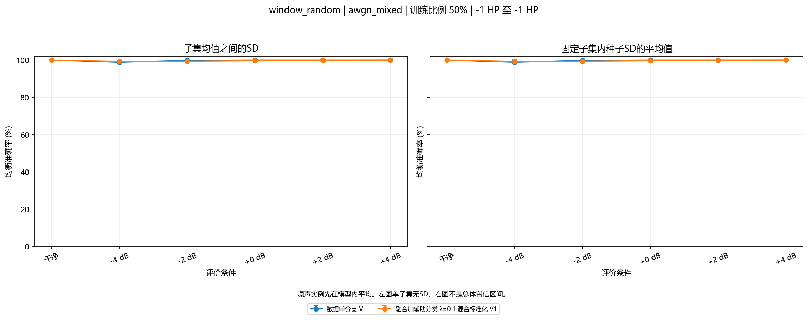
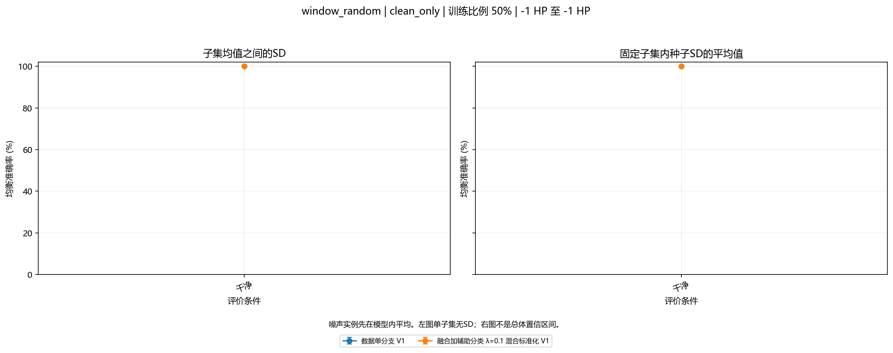
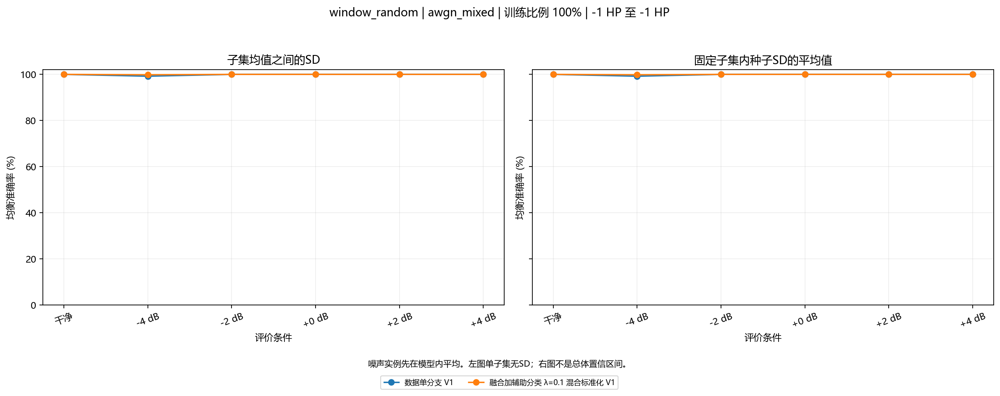
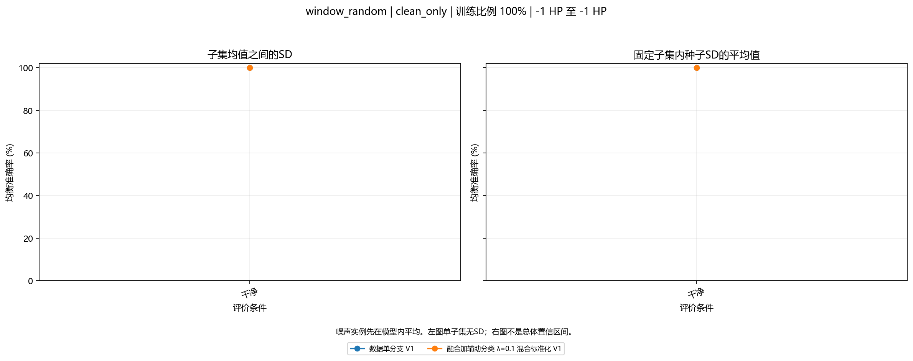

# 阶段验证报告

以下仅为固定验证集结果。完成计算、采用改动、进入下一阶段是不同状态，以阶段决策为准。

## 已锁定的阶段决策

```json
{
  "selected_aux_weight": 0.1,
  "configuration_fixed": true,
  "scope": "完整评价，无论对照优劣均保留；验证结果不再改变系数"
}
```

## 验证指标

均值先在每模型内平均噪声实例，再在固定子集内平均训练种子，最后对子集等权平均。表中数值为百分数或百分点。子集间SD与种子SD分别报告，不能合并成独立数据集重复。一个子集的子集间SD为NaN；少于三个训练种子的分组明确标记为不足。

| config_id                                                                            | variant       | domain        |   ratio | protocol   |   source_load_hp |   target_load_hp | condition   |   balanced_acc_mean |   subset_mean_sd |   mean_within_subset_seed_sd |   max_within_subset_seed_sd |   subset_count |   min_seed_count |   acc_mean |   recall_OR_mean |   recall_B_mean |
|:-------------------------------------------------------------------------------------|:--------------|:--------------|--------:|:-----------|-----------------:|-----------------:|:------------|--------------------:|-----------------:|-----------------------------:|----------------------------:|---------------:|-----------------:|-----------:|-----------------:|----------------:|
| baseline_data_v6201_e100_s100_p20                                                    | baseline_data | window_random |     0.5 | awgn_mixed |               -1 |               -1 | clean       |             100     |            0     |                        0     |                       0     |              3 |                3 |    100     |          100     |         100     |
| baseline_data_v6201_e100_s100_p20                                                    | baseline_data | window_random |     0.5 | awgn_mixed |               -1 |               -1 | white_+0    |             100     |            0     |                        0     |                       0     |              3 |                3 |    100     |          100     |         100     |
| baseline_data_v6201_e100_s100_p20                                                    | baseline_data | window_random |     0.5 | awgn_mixed |               -1 |               -1 | white_+2    |             100     |            0     |                        0     |                       0     |              3 |                3 |    100     |          100     |         100     |
| baseline_data_v6201_e100_s100_p20                                                    | baseline_data | window_random |     0.5 | awgn_mixed |               -1 |               -1 | white_+4    |             100     |            0     |                        0     |                       0     |              3 |                3 |    100     |          100     |         100     |
| baseline_data_v6201_e100_s100_p20                                                    | baseline_data | window_random |     0.5 | awgn_mixed |               -1 |               -1 | white_-2    |              99.826 |            0.15  |                        0.301 |                       0.451 |              3 |                3 |     99.784 |           99.653 |          99.653 |
| baseline_data_v6201_e100_s100_p20                                                    | baseline_data | window_random |     0.5 | awgn_mixed |               -1 |               -1 | white_-4    |              98.872 |            0.301 |                        0.809 |                       1.193 |              3 |                3 |     98.598 |           97.569 |          97.917 |
| baseline_data_v6201_e100_s100_p20                                                    | baseline_data | window_random |     0.5 | clean_only |               -1 |               -1 | clean       |             100     |            0     |                        0     |                       0     |              3 |                3 |    100     |          100     |         100     |
| baseline_data_v6201_e100_s100_p20                                                    | baseline_data | window_random |     1   | awgn_mixed |               -1 |               -1 | clean       |             100     |          nan     |                        0     |                       0     |              1 |                5 |    100     |          100     |         100     |
| baseline_data_v6201_e100_s100_p20                                                    | baseline_data | window_random |     1   | awgn_mixed |               -1 |               -1 | white_+0    |             100     |          nan     |                        0     |                       0     |              1 |                5 |    100     |          100     |         100     |
| baseline_data_v6201_e100_s100_p20                                                    | baseline_data | window_random |     1   | awgn_mixed |               -1 |               -1 | white_+2    |             100     |          nan     |                        0     |                       0     |              1 |                5 |    100     |          100     |         100     |
| baseline_data_v6201_e100_s100_p20                                                    | baseline_data | window_random |     1   | awgn_mixed |               -1 |               -1 | white_+4    |             100     |          nan     |                        0     |                       0     |              1 |                5 |    100     |          100     |         100     |
| baseline_data_v6201_e100_s100_p20                                                    | baseline_data | window_random |     1   | awgn_mixed |               -1 |               -1 | white_-2    |             100     |          nan     |                        0     |                       0     |              1 |                5 |    100     |          100     |         100     |
| baseline_data_v6201_e100_s100_p20                                                    | baseline_data | window_random |     1   | awgn_mixed |               -1 |               -1 | white_-4    |              99.219 |          nan     |                        0.552 |                       0.552 |              1 |                5 |     99.029 |           98.125 |          98.75  |
| baseline_data_v6201_e100_s100_p20                                                    | baseline_data | window_random |     1   | clean_only |               -1 |               -1 | clean       |             100     |          nan     |                        0     |                       0     |              1 |                5 |    100     |          100     |         100     |
| data_aux_ce_a0p1_fitmatched_noise_headshared_fitseed6301_fitrep3_v6201_e100_s100_p20 | data_aux_ce   | window_random |     0.5 | awgn_mixed |               -1 |               -1 | clean       |             100     |            0     |                        0     |                       0     |              3 |                3 |    100     |          100     |         100     |
| data_aux_ce_a0p1_fitmatched_noise_headshared_fitseed6301_fitrep3_v6201_e100_s100_p20 | data_aux_ce   | window_random |     0.5 | awgn_mixed |               -1 |               -1 | white_+0    |              99.653 |            0.15  |                        0.601 |                       0.902 |              3 |                3 |     99.569 |           99.653 |          98.958 |
| data_aux_ce_a0p1_fitmatched_noise_headshared_fitseed6301_fitrep3_v6201_e100_s100_p20 | data_aux_ce   | window_random |     0.5 | awgn_mixed |               -1 |               -1 | white_+2    |              99.913 |            0.15  |                        0.15  |                       0.451 |              3 |                3 |     99.892 |          100     |          99.653 |
| data_aux_ce_a0p1_fitmatched_noise_headshared_fitseed6301_fitrep3_v6201_e100_s100_p20 | data_aux_ce   | window_random |     0.5 | awgn_mixed |               -1 |               -1 | white_+4    |             100     |            0     |                        0     |                       0     |              3 |                3 |    100     |          100     |         100     |
| data_aux_ce_a0p1_fitmatched_noise_headshared_fitseed6301_fitrep3_v6201_e100_s100_p20 | data_aux_ce   | window_random |     0.5 | awgn_mixed |               -1 |               -1 | white_-2    |              99.392 |            0.15  |                        0.862 |                       0.902 |              3 |                3 |     99.245 |           98.958 |          98.611 |
| data_aux_ce_a0p1_fitmatched_noise_headshared_fitseed6301_fitrep3_v6201_e100_s100_p20 | data_aux_ce   | window_random |     0.5 | awgn_mixed |               -1 |               -1 | white_-4    |              99.306 |            0.15  |                        1.012 |                       1.353 |              3 |                3 |     99.137 |           98.958 |          98.264 |
| data_aux_ce_a0p1_fitmatched_noise_headshared_fitseed6301_fitrep3_v6201_e100_s100_p20 | data_aux_ce   | window_random |     0.5 | clean_only |               -1 |               -1 | clean       |             100     |            0     |                        0     |                       0     |              3 |                3 |    100     |          100     |         100     |
| data_aux_ce_a0p1_fitmatched_noise_headshared_fitseed6301_fitrep3_v6201_e100_s100_p20 | data_aux_ce   | window_random |     1   | awgn_mixed |               -1 |               -1 | clean       |             100     |          nan     |                        0     |                       0     |              1 |                5 |    100     |          100     |         100     |
| data_aux_ce_a0p1_fitmatched_noise_headshared_fitseed6301_fitrep3_v6201_e100_s100_p20 | data_aux_ce   | window_random |     1   | awgn_mixed |               -1 |               -1 | white_+0    |             100     |          nan     |                        0     |                       0     |              1 |                5 |    100     |          100     |         100     |
| data_aux_ce_a0p1_fitmatched_noise_headshared_fitseed6301_fitrep3_v6201_e100_s100_p20 | data_aux_ce   | window_random |     1   | awgn_mixed |               -1 |               -1 | white_+2    |             100     |          nan     |                        0     |                       0     |              1 |                5 |    100     |          100     |         100     |
| data_aux_ce_a0p1_fitmatched_noise_headshared_fitseed6301_fitrep3_v6201_e100_s100_p20 | data_aux_ce   | window_random |     1   | awgn_mixed |               -1 |               -1 | white_+4    |             100     |          nan     |                        0     |                       0     |              1 |                5 |    100     |          100     |         100     |
| data_aux_ce_a0p1_fitmatched_noise_headshared_fitseed6301_fitrep3_v6201_e100_s100_p20 | data_aux_ce   | window_random |     1   | awgn_mixed |               -1 |               -1 | white_-2    |             100     |          nan     |                        0     |                       0     |              1 |                5 |    100     |          100     |         100     |
| data_aux_ce_a0p1_fitmatched_noise_headshared_fitseed6301_fitrep3_v6201_e100_s100_p20 | data_aux_ce   | window_random |     1   | awgn_mixed |               -1 |               -1 | white_-4    |              99.844 |          nan     |                        0.349 |                       0.349 |              1 |                5 |     99.806 |           99.375 |         100     |
| data_aux_ce_a0p1_fitmatched_noise_headshared_fitseed6301_fitrep3_v6201_e100_s100_p20 | data_aux_ce   | window_random |     1   | clean_only |               -1 |               -1 | clean       |             100     |          nan     |                        0     |                       0     |              1 |                5 |    100     |          100     |         100     |

固定验证集被反复用于选择配置，结果属于探索性分析。2026-10-21用户已取消SD不超过0.5个百分点的硬门槛。表中的seed_sd_over_0_5pp仅为描述性波动警示，不参与采用、停止或扩展判定，也不是显著性检验。







