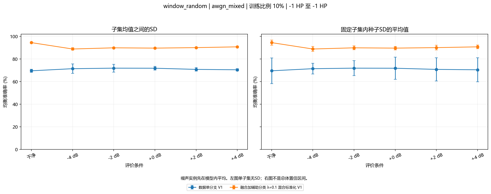
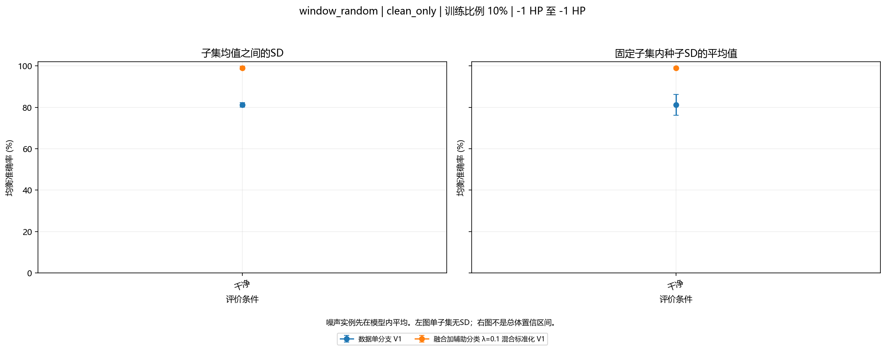
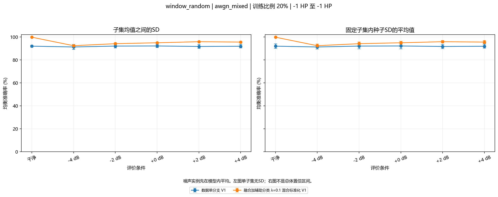
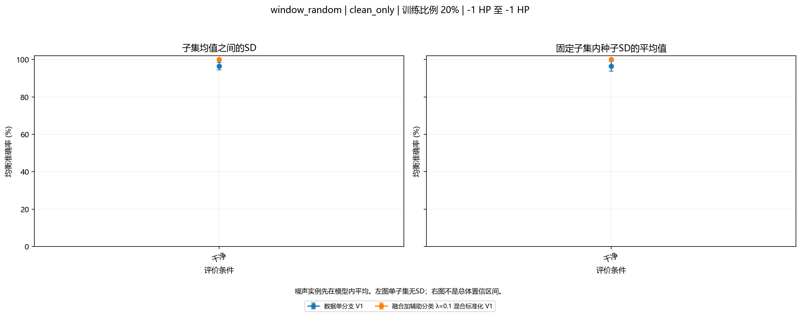

# 阶段验证报告

以下仅为固定验证集结果。完成计算、采用改动、进入下一阶段是不同状态，以阶段决策为准。

## 已锁定的阶段决策

```json
{
  "selected_aux_weight": 0.1,
  "configuration_fixed": true,
  "scope": "完整评价，无论对照优劣均保留；验证结果不再改变系数"
}
```

## 验证指标

均值先在每模型内平均噪声实例，再在固定子集内平均训练种子，最后对子集等权平均。表中数值为百分数或百分点。子集间SD与种子SD分别报告，不能合并成独立数据集重复。一个子集的子集间SD为NaN；少于三个训练种子的分组明确标记为不足。

| config_id                                                                            | variant       | domain        |   ratio | protocol   |   source_load_hp |   target_load_hp | condition   |   balanced_acc_mean |   subset_mean_sd |   mean_within_subset_seed_sd |   max_within_subset_seed_sd |   subset_count |   min_seed_count |   acc_mean |   recall_OR_mean |   recall_B_mean |
|:-------------------------------------------------------------------------------------|:--------------|:--------------|--------:|:-----------|-----------------:|-----------------:|:------------|--------------------:|-----------------:|-----------------------------:|----------------------------:|---------------:|-----------------:|-----------:|-----------------:|----------------:|
| baseline_data_v6201_e100_s100_p20                                                    | baseline_data | window_random |     0.1 | awgn_mixed |               -1 |               -1 | clean       |              69.606 |            1.419 |                       11.393 |                      14.03  |              3 |                3 |     62.352 |           43.75  |          38.889 |
| baseline_data_v6201_e100_s100_p20                                                    | baseline_data | window_random |     0.1 | awgn_mixed |               -1 |               -1 | white_+0    |              71.872 |            1.676 |                        9.796 |                      13.532 |              3 |                3 |     65.156 |           58.333 |          32.986 |
| baseline_data_v6201_e100_s100_p20                                                    | baseline_data | window_random |     0.1 | awgn_mixed |               -1 |               -1 | white_+2    |              70.848 |            1.55  |                       10.331 |                      12.41  |              3 |                3 |     63.862 |           52.083 |          34.375 |
| baseline_data_v6201_e100_s100_p20                                                    | baseline_data | window_random |     0.1 | awgn_mixed |               -1 |               -1 | white_+4    |              70.501 |            1.033 |                       10.711 |                      12.908 |              3 |                3 |     63.43  |           47.569 |          37.5   |
| baseline_data_v6201_e100_s100_p20                                                    | baseline_data | window_random |     0.1 | awgn_mixed |               -1 |               -1 | white_-2    |              71.941 |            3.44  |                        6.611 |                       7.857 |              3 |                3 |     65.264 |           62.847 |          29.514 |
| baseline_data_v6201_e100_s100_p20                                                    | baseline_data | window_random |     0.1 | awgn_mixed |               -1 |               -1 | white_-4    |              71.471 |            4.184 |                        4.715 |                       6.023 |              3 |                3 |     64.725 |           66.667 |          25.347 |
| baseline_data_v6201_e100_s100_p20                                                    | baseline_data | window_random |     0.1 | clean_only |               -1 |               -1 | clean       |              81.223 |            1.082 |                        5.083 |                       7.453 |              3 |                3 |     76.699 |           62.5   |          63.542 |
| baseline_data_v6201_e100_s100_p20                                                    | baseline_data | window_random |     0.2 | awgn_mixed |               -1 |               -1 | clean       |              92.014 |            0.796 |                        1.984 |                       3.157 |              3 |                3 |     90.076 |           72.917 |          95.139 |
| baseline_data_v6201_e100_s100_p20                                                    | baseline_data | window_random |     0.2 | awgn_mixed |               -1 |               -1 | white_+0    |              92.188 |            1.353 |                        2.513 |                       3.405 |              3 |                3 |     90.291 |           77.431 |          91.319 |
| baseline_data_v6201_e100_s100_p20                                                    | baseline_data | window_random |     0.2 | awgn_mixed |               -1 |               -1 | white_+2    |              91.753 |            1.734 |                        1.806 |                       3.405 |              3 |                3 |     89.752 |           74.653 |          92.361 |
| baseline_data_v6201_e100_s100_p20                                                    | baseline_data | window_random |     0.2 | awgn_mixed |               -1 |               -1 | white_+4    |              91.927 |            1.584 |                        1.683 |                       3.405 |              3 |                3 |     89.968 |           74.306 |          93.403 |
| baseline_data_v6201_e100_s100_p20                                                    | baseline_data | window_random |     0.2 | awgn_mixed |               -1 |               -1 | white_-2    |              92.101 |            1.734 |                        2.471 |                       2.958 |              3 |                3 |     90.183 |           80.556 |          87.847 |
| baseline_data_v6201_e100_s100_p20                                                    | baseline_data | window_random |     0.2 | awgn_mixed |               -1 |               -1 | white_-4    |              91.319 |            2.168 |                        1.741 |                       2.706 |              3 |                3 |     89.213 |           87.5   |          77.778 |
| baseline_data_v6201_e100_s100_p20                                                    | baseline_data | window_random |     0.2 | clean_only |               -1 |               -1 | clean       |              96.441 |            1.972 |                        2.571 |                       3.854 |              3 |                3 |     95.577 |           88.194 |          97.569 |
| data_aux_ce_a0p1_fitmatched_noise_headshared_fitseed6301_fitrep3_v6201_e100_s100_p20 | data_aux_ce   | window_random |     0.1 | awgn_mixed |               -1 |               -1 | clean       |              94.531 |            0.689 |                        2.331 |                       3.253 |              3 |                3 |     93.204 |           79.861 |          98.264 |
| data_aux_ce_a0p1_fitmatched_noise_headshared_fitseed6301_fitrep3_v6201_e100_s100_p20 | data_aux_ce   | window_random |     0.1 | awgn_mixed |               -1 |               -1 | white_+0    |              89.67  |            0.301 |                        1.538 |                       2.067 |              3 |                3 |     87.163 |           72.569 |          86.111 |
| data_aux_ce_a0p1_fitmatched_noise_headshared_fitseed6301_fitrep3_v6201_e100_s100_p20 | data_aux_ce   | window_random |     0.1 | awgn_mixed |               -1 |               -1 | white_+2    |              90.104 |            0.451 |                        2.079 |                       2.817 |              3 |                3 |     87.702 |           75     |          85.417 |
| data_aux_ce_a0p1_fitmatched_noise_headshared_fitseed6301_fitrep3_v6201_e100_s100_p20 | data_aux_ce   | window_random |     0.1 | awgn_mixed |               -1 |               -1 | white_+4    |              90.799 |            0.542 |                        1.56  |                       2.706 |              3 |                3 |     88.565 |           78.472 |          84.722 |
| data_aux_ce_a0p1_fitmatched_noise_headshared_fitseed6301_fitrep3_v6201_e100_s100_p20 | data_aux_ce   | window_random |     0.1 | awgn_mixed |               -1 |               -1 | white_-2    |              89.931 |            0.542 |                        1.692 |                       2.255 |              3 |                3 |     87.487 |           71.181 |          88.542 |
| data_aux_ce_a0p1_fitmatched_noise_headshared_fitseed6301_fitrep3_v6201_e100_s100_p20 | data_aux_ce   | window_random |     0.1 | awgn_mixed |               -1 |               -1 | white_-4    |              88.886 |            1.09  |                        2.181 |                       3.157 |              3 |                3 |     86.516 |           70.486 |          89.236 |
| data_aux_ce_a0p1_fitmatched_noise_headshared_fitseed6301_fitrep3_v6201_e100_s100_p20 | data_aux_ce   | window_random |     0.1 | clean_only |               -1 |               -1 | clean       |              99.045 |            0.796 |                        0.561 |                       0.781 |              3 |                3 |     98.813 |           96.875 |          99.306 |
| data_aux_ce_a0p1_fitmatched_noise_headshared_fitseed6301_fitrep3_v6201_e100_s100_p20 | data_aux_ce   | window_random |     0.2 | awgn_mixed |               -1 |               -1 | clean       |              99.826 |            0.301 |                        0.15  |                       0.451 |              3 |                3 |     99.784 |           99.306 |         100     |
| data_aux_ce_a0p1_fitmatched_noise_headshared_fitseed6301_fitrep3_v6201_e100_s100_p20 | data_aux_ce   | window_random |     0.2 | awgn_mixed |               -1 |               -1 | white_+0    |              94.965 |            0.301 |                        1.345 |                       1.626 |              3 |                3 |     93.743 |           88.889 |          90.972 |
| data_aux_ce_a0p1_fitmatched_noise_headshared_fitseed6301_fitrep3_v6201_e100_s100_p20 | data_aux_ce   | window_random |     0.2 | awgn_mixed |               -1 |               -1 | white_+2    |              95.92  |            0.542 |                        1.012 |                       1.353 |              3 |                3 |     94.93  |           91.667 |          92.014 |
| data_aux_ce_a0p1_fitmatched_noise_headshared_fitseed6301_fitrep3_v6201_e100_s100_p20 | data_aux_ce   | window_random |     0.2 | awgn_mixed |               -1 |               -1 | white_+4    |              95.573 |            0.451 |                        1.423 |                       1.562 |              3 |                3 |     94.498 |           92.361 |          89.931 |
| data_aux_ce_a0p1_fitmatched_noise_headshared_fitseed6301_fitrep3_v6201_e100_s100_p20 | data_aux_ce   | window_random |     0.2 | awgn_mixed |               -1 |               -1 | white_-2    |              94.184 |            0.796 |                        1.488 |                       2.387 |              3 |                3 |     92.772 |           84.028 |          92.708 |
| data_aux_ce_a0p1_fitmatched_noise_headshared_fitseed6301_fitrep3_v6201_e100_s100_p20 | data_aux_ce   | window_random |     0.2 | awgn_mixed |               -1 |               -1 | white_-4    |              92.421 |            0.475 |                        1.371 |                       1.972 |              3 |                3 |     90.615 |           79.514 |          91.319 |
| data_aux_ce_a0p1_fitmatched_noise_headshared_fitseed6301_fitrep3_v6201_e100_s100_p20 | data_aux_ce   | window_random |     0.2 | clean_only |               -1 |               -1 | clean       |             100     |            0     |                        0     |                       0     |              3 |                3 |    100     |          100     |         100     |

固定验证集被反复用于选择配置，结果属于探索性分析。2026-10-21用户已取消SD不超过0.5个百分点的硬门槛。表中的seed_sd_over_0_5pp仅为描述性波动警示，不参与采用、停止或扩展判定，也不是显著性检验。







