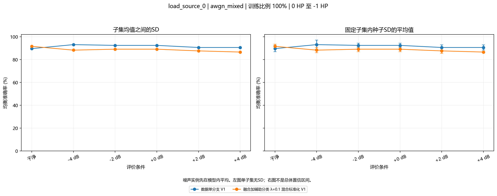
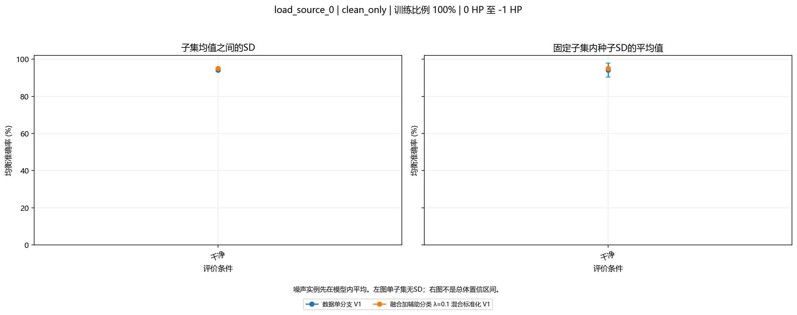
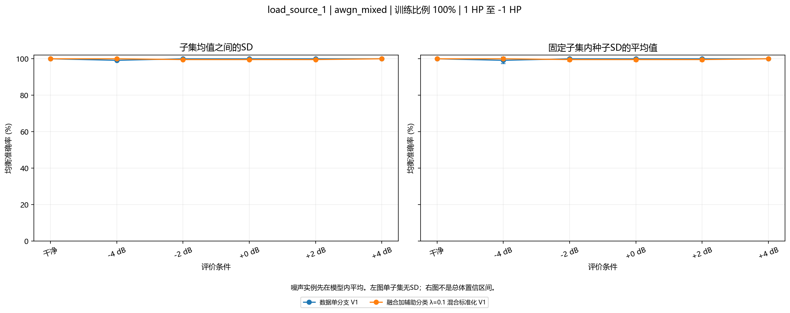
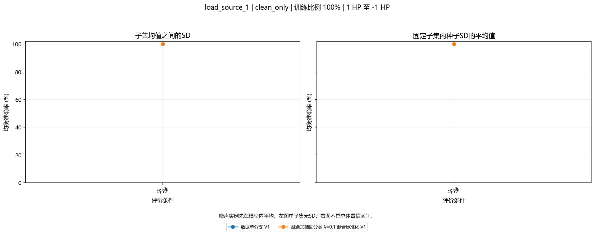
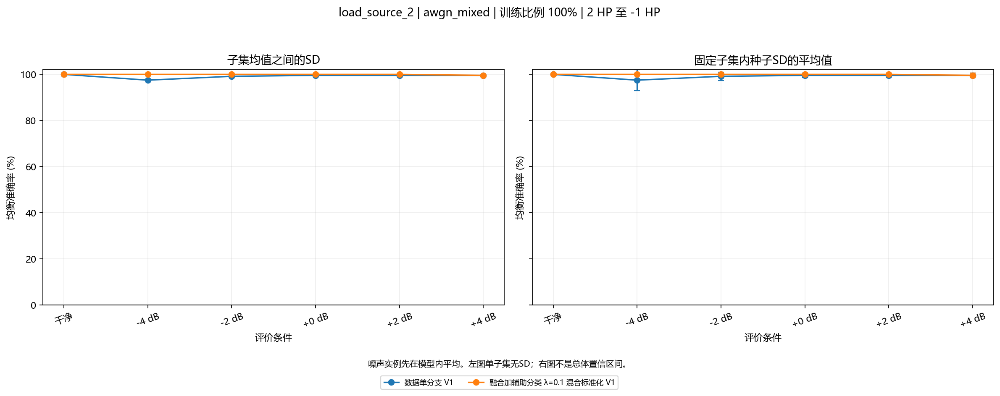
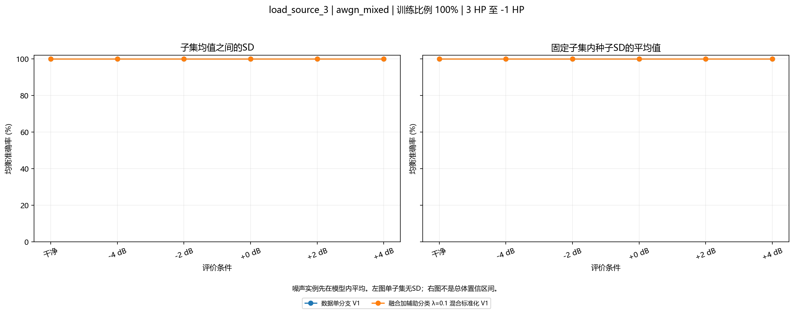

# 阶段验证报告

以下仅为固定验证集结果。完成计算、采用改动、进入下一阶段是不同状态，以阶段决策为准。

## 已锁定的阶段决策

```json
{
  "selected_aux_weight": 0.1,
  "configuration_fixed": true,
  "scope": "完整评价，无论对照优劣均保留；验证结果不再改变系数"
}
```

## 验证指标

均值先在每模型内平均噪声实例，再在固定子集内平均训练种子，最后对子集等权平均。表中数值为百分数或百分点。子集间SD与种子SD分别报告，不能合并成独立数据集重复。一个子集的子集间SD为NaN；少于三个训练种子的分组明确标记为不足。

| config_id                                                                            | variant       | domain        |   ratio | protocol   |   source_load_hp |   target_load_hp | condition   |   balanced_acc_mean |   subset_mean_sd |   mean_within_subset_seed_sd |   max_within_subset_seed_sd |   subset_count |   min_seed_count |   acc_mean |   recall_OR_mean |   recall_B_mean |
|:-------------------------------------------------------------------------------------|:--------------|:--------------|--------:|:-----------|-----------------:|-----------------:|:------------|--------------------:|-----------------:|-----------------------------:|----------------------------:|---------------:|-----------------:|-----------:|-----------------:|----------------:|
| baseline_data_v6201_e100_s100_p20                                                    | baseline_data | load_source_0 |       1 | awgn_mixed |                0 |               -1 | clean       |              89.667 |              nan |                        2.739 |                       2.739 |              1 |                5 |     87.368 |           66.667 |         100     |
| baseline_data_v6201_e100_s100_p20                                                    | baseline_data | load_source_0 |       1 | awgn_mixed |                0 |               -1 | white_+0    |              92.5   |              nan |                        1.863 |                       1.863 |              1 |                5 |     90.526 |           70     |         100     |
| baseline_data_v6201_e100_s100_p20                                                    | baseline_data | load_source_0 |       1 | awgn_mixed |                0 |               -1 | white_+2    |              90.667 |              nan |                        2.236 |                       2.236 |              1 |                5 |     88.421 |           66.667 |         100     |
| baseline_data_v6201_e100_s100_p20                                                    | baseline_data | load_source_0 |       1 | awgn_mixed |                0 |               -1 | white_+4    |              90.667 |              nan |                        2.236 |                       2.236 |              1 |                5 |     88.421 |           66.667 |         100     |
| baseline_data_v6201_e100_s100_p20                                                    | baseline_data | load_source_0 |       1 | awgn_mixed |                0 |               -1 | white_-2    |              92.5   |              nan |                        1.863 |                       1.863 |              1 |                5 |     90.526 |           70     |         100     |
| baseline_data_v6201_e100_s100_p20                                                    | baseline_data | load_source_0 |       1 | awgn_mixed |                0 |               -1 | white_-4    |              93.167 |              nan |                        4.057 |                       4.057 |              1 |                5 |     91.579 |           83.333 |          93.333 |
| baseline_data_v6201_e100_s100_p20                                                    | baseline_data | load_source_0 |       1 | clean_only |                0 |               -1 | clean       |              94.167 |              nan |                        3.727 |                       3.727 |              1 |                5 |     92.632 |           76.667 |         100     |
| baseline_data_v6201_e100_s100_p20                                                    | baseline_data | load_source_1 |       1 | awgn_mixed |                1 |               -1 | clean       |             100     |              nan |                        0     |                       0     |              1 |                5 |    100     |          100     |         100     |
| baseline_data_v6201_e100_s100_p20                                                    | baseline_data | load_source_1 |       1 | awgn_mixed |                1 |               -1 | white_+0    |             100     |              nan |                        0     |                       0     |              1 |                5 |    100     |          100     |         100     |
| baseline_data_v6201_e100_s100_p20                                                    | baseline_data | load_source_1 |       1 | awgn_mixed |                1 |               -1 | white_+2    |             100     |              nan |                        0     |                       0     |              1 |                5 |    100     |          100     |         100     |
| baseline_data_v6201_e100_s100_p20                                                    | baseline_data | load_source_1 |       1 | awgn_mixed |                1 |               -1 | white_+4    |             100     |              nan |                        0     |                       0     |              1 |                5 |    100     |          100     |         100     |
| baseline_data_v6201_e100_s100_p20                                                    | baseline_data | load_source_1 |       1 | awgn_mixed |                1 |               -1 | white_-2    |             100     |              nan |                        0     |                       0     |              1 |                5 |    100     |          100     |         100     |
| baseline_data_v6201_e100_s100_p20                                                    | baseline_data | load_source_1 |       1 | awgn_mixed |                1 |               -1 | white_-4    |              99.167 |              nan |                        1.863 |                       1.863 |              1 |                5 |     98.974 |          100     |          96.667 |
| baseline_data_v6201_e100_s100_p20                                                    | baseline_data | load_source_1 |       1 | clean_only |                1 |               -1 | clean       |             100     |              nan |                        0     |                       0     |              1 |                5 |    100     |          100     |         100     |
| baseline_data_v6201_e100_s100_p20                                                    | baseline_data | load_source_2 |       1 | awgn_mixed |                2 |               -1 | clean       |             100     |              nan |                        0     |                       0     |              1 |                5 |    100     |          100     |         100     |
| baseline_data_v6201_e100_s100_p20                                                    | baseline_data | load_source_2 |       1 | awgn_mixed |                2 |               -1 | white_+0    |              99.583 |              nan |                        0.932 |                       0.932 |              1 |                5 |     99.5   |          100     |          98.333 |
| baseline_data_v6201_e100_s100_p20                                                    | baseline_data | load_source_2 |       1 | awgn_mixed |                2 |               -1 | white_+2    |              99.583 |              nan |                        0.932 |                       0.932 |              1 |                5 |     99.5   |          100     |          98.333 |
| baseline_data_v6201_e100_s100_p20                                                    | baseline_data | load_source_2 |       1 | awgn_mixed |                2 |               -1 | white_+4    |              99.583 |              nan |                        0.932 |                       0.932 |              1 |                5 |     99.5   |          100     |          98.333 |
| baseline_data_v6201_e100_s100_p20                                                    | baseline_data | load_source_2 |       1 | awgn_mixed |                2 |               -1 | white_-2    |              99.167 |              nan |                        1.863 |                       1.863 |              1 |                5 |     99     |          100     |          96.667 |
| baseline_data_v6201_e100_s100_p20                                                    | baseline_data | load_source_2 |       1 | awgn_mixed |                2 |               -1 | white_-4    |              97.5   |              nan |                        4.517 |                       4.517 |              1 |                5 |     97     |          100     |          93.333 |
| baseline_data_v6201_e100_s100_p20                                                    | baseline_data | load_source_2 |       1 | clean_only |                2 |               -1 | clean       |             100     |              nan |                        0     |                       0     |              1 |                5 |    100     |          100     |         100     |
| baseline_data_v6201_e100_s100_p20                                                    | baseline_data | load_source_3 |       1 | awgn_mixed |                3 |               -1 | clean       |             100     |              nan |                        0     |                       0     |              1 |                5 |    100     |          100     |         100     |
| baseline_data_v6201_e100_s100_p20                                                    | baseline_data | load_source_3 |       1 | awgn_mixed |                3 |               -1 | white_+0    |             100     |              nan |                        0     |                       0     |              1 |                5 |    100     |          100     |         100     |
| baseline_data_v6201_e100_s100_p20                                                    | baseline_data | load_source_3 |       1 | awgn_mixed |                3 |               -1 | white_+2    |             100     |              nan |                        0     |                       0     |              1 |                5 |    100     |          100     |         100     |
| baseline_data_v6201_e100_s100_p20                                                    | baseline_data | load_source_3 |       1 | awgn_mixed |                3 |               -1 | white_+4    |             100     |              nan |                        0     |                       0     |              1 |                5 |    100     |          100     |         100     |
| baseline_data_v6201_e100_s100_p20                                                    | baseline_data | load_source_3 |       1 | awgn_mixed |                3 |               -1 | white_-2    |             100     |              nan |                        0     |                       0     |              1 |                5 |    100     |          100     |         100     |
| baseline_data_v6201_e100_s100_p20                                                    | baseline_data | load_source_3 |       1 | awgn_mixed |                3 |               -1 | white_-4    |             100     |              nan |                        0     |                       0     |              1 |                5 |    100     |          100     |         100     |
| baseline_data_v6201_e100_s100_p20                                                    | baseline_data | load_source_3 |       1 | clean_only |                3 |               -1 | clean       |             100     |              nan |                        0     |                       0     |              1 |                5 |    100     |          100     |         100     |
| data_aux_ce_a0p1_fitmatched_noise_headshared_fitseed6301_fitrep3_v6201_e100_s100_p20 | data_aux_ce   | load_source_0 |       1 | awgn_mixed |                0 |               -1 | clean       |              91.667 |              nan |                        1.863 |                       1.863 |              1 |                5 |     90.526 |           86.667 |         100     |
| data_aux_ce_a0p1_fitmatched_noise_headshared_fitseed6301_fitrep3_v6201_e100_s100_p20 | data_aux_ce   | load_source_0 |       1 | awgn_mixed |                0 |               -1 | white_+0    |              89.167 |              nan |                        2.282 |                       2.282 |              1 |                5 |     87.368 |           83.333 |          93.333 |
| data_aux_ce_a0p1_fitmatched_noise_headshared_fitseed6301_fitrep3_v6201_e100_s100_p20 | data_aux_ce   | load_source_0 |       1 | awgn_mixed |                0 |               -1 | white_+2    |              87.667 |              nan |                        2.236 |                       2.236 |              1 |                5 |     85.263 |           83.333 |          83.333 |
| data_aux_ce_a0p1_fitmatched_noise_headshared_fitseed6301_fitrep3_v6201_e100_s100_p20 | data_aux_ce   | load_source_0 |       1 | awgn_mixed |                0 |               -1 | white_+4    |              86.667 |              nan |                        0     |                       0     |              1 |                5 |     84.211 |           83.333 |          83.333 |
| data_aux_ce_a0p1_fitmatched_noise_headshared_fitseed6301_fitrep3_v6201_e100_s100_p20 | data_aux_ce   | load_source_0 |       1 | awgn_mixed |                0 |               -1 | white_-2    |              89.167 |              nan |                        2.282 |                       2.282 |              1 |                5 |     87.368 |           83.333 |          93.333 |
| data_aux_ce_a0p1_fitmatched_noise_headshared_fitseed6301_fitrep3_v6201_e100_s100_p20 | data_aux_ce   | load_source_0 |       1 | awgn_mixed |                0 |               -1 | white_-4    |              88.333 |              nan |                        2.282 |                       2.282 |              1 |                5 |     86.316 |           83.333 |          90     |
| data_aux_ce_a0p1_fitmatched_noise_headshared_fitseed6301_fitrep3_v6201_e100_s100_p20 | data_aux_ce   | load_source_0 |       1 | clean_only |                0 |               -1 | clean       |              95     |              nan |                        0     |                       0     |              1 |                5 |     94.737 |          100     |         100     |
| data_aux_ce_a0p1_fitmatched_noise_headshared_fitseed6301_fitrep3_v6201_e100_s100_p20 | data_aux_ce   | load_source_1 |       1 | awgn_mixed |                1 |               -1 | clean       |             100     |              nan |                        0     |                       0     |              1 |                5 |    100     |          100     |         100     |
| data_aux_ce_a0p1_fitmatched_noise_headshared_fitseed6301_fitrep3_v6201_e100_s100_p20 | data_aux_ce   | load_source_1 |       1 | awgn_mixed |                1 |               -1 | white_+0    |              99.583 |              nan |                        0.932 |                       0.932 |              1 |                5 |     99.487 |           98.333 |         100     |
| data_aux_ce_a0p1_fitmatched_noise_headshared_fitseed6301_fitrep3_v6201_e100_s100_p20 | data_aux_ce   | load_source_1 |       1 | awgn_mixed |                1 |               -1 | white_+2    |              99.583 |              nan |                        0.932 |                       0.932 |              1 |                5 |     99.487 |           98.333 |         100     |
| data_aux_ce_a0p1_fitmatched_noise_headshared_fitseed6301_fitrep3_v6201_e100_s100_p20 | data_aux_ce   | load_source_1 |       1 | awgn_mixed |                1 |               -1 | white_+4    |             100     |              nan |                        0     |                       0     |              1 |                5 |    100     |          100     |         100     |
| data_aux_ce_a0p1_fitmatched_noise_headshared_fitseed6301_fitrep3_v6201_e100_s100_p20 | data_aux_ce   | load_source_1 |       1 | awgn_mixed |                1 |               -1 | white_-2    |              99.583 |              nan |                        0.932 |                       0.932 |              1 |                5 |     99.487 |           98.333 |         100     |
| data_aux_ce_a0p1_fitmatched_noise_headshared_fitseed6301_fitrep3_v6201_e100_s100_p20 | data_aux_ce   | load_source_1 |       1 | awgn_mixed |                1 |               -1 | white_-4    |             100     |              nan |                        0     |                       0     |              1 |                5 |    100     |          100     |         100     |
| data_aux_ce_a0p1_fitmatched_noise_headshared_fitseed6301_fitrep3_v6201_e100_s100_p20 | data_aux_ce   | load_source_1 |       1 | clean_only |                1 |               -1 | clean       |             100     |              nan |                        0     |                       0     |              1 |                5 |    100     |          100     |         100     |
| data_aux_ce_a0p1_fitmatched_noise_headshared_fitseed6301_fitrep3_v6201_e100_s100_p20 | data_aux_ce   | load_source_2 |       1 | awgn_mixed |                2 |               -1 | clean       |             100     |              nan |                        0     |                       0     |              1 |                5 |    100     |          100     |         100     |
| data_aux_ce_a0p1_fitmatched_noise_headshared_fitseed6301_fitrep3_v6201_e100_s100_p20 | data_aux_ce   | load_source_2 |       1 | awgn_mixed |                2 |               -1 | white_+0    |             100     |              nan |                        0     |                       0     |              1 |                5 |    100     |          100     |         100     |
| data_aux_ce_a0p1_fitmatched_noise_headshared_fitseed6301_fitrep3_v6201_e100_s100_p20 | data_aux_ce   | load_source_2 |       1 | awgn_mixed |                2 |               -1 | white_+2    |             100     |              nan |                        0     |                       0     |              1 |                5 |    100     |          100     |         100     |
| data_aux_ce_a0p1_fitmatched_noise_headshared_fitseed6301_fitrep3_v6201_e100_s100_p20 | data_aux_ce   | load_source_2 |       1 | awgn_mixed |                2 |               -1 | white_+4    |              99.583 |              nan |                        0.932 |                       0.932 |              1 |                5 |     99.5   |          100     |          98.333 |
| data_aux_ce_a0p1_fitmatched_noise_headshared_fitseed6301_fitrep3_v6201_e100_s100_p20 | data_aux_ce   | load_source_2 |       1 | awgn_mixed |                2 |               -1 | white_-2    |             100     |              nan |                        0     |                       0     |              1 |                5 |    100     |          100     |         100     |
| data_aux_ce_a0p1_fitmatched_noise_headshared_fitseed6301_fitrep3_v6201_e100_s100_p20 | data_aux_ce   | load_source_2 |       1 | awgn_mixed |                2 |               -1 | white_-4    |             100     |              nan |                        0     |                       0     |              1 |                5 |    100     |          100     |         100     |
| data_aux_ce_a0p1_fitmatched_noise_headshared_fitseed6301_fitrep3_v6201_e100_s100_p20 | data_aux_ce   | load_source_2 |       1 | clean_only |                2 |               -1 | clean       |             100     |              nan |                        0     |                       0     |              1 |                5 |    100     |          100     |         100     |
| data_aux_ce_a0p1_fitmatched_noise_headshared_fitseed6301_fitrep3_v6201_e100_s100_p20 | data_aux_ce   | load_source_3 |       1 | awgn_mixed |                3 |               -1 | clean       |             100     |              nan |                        0     |                       0     |              1 |                5 |    100     |          100     |         100     |
| data_aux_ce_a0p1_fitmatched_noise_headshared_fitseed6301_fitrep3_v6201_e100_s100_p20 | data_aux_ce   | load_source_3 |       1 | awgn_mixed |                3 |               -1 | white_+0    |             100     |              nan |                        0     |                       0     |              1 |                5 |    100     |          100     |         100     |
| data_aux_ce_a0p1_fitmatched_noise_headshared_fitseed6301_fitrep3_v6201_e100_s100_p20 | data_aux_ce   | load_source_3 |       1 | awgn_mixed |                3 |               -1 | white_+2    |             100     |              nan |                        0     |                       0     |              1 |                5 |    100     |          100     |         100     |
| data_aux_ce_a0p1_fitmatched_noise_headshared_fitseed6301_fitrep3_v6201_e100_s100_p20 | data_aux_ce   | load_source_3 |       1 | awgn_mixed |                3 |               -1 | white_+4    |             100     |              nan |                        0     |                       0     |              1 |                5 |    100     |          100     |         100     |
| data_aux_ce_a0p1_fitmatched_noise_headshared_fitseed6301_fitrep3_v6201_e100_s100_p20 | data_aux_ce   | load_source_3 |       1 | awgn_mixed |                3 |               -1 | white_-2    |             100     |              nan |                        0     |                       0     |              1 |                5 |    100     |          100     |         100     |
| data_aux_ce_a0p1_fitmatched_noise_headshared_fitseed6301_fitrep3_v6201_e100_s100_p20 | data_aux_ce   | load_source_3 |       1 | awgn_mixed |                3 |               -1 | white_-4    |             100     |              nan |                        0     |                       0     |              1 |                5 |    100     |          100     |         100     |
| data_aux_ce_a0p1_fitmatched_noise_headshared_fitseed6301_fitrep3_v6201_e100_s100_p20 | data_aux_ce   | load_source_3 |       1 | clean_only |                3 |               -1 | clean       |             100     |              nan |                        0     |                       0     |              1 |                5 |    100     |          100     |         100     |

固定验证集被反复用于选择配置，结果属于探索性分析。2026-10-21用户已取消SD不超过0.5个百分点的硬门槛。表中的seed_sd_over_0_5pp仅为描述性波动警示，不参与采用、停止或扩展判定，也不是显著性检验。














