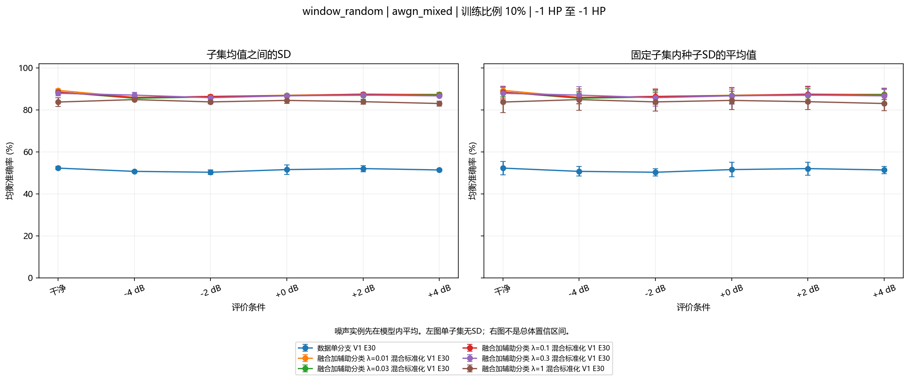
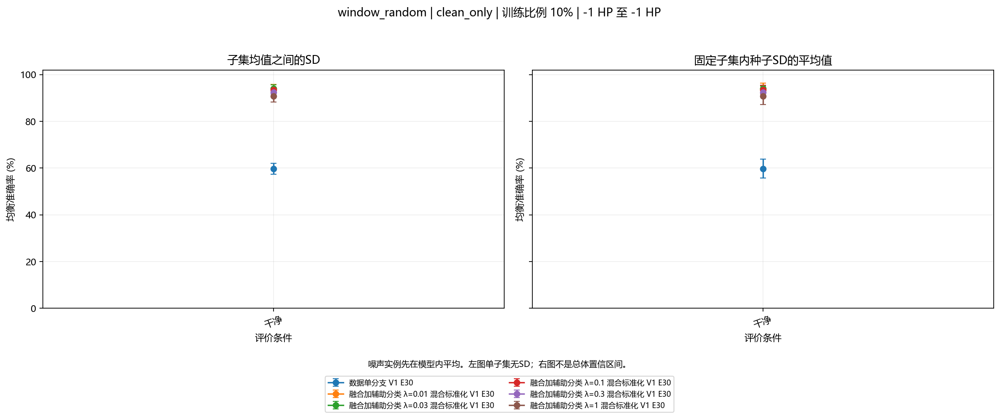
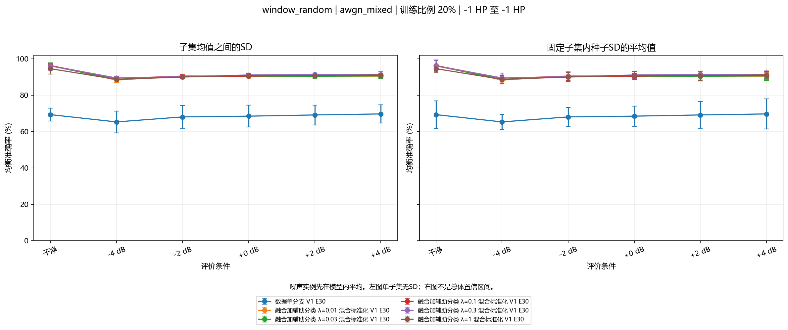
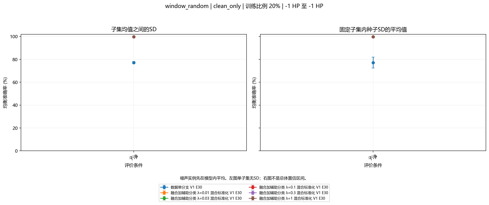
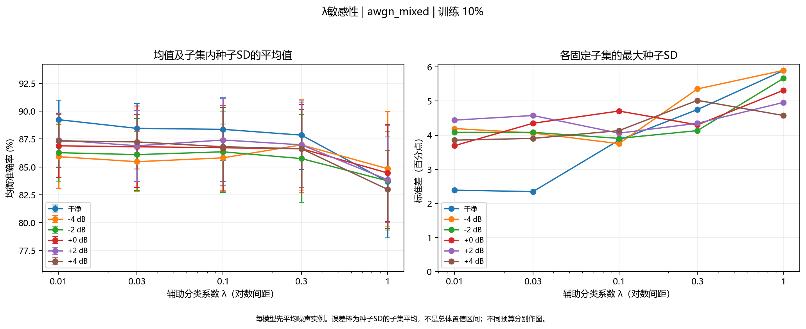
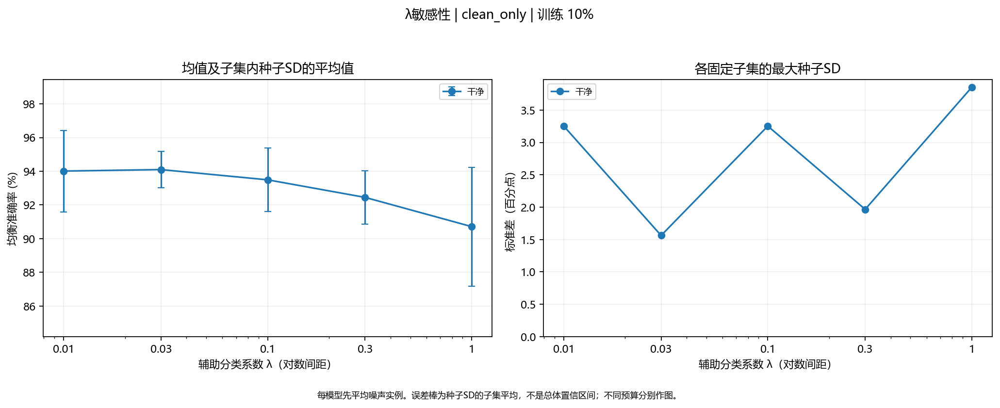
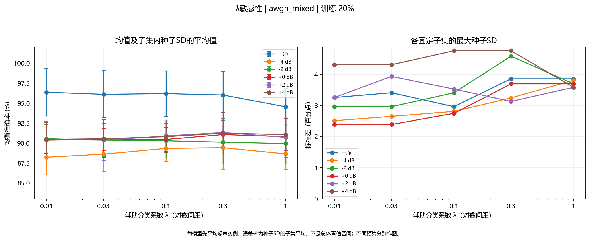
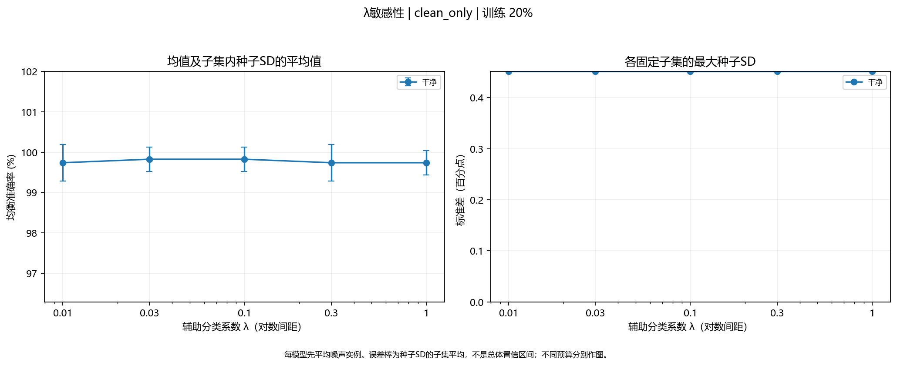

# 阶段验证报告

以下仅为固定验证集结果。完成计算、采用改动、进入下一阶段是不同状态，以阶段决策为准。

## 已锁定的阶段决策

```json
{
  "selected_config_id": "data_aux_ce_a0p1_fitmatched_noise_headshared_fitseed6301_fitrep3_v6201_e30_s100_p20",
  "selected_aux_weight": 0.1,
  "assessments": {
    "data_aux_ce_a0p01_fitmatched_noise_headshared_fitseed6301_fitrep3_v6201_e30_s100_p20": {
      "candidate_id": "data_aux_ce_a0p01_fitmatched_noise_headshared_fitseed6301_fitrep3_v6201_e30_s100_p20",
      "reference_id": "data_aux_ce_a0p1_fitmatched_noise_headshared_fitseed6301_fitrep3_v6201_e30_s100_p20",
      "data_id": "baseline_data_v6201_e30_s100_p20",
      "passed": false,
      "checks": {
        "noisy_gain": false,
        "positive_pairs": false,
        "or_preservation": true,
        "clean_preservation": true,
        "each_budget_preservation": true,
        "data_reference": true
      },
      "noisy_gain_pp": -0.2060883620689658,
      "noisy_balanced_acc": 0.8773766762452107,
      "positive_pair_fraction": 0.4444444444444444,
      "or_gain_pp": -0.2604166666666667,
      "clean_gain_pp": {
        "clean_only": 0.2170138888888889,
        "awgn_mixed": 0.5208333333333333
      },
      "per_budget_gain_pp": {
        "0.1": 0.013170498084291094,
        "0.2": -0.4253472222222227
      },
      "max_seed_sd_pp": 4.194359257027998,
      "max_paired_sd_pp": 3.706561096071801,
      "seed_sd_over_0_5pp": true,
      "paired_sd_over_0_5pp": true,
      "sd_is_hard_gate": false,
      "data_gap_pp": 29.199742576628353,
      "min_data_condition_gap_pp": 28.397090517241374,
      "max_data_paired_sd_pp": 8.724012637667366,
      "data_paired_sd_over_0_5pp": true,
      "data_positive_pair_fraction": 1.0,
      "minimum_seeds_per_subset": 3,
      "paired_model_count": 18,
      "require_gain": true,
      "full_sample_rule": false,
      "decision_data": "fixed validation only; test metrics prohibited",
      "stability_rule": "SD is descriptive, not an acceptance gate or significance test; report paired improvement coverage separately"
    },
    "data_aux_ce_a0p03_fitmatched_noise_headshared_fitseed6301_fitrep3_v6201_e30_s100_p20": {
      "candidate_id": "data_aux_ce_a0p03_fitmatched_noise_headshared_fitseed6301_fitrep3_v6201_e30_s100_p20",
      "reference_id": "data_aux_ce_a0p1_fitmatched_noise_headshared_fitseed6301_fitrep3_v6201_e30_s100_p20",
      "data_id": "baseline_data_v6201_e30_s100_p20",
      "passed": false,
      "checks": {
        "noisy_gain": false,
        "positive_pairs": false,
        "or_preservation": true,
        "clean_preservation": true,
        "each_budget_preservation": true,
        "data_reference": true
      },
      "noisy_gain_pp": -0.31025502873563243,
      "noisy_balanced_acc": 0.876335009578544,
      "positive_pair_fraction": 0.2222222222222222,
      "or_gain_pp": -0.3472222222222222,
      "clean_gain_pp": {
        "clean_only": 0.3038194444444445,
        "awgn_mixed": 0.0
      },
      "per_budget_gain_pp": {
        "0.1": -0.29932950191570906,
        "0.2": -0.3211805555555558
      },
      "max_seed_sd_pp": 4.0830244761687915,
      "max_paired_sd_pp": 1.9719999331894527,
      "seed_sd_over_0_5pp": true,
      "paired_sd_over_0_5pp": true,
      "sd_is_hard_gate": false,
      "data_gap_pp": 29.095575909961692,
      "min_data_condition_gap_pp": 28.09327107279693,
      "max_data_paired_sd_pp": 8.724012637667366,
      "data_paired_sd_over_0_5pp": true,
      "data_positive_pair_fraction": 1.0,
      "minimum_seeds_per_subset": 3,
      "paired_model_count": 18,
      "require_gain": true,
      "full_sample_rule": false,
      "decision_data": "fixed validation only; test metrics prohibited",
      "stability_rule": "SD is descriptive, not an acceptance gate or significance test; report paired improvement coverage separately"
    },
    "data_aux_ce_a0p1_fitmatched_noise_headshared_fitseed6301_fitrep3_v6201_e30_s100_p20": {
      "candidate_id": "data_aux_ce_a0p1_fitmatched_noise_headshared_fitseed6301_fitrep3_v6201_e30_s100_p20",
      "reference_id": "data_aux_ce_a0p1_fitmatched_noise_headshared_fitseed6301_fitrep3_v6201_e30_s100_p20",
      "data_id": "baseline_data_v6201_e30_s100_p20",
      "passed": false,
      "checks": {
        "noisy_gain": false,
        "positive_pairs": false,
        "or_preservation": true,
        "clean_preservation": true,
        "each_budget_preservation": true,
        "data_reference": true
      },
      "noisy_gain_pp": 0.0,
      "noisy_balanced_acc": 0.8794375598659004,
      "positive_pair_fraction": 0.0,
      "or_gain_pp": 0.0,
      "clean_gain_pp": {
        "clean_only": 0.0,
        "awgn_mixed": 0.0
      },
      "per_budget_gain_pp": {
        "0.1": 0.0,
        "0.2": 0.0
      },
      "max_seed_sd_pp": 3.90625,
      "max_paired_sd_pp": 0.0,
      "seed_sd_over_0_5pp": true,
      "paired_sd_over_0_5pp": false,
      "sd_is_hard_gate": false,
      "data_gap_pp": 29.40583093869732,
      "min_data_condition_gap_pp": 28.220785440613028,
      "max_data_paired_sd_pp": 8.599279717524364,
      "data_paired_sd_over_0_5pp": true,
      "data_positive_pair_fraction": 1.0,
      "minimum_seeds_per_subset": 3,
      "paired_model_count": 18,
      "require_gain": true,
      "full_sample_rule": false,
      "decision_data": "fixed validation only; test metrics prohibited",
      "stability_rule": "SD is descriptive, not an acceptance gate or significance test; report paired improvement coverage separately"
    },
    "data_aux_ce_a0p3_fitmatched_noise_headshared_fitseed6301_fitrep3_v6201_e30_s100_p20": {
      "candidate_id": "data_aux_ce_a0p3_fitmatched_noise_headshared_fitseed6301_fitrep3_v6201_e30_s100_p20",
      "reference_id": "data_aux_ce_a0p1_fitmatched_noise_headshared_fitseed6301_fitrep3_v6201_e30_s100_p20",
      "data_id": "baseline_data_v6201_e30_s100_p20",
      "passed": false,
      "checks": {
        "noisy_gain": false,
        "positive_pairs": false,
        "or_preservation": true,
        "clean_preservation": false,
        "each_budget_preservation": true,
        "data_reference": true
      },
      "noisy_gain_pp": 0.11703783524904193,
      "noisy_balanced_acc": 0.8806079382183907,
      "positive_pair_fraction": 0.4444444444444444,
      "or_gain_pp": 0.954861111111111,
      "clean_gain_pp": {
        "clean_only": -0.564236111111111,
        "awgn_mixed": -0.3472222222222222
      },
      "per_budget_gain_pp": {
        "0.1": 0.27747844827586166,
        "0.2": -0.04340277777777778
      },
      "max_seed_sd_pp": 5.357421701858354,
      "max_paired_sd_pp": 3.2979170391087798,
      "seed_sd_over_0_5pp": true,
      "paired_sd_over_0_5pp": true,
      "sd_is_hard_gate": false,
      "data_gap_pp": 29.522868773946364,
      "min_data_condition_gap_pp": 27.656549329501917,
      "max_data_paired_sd_pp": 9.349354186853317,
      "data_paired_sd_over_0_5pp": true,
      "data_positive_pair_fraction": 1.0,
      "minimum_seeds_per_subset": 3,
      "paired_model_count": 18,
      "require_gain": true,
      "full_sample_rule": false,
      "decision_data": "fixed validation only; test metrics prohibited",
      "stability_rule": "SD is descriptive, not an acceptance gate or significance test; report paired improvement coverage separately"
    },
    "data_aux_ce_a1_fitmatched_noise_headshared_fitseed6301_fitrep3_v6201_e30_s100_p20": {
      "candidate_id": "data_aux_ce_a1_fitmatched_noise_headshared_fitseed6301_fitrep3_v6201_e30_s100_p20",
      "reference_id": "data_aux_ce_a0p1_fitmatched_noise_headshared_fitseed6301_fitrep3_v6201_e30_s100_p20",
      "data_id": "baseline_data_v6201_e30_s100_p20",
      "passed": false,
      "checks": {
        "noisy_gain": false,
        "positive_pairs": false,
        "or_preservation": true,
        "clean_preservation": false,
        "each_budget_preservation": false,
        "data_reference": true
      },
      "noisy_gain_pp": -1.1545138888888886,
      "noisy_balanced_acc": 0.8678924209770116,
      "positive_pair_fraction": 0.3333333333333333,
      "or_gain_pp": 3.385416666666667,
      "clean_gain_pp": {
        "clean_only": -1.4322916666666665,
        "awgn_mixed": -3.1684027777777777
      },
      "per_budget_gain_pp": {
        "0.1": -1.788194444444444,
        "0.2": -0.5208333333333333
      },
      "max_seed_sd_pp": 5.903248307429698,
      "max_paired_sd_pp": 4.878904686248749,
      "seed_sd_over_0_5pp": true,
      "paired_sd_over_0_5pp": true,
      "sd_is_hard_gate": false,
      "data_gap_pp": 28.251317049808435,
      "min_data_condition_gap_pp": 26.53855363984674,
      "max_data_paired_sd_pp": 7.821273685208363,
      "data_paired_sd_over_0_5pp": true,
      "data_positive_pair_fraction": 1.0,
      "minimum_seeds_per_subset": 3,
      "paired_model_count": 18,
      "require_gain": true,
      "full_sample_rule": false,
      "decision_data": "fixed validation only; test metrics prohibited",
      "stability_rule": "SD is descriptive, not an acceptance gate or significance test; report paired improvement coverage separately"
    }
  },
  "adopted": false,
  "passed": false,
  "reference_retained": true,
  "sd_is_hard_gate": false,
  "eligible_config_ids": [],
  "reason": "没有新系数通过全部验证规则，保留0.1，失败结果全部保留；下一阶段以原配置为参照。",
  "decision_data": "fixed validation only; no test metrics",
  "tie_break": "maximum noisy validation BA, then nearest to 0.1, then smaller lambda"
}
```

## 验证指标

均值先在每模型内平均噪声实例，再在固定子集内平均训练种子，最后对子集等权平均。表中数值为百分数或百分点。子集间SD与种子SD分别报告，不能合并成独立数据集重复。一个子集的子集间SD为NaN；少于三个训练种子的分组明确标记为不足。

| config_id                                                                            | variant       | domain        |   ratio | protocol   |   source_load_hp |   target_load_hp | condition   |   balanced_acc_mean |   subset_mean_sd |   mean_within_subset_seed_sd |   max_within_subset_seed_sd |   subset_count |   min_seed_count |   acc_mean |   recall_OR_mean |   recall_B_mean |
|:-------------------------------------------------------------------------------------|:--------------|:--------------|--------:|:-----------|-----------------:|-----------------:|:------------|--------------------:|-----------------:|-----------------------------:|----------------------------:|---------------:|-----------------:|-----------:|-----------------:|----------------:|
| baseline_data_v6201_e30_s100_p20                                                     | baseline_data | window_random |     0.1 | awgn_mixed |               -1 |               -1 | clean       |              52.212 |            0.716 |                        3.183 |                       5.242 |              3 |                3 |     42.611 |           69.792 |           7.639 |
| baseline_data_v6201_e30_s100_p20                                                     | baseline_data | window_random |     0.1 | awgn_mixed |               -1 |               -1 | white_+0    |              51.513 |            2.251 |                        3.408 |                       5.315 |              3 |                3 |     42.611 |           76.736 |           6.597 |
| baseline_data_v6201_e30_s100_p20                                                     | baseline_data | window_random |     0.1 | awgn_mixed |               -1 |               -1 | white_+2    |              51.991 |            1.446 |                        3.079 |                       5.707 |              3 |                3 |     42.718 |           75.347 |           7.292 |
| baseline_data_v6201_e30_s100_p20                                                     | baseline_data | window_random |     0.1 | awgn_mixed |               -1 |               -1 | white_+4    |              51.332 |            0.539 |                        1.715 |                       2.255 |              3 |                3 |     41.64  |           71.528 |           6.597 |
| baseline_data_v6201_e30_s100_p20                                                     | baseline_data | window_random |     0.1 | awgn_mixed |               -1 |               -1 | white_-2    |              50.243 |            1.085 |                        1.741 |                       2.706 |              3 |                3 |     41.855 |           77.083 |           8.333 |
| baseline_data_v6201_e30_s100_p20                                                     | baseline_data | window_random |     0.1 | awgn_mixed |               -1 |               -1 | white_-4    |              50.66  |            0.547 |                        2.273 |                       4.511 |              3 |                3 |     42.611 |           77.431 |          10.764 |
| baseline_data_v6201_e30_s100_p20                                                     | baseline_data | window_random |     0.1 | clean_only |               -1 |               -1 | clean       |              59.71  |            2.34  |                        4.055 |                       7.574 |              3 |                3 |     50.701 |           55.208 |          10.069 |
| baseline_data_v6201_e30_s100_p20                                                     | baseline_data | window_random |     0.2 | awgn_mixed |               -1 |               -1 | clean       |              69.256 |            3.486 |                        7.651 |                      12.609 |              3 |                3 |     62.352 |           57.986 |          38.194 |
| baseline_data_v6201_e30_s100_p20                                                     | baseline_data | window_random |     0.2 | awgn_mixed |               -1 |               -1 | white_+0    |              68.418 |            5.997 |                        5.526 |                       6.93  |              3 |                3 |     61.489 |           67.361 |          31.597 |
| baseline_data_v6201_e30_s100_p20                                                     | baseline_data | window_random |     0.2 | awgn_mixed |               -1 |               -1 | white_+2    |              69.079 |            5.437 |                        7.326 |                      10.719 |              3 |                3 |     62.244 |           66.319 |          32.986 |
| baseline_data_v6201_e30_s100_p20                                                     | baseline_data | window_random |     0.2 | awgn_mixed |               -1 |               -1 | white_+4    |              69.636 |            4.924 |                        8.279 |                      12.73  |              3 |                3 |     62.891 |           63.889 |          36.111 |
| baseline_data_v6201_e30_s100_p20                                                     | baseline_data | window_random |     0.2 | awgn_mixed |               -1 |               -1 | white_-2    |              67.999 |            6.297 |                        5.182 |                       6.499 |              3 |                3 |     61.273 |           69.444 |          31.25  |
| baseline_data_v6201_e30_s100_p20                                                     | baseline_data | window_random |     0.2 | awgn_mixed |               -1 |               -1 | white_-4    |              65.25  |            6.022 |                        4.166 |                       4.712 |              3 |                3 |     58.576 |           70.139 |          30.208 |
| baseline_data_v6201_e30_s100_p20                                                     | baseline_data | window_random |     0.2 | clean_only |               -1 |               -1 | clean       |              77.164 |            0.985 |                        4.782 |                       7.324 |              3 |                3 |     71.845 |           55.208 |          61.111 |
| data_aux_ce_a0p01_fitmatched_noise_headshared_fitseed6301_fitrep3_v6201_e30_s100_p20 | data_aux_ce   | window_random |     0.1 | awgn_mixed |               -1 |               -1 | clean       |              89.236 |            0.752 |                        1.735 |                       2.387 |              3 |                3 |     86.624 |           81.597 |          75.347 |
| data_aux_ce_a0p01_fitmatched_noise_headshared_fitseed6301_fitrep3_v6201_e30_s100_p20 | data_aux_ce   | window_random |     0.1 | awgn_mixed |               -1 |               -1 | white_+0    |              86.892 |            0.601 |                        2.859 |                       3.692 |              3 |                3 |     83.711 |           72.222 |          75.347 |
| data_aux_ce_a0p01_fitmatched_noise_headshared_fitseed6301_fitrep3_v6201_e30_s100_p20 | data_aux_ce   | window_random |     0.1 | awgn_mixed |               -1 |               -1 | white_+2    |              87.413 |            0.837 |                        2.421 |                       4.442 |              3 |                3 |     84.358 |           74.306 |          75.347 |
| data_aux_ce_a0p01_fitmatched_noise_headshared_fitseed6301_fitrep3_v6201_e30_s100_p20 | data_aux_ce   | window_random |     0.1 | awgn_mixed |               -1 |               -1 | white_+4    |              87.326 |            0.986 |                        2.381 |                       3.854 |              3 |                3 |     84.25  |           77.431 |          71.875 |
| data_aux_ce_a0p01_fitmatched_noise_headshared_fitseed6301_fitrep3_v6201_e30_s100_p20 | data_aux_ce   | window_random |     0.1 | awgn_mixed |               -1 |               -1 | white_-2    |              86.276 |            0.843 |                        2.564 |                       4.083 |              3 |                3 |     82.956 |           69.097 |          76.389 |
| data_aux_ce_a0p01_fitmatched_noise_headshared_fitseed6301_fitrep3_v6201_e30_s100_p20 | data_aux_ce   | window_random |     0.1 | awgn_mixed |               -1 |               -1 | white_-4    |              85.918 |            0.628 |                        2.857 |                       4.194 |              3 |                3 |     83.279 |           69.097 |          80.208 |
| data_aux_ce_a0p01_fitmatched_noise_headshared_fitseed6301_fitrep3_v6201_e30_s100_p20 | data_aux_ce   | window_random |     0.1 | clean_only |               -1 |               -1 | clean       |              94.01  |            1.878 |                        2.421 |                       3.253 |              3 |                3 |     92.557 |           87.153 |          88.889 |
| data_aux_ce_a0p01_fitmatched_noise_headshared_fitseed6301_fitrep3_v6201_e30_s100_p20 | data_aux_ce   | window_random |     0.2 | awgn_mixed |               -1 |               -1 | clean       |              96.354 |            1.302 |                        2.972 |                       3.253 |              3 |                3 |     95.469 |           86.111 |          99.306 |
| data_aux_ce_a0p01_fitmatched_noise_headshared_fitseed6301_fitrep3_v6201_e30_s100_p20 | data_aux_ce   | window_random |     0.2 | awgn_mixed |               -1 |               -1 | white_+0    |              90.365 |            0.26  |                        1.644 |                       2.387 |              3 |                3 |     88.026 |           76.042 |          85.417 |
| data_aux_ce_a0p01_fitmatched_noise_headshared_fitseed6301_fitrep3_v6201_e30_s100_p20 | data_aux_ce   | window_random |     0.2 | awgn_mixed |               -1 |               -1 | white_+2    |              90.451 |            0.986 |                        2.234 |                       3.253 |              3 |                3 |     88.134 |           78.819 |          82.986 |
| data_aux_ce_a0p01_fitmatched_noise_headshared_fitseed6301_fitrep3_v6201_e30_s100_p20 | data_aux_ce   | window_random |     0.2 | awgn_mixed |               -1 |               -1 | white_+4    |              90.451 |            1.434 |                        2.092 |                       4.303 |              3 |                3 |     88.134 |           81.597 |          80.208 |
| data_aux_ce_a0p01_fitmatched_noise_headshared_fitseed6301_fitrep3_v6201_e30_s100_p20 | data_aux_ce   | window_random |     0.2 | awgn_mixed |               -1 |               -1 | white_-2    |              90.538 |            0.837 |                        1.792 |                       2.958 |              3 |                3 |     88.242 |           74.306 |          87.847 |
| data_aux_ce_a0p01_fitmatched_noise_headshared_fitseed6301_fitrep3_v6201_e30_s100_p20 | data_aux_ce   | window_random |     0.2 | awgn_mixed |               -1 |               -1 | white_-4    |              88.218 |            1.319 |                        2.2   |                       2.507 |              3 |                3 |     86.624 |           71.528 |          89.583 |
| data_aux_ce_a0p01_fitmatched_noise_headshared_fitseed6301_fitrep3_v6201_e30_s100_p20 | data_aux_ce   | window_random |     0.2 | clean_only |               -1 |               -1 | clean       |              99.74  |            0     |                        0.451 |                       0.451 |              3 |                3 |     99.676 |           98.958 |         100     |
| data_aux_ce_a0p03_fitmatched_noise_headshared_fitseed6301_fitrep3_v6201_e30_s100_p20 | data_aux_ce   | window_random |     0.1 | awgn_mixed |               -1 |               -1 | clean       |              88.455 |            0.542 |                        2.222 |                       2.344 |              3 |                3 |     85.653 |           80.556 |          73.264 |
| data_aux_ce_a0p03_fitmatched_noise_headshared_fitseed6301_fitrep3_v6201_e30_s100_p20 | data_aux_ce   | window_random |     0.1 | awgn_mixed |               -1 |               -1 | white_+0    |              86.806 |            0.398 |                        3.639 |                       4.35  |              3 |                3 |     83.603 |           72.917 |          74.306 |
| data_aux_ce_a0p03_fitmatched_noise_headshared_fitseed6301_fitrep3_v6201_e30_s100_p20 | data_aux_ce   | window_random |     0.1 | awgn_mixed |               -1 |               -1 | white_+2    |              86.892 |            0.601 |                        3.192 |                       4.578 |              3 |                3 |     83.711 |           75.694 |          71.875 |
| data_aux_ce_a0p03_fitmatched_noise_headshared_fitseed6301_fitrep3_v6201_e30_s100_p20 | data_aux_ce   | window_random |     0.1 | awgn_mixed |               -1 |               -1 | white_+4    |              87.24  |            0.902 |                        2.442 |                       3.906 |              3 |                3 |     84.142 |           78.819 |          70.139 |
| data_aux_ce_a0p03_fitmatched_noise_headshared_fitseed6301_fitrep3_v6201_e30_s100_p20 | data_aux_ce   | window_random |     0.1 | awgn_mixed |               -1 |               -1 | white_-2    |              86.102 |            0.309 |                        3.224 |                       4.083 |              3 |                3 |     82.74  |           69.792 |          75     |
| data_aux_ce_a0p03_fitmatched_noise_headshared_fitseed6301_fitrep3_v6201_e30_s100_p20 | data_aux_ce   | window_random |     0.1 | awgn_mixed |               -1 |               -1 | white_-4    |              85.467 |            0.933 |                        2.704 |                       4.064 |              3 |                3 |     82.956 |           69.097 |          79.514 |
| data_aux_ce_a0p03_fitmatched_noise_headshared_fitseed6301_fitrep3_v6201_e30_s100_p20 | data_aux_ce   | window_random |     0.1 | clean_only |               -1 |               -1 | clean       |              94.097 |            1.591 |                        1.069 |                       1.562 |              3 |                3 |     92.665 |           86.806 |          89.583 |
| data_aux_ce_a0p03_fitmatched_noise_headshared_fitseed6301_fitrep3_v6201_e30_s100_p20 | data_aux_ce   | window_random |     0.2 | awgn_mixed |               -1 |               -1 | clean       |              96.094 |            1.562 |                        2.939 |                       3.405 |              3 |                3 |     95.146 |           84.722 |          99.653 |
| data_aux_ce_a0p03_fitmatched_noise_headshared_fitseed6301_fitrep3_v6201_e30_s100_p20 | data_aux_ce   | window_random |     0.2 | awgn_mixed |               -1 |               -1 | white_+0    |              90.451 |            0.915 |                        1.397 |                       2.387 |              3 |                3 |     88.134 |           76.736 |          85.069 |
| data_aux_ce_a0p03_fitmatched_noise_headshared_fitseed6301_fitrep3_v6201_e30_s100_p20 | data_aux_ce   | window_random |     0.2 | awgn_mixed |               -1 |               -1 | white_+2    |              90.365 |            1.135 |                        2.542 |                       3.932 |              3 |                3 |     88.026 |           78.819 |          82.639 |
| data_aux_ce_a0p03_fitmatched_noise_headshared_fitseed6301_fitrep3_v6201_e30_s100_p20 | data_aux_ce   | window_random |     0.2 | awgn_mixed |               -1 |               -1 | white_+4    |              90.538 |            1.311 |                        2.374 |                       4.303 |              3 |                3 |     88.242 |           80.903 |          81.25  |
| data_aux_ce_a0p03_fitmatched_noise_headshared_fitseed6301_fitrep3_v6201_e30_s100_p20 | data_aux_ce   | window_random |     0.2 | awgn_mixed |               -1 |               -1 | white_-2    |              90.365 |            0.781 |                        2.082 |                       2.958 |              3 |                3 |     88.026 |           73.611 |          87.847 |
| data_aux_ce_a0p03_fitmatched_noise_headshared_fitseed6301_fitrep3_v6201_e30_s100_p20 | data_aux_ce   | window_random |     0.2 | awgn_mixed |               -1 |               -1 | white_-4    |              88.6   |            0.517 |                        2.138 |                       2.647 |              3 |                3 |     86.624 |           71.181 |          89.236 |
| data_aux_ce_a0p03_fitmatched_noise_headshared_fitseed6301_fitrep3_v6201_e30_s100_p20 | data_aux_ce   | window_random |     0.2 | clean_only |               -1 |               -1 | clean       |              99.826 |            0.15  |                        0.301 |                       0.451 |              3 |                3 |     99.784 |           99.306 |         100     |
| data_aux_ce_a0p1_fitmatched_noise_headshared_fitseed6301_fitrep3_v6201_e30_s100_p20  | data_aux_ce   | window_random |     0.1 | awgn_mixed |               -1 |               -1 | clean       |              88.368 |            0.542 |                        2.832 |                       3.854 |              3 |                3 |     85.545 |           81.25  |          72.222 |
| data_aux_ce_a0p1_fitmatched_noise_headshared_fitseed6301_fitrep3_v6201_e30_s100_p20  | data_aux_ce   | window_random |     0.1 | awgn_mixed |               -1 |               -1 | white_+0    |              86.719 |            0.689 |                        3.816 |                       4.709 |              3 |                3 |     83.495 |           72.569 |          74.306 |
| data_aux_ce_a0p1_fitmatched_noise_headshared_fitseed6301_fitrep3_v6201_e30_s100_p20  | data_aux_ce   | window_random |     0.1 | awgn_mixed |               -1 |               -1 | white_+2    |              87.413 |            0.15  |                        3.721 |                       4.059 |              3 |                3 |     84.358 |           76.042 |          73.611 |
| data_aux_ce_a0p1_fitmatched_noise_headshared_fitseed6301_fitrep3_v6201_e30_s100_p20  | data_aux_ce   | window_random |     0.1 | awgn_mixed |               -1 |               -1 | white_+4    |              86.806 |            0.752 |                        3.515 |                       4.134 |              3 |                3 |     83.603 |           77.083 |          70.139 |
| data_aux_ce_a0p1_fitmatched_noise_headshared_fitseed6301_fitrep3_v6201_e30_s100_p20  | data_aux_ce   | window_random |     0.1 | awgn_mixed |               -1 |               -1 | white_-2    |              86.354 |            0.531 |                        3.653 |                       3.906 |              3 |                3 |     83.064 |           70.486 |          75.694 |
| data_aux_ce_a0p1_fitmatched_noise_headshared_fitseed6301_fitrep3_v6201_e30_s100_p20  | data_aux_ce   | window_random |     0.1 | awgn_mixed |               -1 |               -1 | white_-4    |              85.814 |            0.784 |                        3.024 |                       3.751 |              3 |                3 |     83.387 |           69.097 |          80.903 |
| data_aux_ce_a0p1_fitmatched_noise_headshared_fitseed6301_fitrep3_v6201_e30_s100_p20  | data_aux_ce   | window_random |     0.1 | clean_only |               -1 |               -1 | clean       |              93.49  |            0.781 |                        1.88  |                       3.253 |              3 |                3 |     91.909 |           88.194 |          85.764 |
| data_aux_ce_a0p1_fitmatched_noise_headshared_fitseed6301_fitrep3_v6201_e30_s100_p20  | data_aux_ce   | window_random |     0.2 | awgn_mixed |               -1 |               -1 | clean       |              96.181 |            1.434 |                        2.827 |                       2.958 |              3 |                3 |     95.254 |           85.069 |          99.653 |
| data_aux_ce_a0p1_fitmatched_noise_headshared_fitseed6301_fitrep3_v6201_e30_s100_p20  | data_aux_ce   | window_random |     0.2 | awgn_mixed |               -1 |               -1 | white_+0    |              90.451 |            0.601 |                        1.516 |                       2.744 |              3 |                3 |     88.134 |           75.694 |          86.111 |
| data_aux_ce_a0p1_fitmatched_noise_headshared_fitseed6301_fitrep3_v6201_e30_s100_p20  | data_aux_ce   | window_random |     0.2 | awgn_mixed |               -1 |               -1 | white_+2    |              90.885 |            0.939 |                        1.996 |                       3.523 |              3 |                3 |     88.673 |           78.125 |          85.417 |
| data_aux_ce_a0p1_fitmatched_noise_headshared_fitseed6301_fitrep3_v6201_e30_s100_p20  | data_aux_ce   | window_random |     0.2 | awgn_mixed |               -1 |               -1 | white_+4    |              90.799 |            1.052 |                        1.982 |                       4.752 |              3 |                3 |     88.565 |           82.292 |          80.903 |
| data_aux_ce_a0p1_fitmatched_noise_headshared_fitseed6301_fitrep3_v6201_e30_s100_p20  | data_aux_ce   | window_random |     0.2 | awgn_mixed |               -1 |               -1 | white_-2    |              90.278 |            1.052 |                        2.188 |                       3.405 |              3 |                3 |     87.918 |           73.611 |          87.5   |
| data_aux_ce_a0p1_fitmatched_noise_headshared_fitseed6301_fitrep3_v6201_e30_s100_p20  | data_aux_ce   | window_random |     0.2 | awgn_mixed |               -1 |               -1 | white_-4    |              89.33  |            1.162 |                        1.629 |                       2.806 |              3 |                3 |     87.055 |           71.875 |          89.236 |
| data_aux_ce_a0p1_fitmatched_noise_headshared_fitseed6301_fitrep3_v6201_e30_s100_p20  | data_aux_ce   | window_random |     0.2 | clean_only |               -1 |               -1 | clean       |              99.826 |            0.15  |                        0.301 |                       0.451 |              3 |                3 |     99.784 |           99.306 |         100     |
| data_aux_ce_a0p3_fitmatched_noise_headshared_fitseed6301_fitrep3_v6201_e30_s100_p20  | data_aux_ce   | window_random |     0.1 | awgn_mixed |               -1 |               -1 | clean       |              87.847 |            1.174 |                        3.075 |                       4.752 |              3 |                3 |     84.898 |           82.292 |          69.097 |
| data_aux_ce_a0p3_fitmatched_noise_headshared_fitseed6301_fitrep3_v6201_e30_s100_p20  | data_aux_ce   | window_random |     0.1 | awgn_mixed |               -1 |               -1 | white_+0    |              86.632 |            0.301 |                        3.953 |                       4.303 |              3 |                3 |     83.387 |           75.694 |          70.833 |
| data_aux_ce_a0p3_fitmatched_noise_headshared_fitseed6301_fitrep3_v6201_e30_s100_p20  | data_aux_ce   | window_random |     0.1 | awgn_mixed |               -1 |               -1 | white_+2    |              86.979 |            0.939 |                        3.839 |                       4.35  |              3 |                3 |     83.819 |           78.472 |          69.444 |
| data_aux_ce_a0p3_fitmatched_noise_headshared_fitseed6301_fitrep3_v6201_e30_s100_p20  | data_aux_ce   | window_random |     0.1 | awgn_mixed |               -1 |               -1 | white_+4    |              86.632 |            0.542 |                        3.501 |                       5.023 |              3 |                3 |     83.387 |           79.861 |          66.667 |
| data_aux_ce_a0p3_fitmatched_noise_headshared_fitseed6301_fitrep3_v6201_e30_s100_p20  | data_aux_ce   | window_random |     0.1 | awgn_mixed |               -1 |               -1 | white_-2    |              85.746 |            0.309 |                        3.931 |                       4.134 |              3 |                3 |     82.309 |           70.833 |          72.917 |
| data_aux_ce_a0p3_fitmatched_noise_headshared_fitseed6301_fitrep3_v6201_e30_s100_p20  | data_aux_ce   | window_random |     0.1 | awgn_mixed |               -1 |               -1 | white_-4    |              86.977 |            1.296 |                        4.045 |                       5.357 |              3 |                3 |     84.142 |           69.097 |          82.986 |
| data_aux_ce_a0p3_fitmatched_noise_headshared_fitseed6301_fitrep3_v6201_e30_s100_p20  | data_aux_ce   | window_random |     0.1 | clean_only |               -1 |               -1 | clean       |              92.448 |            0.689 |                        1.574 |                       1.966 |              3 |                3 |     90.615 |           88.542 |          81.25  |
| data_aux_ce_a0p3_fitmatched_noise_headshared_fitseed6301_fitrep3_v6201_e30_s100_p20  | data_aux_ce   | window_random |     0.2 | awgn_mixed |               -1 |               -1 | clean       |              96.007 |            1.231 |                        2.917 |                       3.854 |              3 |                3 |     95.038 |           85.069 |          98.958 |
| data_aux_ce_a0p3_fitmatched_noise_headshared_fitseed6301_fitrep3_v6201_e30_s100_p20  | data_aux_ce   | window_random |     0.2 | awgn_mixed |               -1 |               -1 | white_+0    |              91.059 |            0.655 |                        1.929 |                       3.692 |              3 |                3 |     88.889 |           77.431 |          86.806 |
| data_aux_ce_a0p3_fitmatched_noise_headshared_fitseed6301_fitrep3_v6201_e30_s100_p20  | data_aux_ce   | window_random |     0.2 | awgn_mixed |               -1 |               -1 | white_+2    |              91.319 |            0.398 |                        1.74  |                       3.125 |              3 |                3 |     89.213 |           79.861 |          85.417 |
| data_aux_ce_a0p3_fitmatched_noise_headshared_fitseed6301_fitrep3_v6201_e30_s100_p20  | data_aux_ce   | window_random |     0.2 | awgn_mixed |               -1 |               -1 | white_+4    |              91.233 |            0.837 |                        2.577 |                       4.752 |              3 |                3 |     89.105 |           81.944 |          82.986 |
| data_aux_ce_a0p3_fitmatched_noise_headshared_fitseed6301_fitrep3_v6201_e30_s100_p20  | data_aux_ce   | window_random |     0.2 | awgn_mixed |               -1 |               -1 | white_-2    |              90.104 |            0.689 |                        2.705 |                       4.578 |              3 |                3 |     87.702 |           74.653 |          85.764 |
| data_aux_ce_a0p3_fitmatched_noise_headshared_fitseed6301_fitrep3_v6201_e30_s100_p20  | data_aux_ce   | window_random |     0.2 | awgn_mixed |               -1 |               -1 | white_-4    |              89.416 |            0.912 |                        2.709 |                       3.24  |              3 |                3 |     87.163 |           74.306 |          87.153 |
| data_aux_ce_a0p3_fitmatched_noise_headshared_fitseed6301_fitrep3_v6201_e30_s100_p20  | data_aux_ce   | window_random |     0.2 | clean_only |               -1 |               -1 | clean       |              99.74  |            0     |                        0.451 |                       0.451 |              3 |                3 |     99.676 |           98.958 |         100     |
| data_aux_ce_a1_fitmatched_noise_headshared_fitseed6301_fitrep3_v6201_e30_s100_p20    | data_aux_ce   | window_random |     0.1 | awgn_mixed |               -1 |               -1 | clean       |              83.681 |            2.121 |                        5.054 |                       5.898 |              3 |                3 |     79.72  |           84.028 |          50.694 |
| data_aux_ce_a1_fitmatched_noise_headshared_fitseed6301_fitrep3_v6201_e30_s100_p20    | data_aux_ce   | window_random |     0.1 | awgn_mixed |               -1 |               -1 | white_+0    |              84.462 |            1.434 |                        4.358 |                       5.318 |              3 |                3 |     80.69  |           77.778 |          60.069 |
| data_aux_ce_a1_fitmatched_noise_headshared_fitseed6301_fitrep3_v6201_e30_s100_p20    | data_aux_ce   | window_random |     0.1 | awgn_mixed |               -1 |               -1 | white_+2    |              83.854 |            1.135 |                        3.841 |                       4.962 |              3 |                3 |     79.935 |           81.944 |          53.472 |
| data_aux_ce_a1_fitmatched_noise_headshared_fitseed6301_fitrep3_v6201_e30_s100_p20    | data_aux_ce   | window_random |     0.1 | awgn_mixed |               -1 |               -1 | white_+4    |              82.986 |            1.203 |                        3.517 |                       4.578 |              3 |                3 |     78.857 |           82.639 |          49.306 |
| data_aux_ce_a1_fitmatched_noise_headshared_fitseed6301_fitrep3_v6201_e30_s100_p20    | data_aux_ce   | window_random |     0.1 | awgn_mixed |               -1 |               -1 | white_-2    |              83.749 |            0.916 |                        4.407 |                       5.667 |              3 |                3 |     79.827 |           75     |          60.764 |
| data_aux_ce_a1_fitmatched_noise_headshared_fitseed6301_fitrep3_v6201_e30_s100_p20    | data_aux_ce   | window_random |     0.1 | awgn_mixed |               -1 |               -1 | white_-4    |              84.842 |            0.452 |                        5.142 |                       5.903 |              3 |                3 |     81.23  |           73.611 |          68.056 |
| data_aux_ce_a1_fitmatched_noise_headshared_fitseed6301_fitrep3_v6201_e30_s100_p20    | data_aux_ce   | window_random |     0.1 | clean_only |               -1 |               -1 | clean       |              90.712 |            2.502 |                        3.529 |                       3.854 |              3 |                3 |     88.457 |           88.194 |          74.653 |
| data_aux_ce_a1_fitmatched_noise_headshared_fitseed6301_fitrep3_v6201_e30_s100_p20    | data_aux_ce   | window_random |     0.2 | awgn_mixed |               -1 |               -1 | clean       |              94.531 |            2.9   |                        2.278 |                       3.854 |              3 |                3 |     93.204 |           79.861 |          98.264 |
| data_aux_ce_a1_fitmatched_noise_headshared_fitseed6301_fitrep3_v6201_e30_s100_p20    | data_aux_ce   | window_random |     0.2 | awgn_mixed |               -1 |               -1 | white_+0    |              90.799 |            1.285 |                        2.224 |                       3.692 |              3 |                3 |     88.565 |           76.042 |          87.153 |
| data_aux_ce_a1_fitmatched_noise_headshared_fitseed6301_fitrep3_v6201_e30_s100_p20    | data_aux_ce   | window_random |     0.2 | awgn_mixed |               -1 |               -1 | white_+2    |              90.712 |            1.434 |                        2.53  |                       3.58  |              3 |                3 |     88.457 |           75.694 |          87.153 |
| data_aux_ce_a1_fitmatched_noise_headshared_fitseed6301_fitrep3_v6201_e30_s100_p20    | data_aux_ce   | window_random |     0.2 | awgn_mixed |               -1 |               -1 | white_+4    |              91.059 |            1.773 |                        1.989 |                       3.58  |              3 |                3 |     88.889 |           77.431 |          86.806 |
| data_aux_ce_a1_fitmatched_noise_headshared_fitseed6301_fitrep3_v6201_e30_s100_p20    | data_aux_ce   | window_random |     0.2 | awgn_mixed |               -1 |               -1 | white_-2    |              89.931 |            0.655 |                        2.43  |                       3.692 |              3 |                3 |     87.487 |           74.653 |          85.069 |
| data_aux_ce_a1_fitmatched_noise_headshared_fitseed6301_fitrep3_v6201_e30_s100_p20    | data_aux_ce   | window_random |     0.2 | awgn_mixed |               -1 |               -1 | white_-4    |              88.635 |            0.134 |                        1.976 |                       3.807 |              3 |                3 |     86.192 |           75.347 |          82.986 |
| data_aux_ce_a1_fitmatched_noise_headshared_fitseed6301_fitrep3_v6201_e30_s100_p20    | data_aux_ce   | window_random |     0.2 | clean_only |               -1 |               -1 | clean       |              99.74  |            0.26  |                        0.301 |                       0.451 |              3 |                3 |     99.676 |           98.958 |         100     |

固定验证集被反复用于选择配置，结果属于探索性分析。2026-10-21用户已取消SD不超过0.5个百分点的硬门槛。表中的seed_sd_over_0_5pp仅为描述性波动警示，不参与采用、停止或扩展判定，也不是显著性检验。















