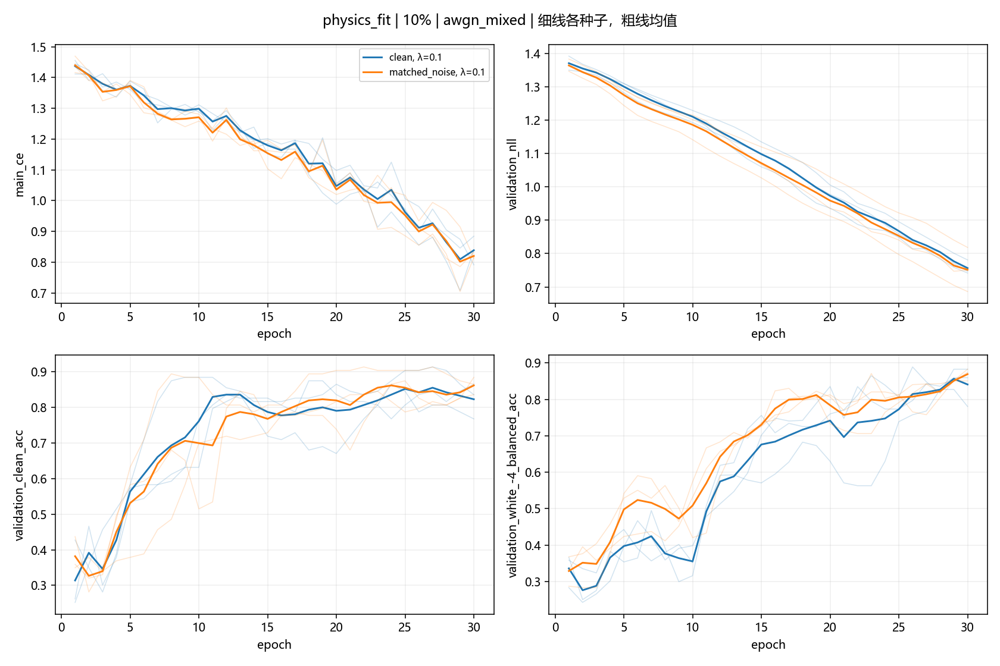
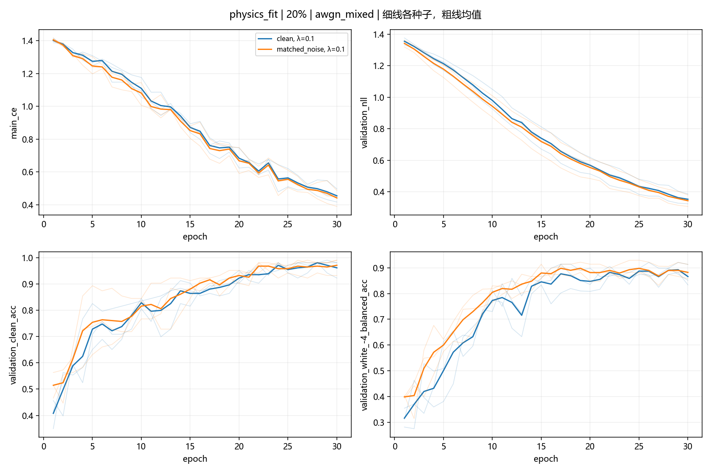

# 30轮探索验证报告

{
  "adopted": true,
  "selected_physics_fit": "matched_noise",
  "checks": {
    "mean_gain": true,
    "positive_pairs": true,
    "clean_preservation": true,
    "or_preservation": true,
    "each_budget_preservation": true
  },
  "noisy_ba_gain_pp": 2.017780172413794,
  "clean_ba_gain_pp": 1.8229166666666667,
  "or_gain_pp": 0.78125,
  "positive_pair_fraction": 0.8333333333333334,
  "sd_is_hard_gate": false,
  "decision_data": "fixed validation only",
  "scope": "one fixed subset, three seeds, 30 epochs; provisional screening"
}

仅固定验证集，未测试。每配置三训练种子、一个固定子集。表内准确率为0至1比例。
|   ratio | protocol   | physics_fit   |   aux_weight | condition   |   acc_mean |   acc_std |   balanced_acc_mean |   balanced_acc_std |   recall_OR_mean |   recall_OR_std |   validation_nll_mean |   validation_nll_std |
|--------:|:-----------|:--------------|-------------:|:------------|-----------:|----------:|--------------------:|-------------------:|-----------------:|----------------:|----------------------:|---------------------:|
|     0.1 | awgn_mixed | clean         |          0.1 | clean       |   0.822006 |  0.049821 |            0.856771 |           0.040091 |         0.729167 |        0.100455 |              0.718579 |             0.029583 |
|     0.1 | awgn_mixed | clean         |          0.1 | white_+0    |   0.789644 |  0.058521 |            0.830729 |           0.047092 |         0.729167 |        0.109746 |              0.781639 |             0.018532 |
|     0.1 | awgn_mixed | clean         |          0.1 | white_+2    |   0.79288  |  0.053472 |            0.833333 |           0.043028 |         0.75     |        0.112673 |              0.765253 |             0.019023 |
|     0.1 | awgn_mixed | clean         |          0.1 | white_+4    |   0.799353 |  0.047892 |            0.838542 |           0.038538 |         0.739583 |        0.118311 |              0.756775 |             0.019134 |
|     0.1 | awgn_mixed | clean         |          0.1 | white_-2    |   0.783172 |  0.053472 |            0.825521 |           0.043028 |         0.708333 |        0.065052 |              0.816857 |             0.020629 |
|     0.1 | awgn_mixed | clean         |          0.1 | white_-4    |   0.802589 |  0.066086 |            0.840876 |           0.053634 |         0.666667 |        0.065052 |              0.852736 |             0.022205 |
|     0.1 | awgn_mixed | matched_noise |          0.1 | clean       |   0.857605 |  0.029661 |            0.885417 |           0.023868 |         0.760417 |        0.078644 |              0.718099 |             0.07663  |
|     0.1 | awgn_mixed | matched_noise |          0.1 | white_+0    |   0.828479 |  0.039237 |            0.861979 |           0.031574 |         0.71875  |        0.08268  |              0.771755 |             0.060873 |
|     0.1 | awgn_mixed | matched_noise |          0.1 | white_+2    |   0.84466  |  0.044491 |            0.875    |           0.035801 |         0.739583 |        0.118311 |              0.757386 |             0.064357 |
|     0.1 | awgn_mixed | matched_noise |          0.1 | white_+4    |   0.841424 |  0.039237 |            0.872396 |           0.031574 |         0.75     |        0.09375  |              0.751736 |             0.063083 |
|     0.1 | awgn_mixed | matched_noise |          0.1 | white_-2    |   0.828479 |  0.047892 |            0.86171  |           0.038732 |         0.6875   |        0.054127 |              0.801087 |             0.048209 |
|     0.1 | awgn_mixed | matched_noise |          0.1 | white_-4    |   0.828479 |  0.022421 |            0.86144  |           0.018509 |         0.6875   |        0.054127 |              0.83364  |             0.047122 |
|     0.2 | awgn_mixed | clean         |          0.1 | clean       |   0.961165 |  0.033632 |            0.96875  |           0.027063 |         0.885417 |        0.118311 |              0.312062 |             0.043344 |
|     0.2 | awgn_mixed | clean         |          0.1 | white_+0    |   0.867314 |  0.031209 |            0.893229 |           0.025114 |         0.833333 |        0.130104 |              0.383795 |             0.027262 |
|     0.2 | awgn_mixed | clean         |          0.1 | white_+2    |   0.87055  |  0.024433 |            0.895833 |           0.019661 |         0.833333 |        0.154153 |              0.370681 |             0.024111 |
|     0.2 | awgn_mixed | clean         |          0.1 | white_+4    |   0.87055  |  0.044843 |            0.895833 |           0.036084 |         0.875    |        0.112673 |              0.368435 |             0.020762 |
|     0.2 | awgn_mixed | clean         |          0.1 | white_-2    |   0.854369 |  0.035005 |            0.882812 |           0.028168 |         0.78125  |        0.112673 |              0.404777 |             0.020359 |
|     0.2 | awgn_mixed | clean         |          0.1 | white_-4    |   0.841424 |  0.044843 |            0.866128 |           0.041793 |         0.770833 |        0.078644 |              0.443764 |             0.0171   |
|     0.2 | awgn_mixed | matched_noise |          0.1 | clean       |   0.970874 |  0.033632 |            0.976562 |           0.027063 |         0.90625  |        0.108253 |              0.297979 |             0.050642 |
|     0.2 | awgn_mixed | matched_noise |          0.1 | white_+0    |   0.877023 |  0.034096 |            0.901042 |           0.027437 |         0.854167 |        0.090211 |              0.377269 |             0.035899 |
|     0.2 | awgn_mixed | matched_noise |          0.1 | white_+2    |   0.889968 |  0.043779 |            0.911458 |           0.035229 |         0.895833 |        0.100455 |              0.367566 |             0.032428 |
|     0.2 | awgn_mixed | matched_noise |          0.1 | white_+4    |   0.883495 |  0.059056 |            0.90625  |           0.047522 |         0.916667 |        0.047735 |              0.368018 |             0.028034 |
|     0.2 | awgn_mixed | matched_noise |          0.1 | white_-2    |   0.864078 |  0.042319 |            0.890625 |           0.034054 |         0.802083 |        0.047735 |              0.401009 |             0.02902  |
|     0.2 | awgn_mixed | matched_noise |          0.1 | white_-4    |   0.854369 |  0.035005 |            0.882274 |           0.02806  |         0.78125  |        0.0625   |              0.433208 |             0.026885 |

LOSS下降趋势、最后10轮变化幅度和种子曲线见curve_diagnosis.csv及图。最后10轮仍下降不能判定收敛；波动幅度仅描述，不以0.5点SD否决。训练ACC来自采样及增强观测，不能视为全部干净训练集ACC。本轮没有同预算数据单分支，不据此声称优于数据单分支；历史100轮不作30轮性能对照。

