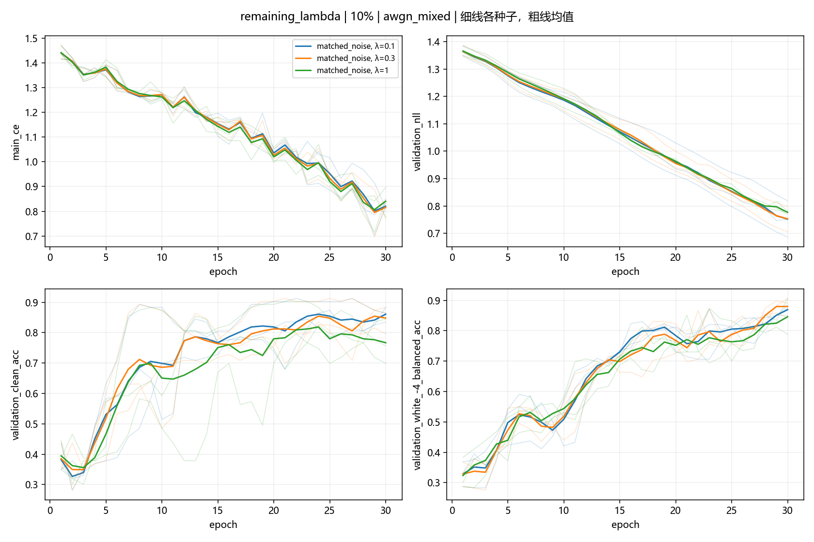
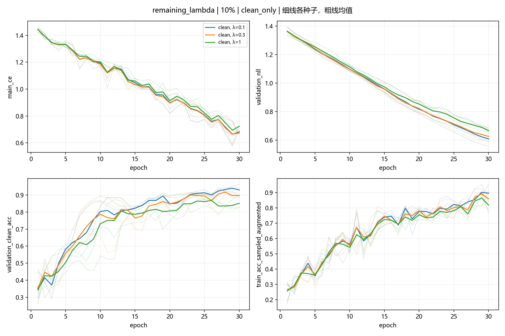
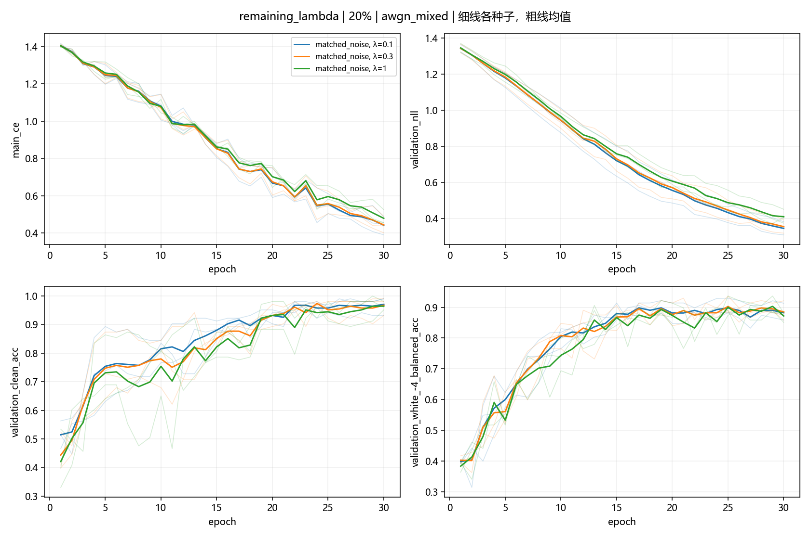
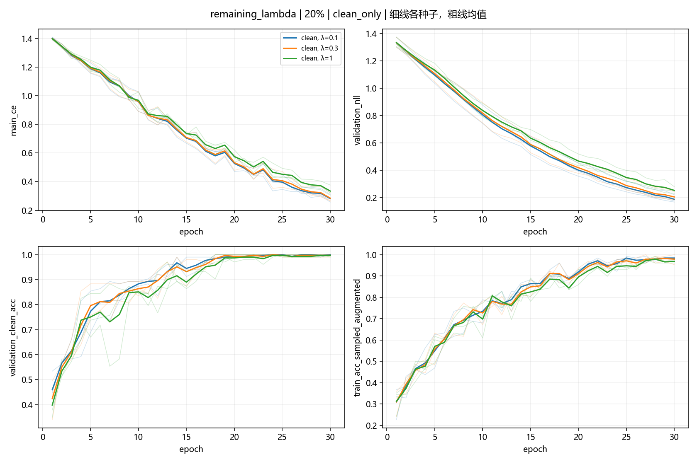

# 30轮探索验证报告

{
  "selected_physics_fit": "matched_noise",
  "coefficients": [
    0.1,
    0.3,
    1.0
  ],
  "best_lambda_not_selected": true,
  "scope": "30轮探索，不以短程测试决定最终方案"
}

仅固定验证集，未测试。每配置三训练种子、一个固定子集。表内准确率为0至1比例。
|   ratio | protocol   | physics_fit   |   aux_weight | condition   |   acc_mean |   acc_std |   balanced_acc_mean |   balanced_acc_std |   recall_OR_mean |   recall_OR_std |   validation_nll_mean |   validation_nll_std |
|--------:|:-----------|:--------------|-------------:|:------------|-----------:|----------:|--------------------:|-------------------:|-----------------:|----------------:|----------------------:|---------------------:|
|     0.1 | awgn_mixed | matched_noise |          0.1 | clean       |   0.857605 |  0.029661 |            0.885417 |           0.023868 |         0.760417 |        0.078644 |              0.718099 |             0.07663  |
|     0.1 | awgn_mixed | matched_noise |          0.1 | white_+0    |   0.828479 |  0.039237 |            0.861979 |           0.031574 |         0.71875  |        0.08268  |              0.771755 |             0.060873 |
|     0.1 | awgn_mixed | matched_noise |          0.1 | white_+2    |   0.84466  |  0.044491 |            0.875    |           0.035801 |         0.739583 |        0.118311 |              0.757386 |             0.064357 |
|     0.1 | awgn_mixed | matched_noise |          0.1 | white_+4    |   0.841424 |  0.039237 |            0.872396 |           0.031574 |         0.75     |        0.09375  |              0.751736 |             0.063083 |
|     0.1 | awgn_mixed | matched_noise |          0.1 | white_-2    |   0.828479 |  0.047892 |            0.86171  |           0.038732 |         0.6875   |        0.054127 |              0.801087 |             0.048209 |
|     0.1 | awgn_mixed | matched_noise |          0.1 | white_-4    |   0.828479 |  0.022421 |            0.86144  |           0.018509 |         0.6875   |        0.054127 |              0.83364  |             0.047122 |
|     0.1 | awgn_mixed | matched_noise |          0.3 | clean       |   0.847896 |  0.045882 |            0.877604 |           0.03692  |         0.770833 |        0.126295 |              0.719763 |             0.051679 |
|     0.1 | awgn_mixed | matched_noise |          0.3 | white_+0    |   0.838188 |  0.040421 |            0.869792 |           0.032526 |         0.739583 |        0.118311 |              0.773275 |             0.044127 |
|     0.1 | awgn_mixed | matched_noise |          0.3 | white_+2    |   0.841424 |  0.039237 |            0.872396 |           0.031574 |         0.760417 |        0.154153 |              0.759107 |             0.046305 |
|     0.1 | awgn_mixed | matched_noise |          0.3 | white_+4    |   0.841424 |  0.02021  |            0.872396 |           0.016263 |         0.78125  |        0.125    |              0.753977 |             0.045566 |
|     0.1 | awgn_mixed | matched_noise |          0.3 | white_-2    |   0.825243 |  0.044491 |            0.859106 |           0.036155 |         0.697917 |        0.078644 |              0.803879 |             0.035782 |
|     0.1 | awgn_mixed | matched_noise |          0.3 | white_-4    |   0.851133 |  0.040421 |            0.879939 |           0.032979 |         0.677083 |        0.078644 |              0.838967 |             0.035146 |
|     0.1 | awgn_mixed | matched_noise |          1   | clean       |   0.76699  |  0.073299 |            0.8125   |           0.058983 |         0.802083 |        0.177695 |              0.753745 |             0.006272 |
|     0.1 | awgn_mixed | matched_noise |          1   | white_+0    |   0.789644 |  0.066086 |            0.830729 |           0.053179 |         0.75     |        0.112673 |              0.790354 |             0.012606 |
|     0.1 | awgn_mixed | matched_noise |          1   | white_+2    |   0.783172 |  0.061659 |            0.825521 |           0.049616 |         0.802083 |        0.157288 |              0.781291 |             0.010762 |
|     0.1 | awgn_mixed | matched_noise |          1   | white_+4    |   0.779935 |  0.056888 |            0.822917 |           0.045777 |         0.802083 |        0.140914 |              0.778368 |             0.010852 |
|     0.1 | awgn_mixed | matched_noise |          1   | white_-2    |   0.786408 |  0.070011 |            0.827856 |           0.056674 |         0.75     |        0.112673 |              0.810418 |             0.015713 |
|     0.1 | awgn_mixed | matched_noise |          1   | white_-4    |   0.809061 |  0.072869 |            0.846085 |           0.059032 |         0.739583 |        0.09547  |              0.835989 |             0.019622 |
|     0.1 | clean_only | clean         |          0.1 | clean       |   0.928803 |  0.040421 |            0.942708 |           0.032526 |         0.895833 |        0.018042 |              0.60898  |             0.062637 |
|     0.1 | clean_only | clean         |          0.3 | clean       |   0.89644  |  0.01483  |            0.916667 |           0.011934 |         0.875    |        0.125    |              0.625997 |             0.051298 |
|     0.1 | clean_only | clean         |          1   | clean       |   0.851133 |  0.044843 |            0.880208 |           0.036084 |         0.885417 |        0.109746 |              0.667339 |             0.015622 |
|     0.2 | awgn_mixed | matched_noise |          0.1 | clean       |   0.970874 |  0.033632 |            0.976562 |           0.027063 |         0.90625  |        0.108253 |              0.297979 |             0.050642 |
|     0.2 | awgn_mixed | matched_noise |          0.1 | white_+0    |   0.877023 |  0.034096 |            0.901042 |           0.027437 |         0.854167 |        0.090211 |              0.377269 |             0.035899 |
|     0.2 | awgn_mixed | matched_noise |          0.1 | white_+2    |   0.889968 |  0.043779 |            0.911458 |           0.035229 |         0.895833 |        0.100455 |              0.367566 |             0.032428 |
|     0.2 | awgn_mixed | matched_noise |          0.1 | white_+4    |   0.883495 |  0.059056 |            0.90625  |           0.047522 |         0.916667 |        0.047735 |              0.368018 |             0.028034 |
|     0.2 | awgn_mixed | matched_noise |          0.1 | white_-2    |   0.864078 |  0.042319 |            0.890625 |           0.034054 |         0.802083 |        0.047735 |              0.401009 |             0.02902  |
|     0.2 | awgn_mixed | matched_noise |          0.1 | white_-4    |   0.854369 |  0.035005 |            0.882274 |           0.02806  |         0.78125  |        0.0625   |              0.433208 |             0.026885 |
|     0.2 | awgn_mixed | matched_noise |          0.3 | clean       |   0.967638 |  0.031209 |            0.973958 |           0.025114 |         0.90625  |        0.108253 |              0.311546 |             0.047188 |
|     0.2 | awgn_mixed | matched_noise |          0.3 | white_+0    |   0.880259 |  0.045882 |            0.903646 |           0.03692  |         0.875    |        0.054127 |              0.384132 |             0.038318 |
|     0.2 | awgn_mixed | matched_noise |          0.3 | white_+2    |   0.893204 |  0.038835 |            0.914062 |           0.03125  |         0.916667 |        0.090211 |              0.374099 |             0.033755 |
|     0.2 | awgn_mixed | matched_noise |          0.3 | white_+4    |   0.883495 |  0.059056 |            0.90625  |           0.047522 |         0.916667 |        0.047735 |              0.372925 |             0.031734 |
|     0.2 | awgn_mixed | matched_noise |          0.3 | white_-2    |   0.867314 |  0.056888 |            0.893229 |           0.045777 |         0.833333 |        0.018042 |              0.405579 |             0.03494  |
|     0.2 | awgn_mixed | matched_noise |          0.3 | white_-4    |   0.857605 |  0.040421 |            0.884878 |           0.0324   |         0.8125   |        0.03125  |              0.439656 |             0.035376 |
|     0.2 | awgn_mixed | matched_noise |          1   | clean       |   0.970874 |  0.016816 |            0.976562 |           0.013532 |         0.90625  |        0.054127 |              0.362476 |             0.053253 |
|     0.2 | awgn_mixed | matched_noise |          1   | white_+0    |   0.89644  |  0.02021  |            0.916667 |           0.016263 |         0.885417 |        0.018042 |              0.42072  |             0.040161 |
|     0.2 | awgn_mixed | matched_noise |          1   | white_+2    |   0.893204 |  0.035005 |            0.914062 |           0.028168 |         0.864583 |        0.036084 |              0.409576 |             0.040354 |
|     0.2 | awgn_mixed | matched_noise |          1   | white_+4    |   0.906149 |  0.01483  |            0.924479 |           0.011934 |         0.885417 |        0.078644 |              0.407766 |             0.038313 |
|     0.2 | awgn_mixed | matched_noise |          1   | white_-2    |   0.883495 |  0.035005 |            0.90625  |           0.028168 |         0.84375  |        0.054127 |              0.44532  |             0.036415 |
|     0.2 | awgn_mixed | matched_noise |          1   | white_-4    |   0.857605 |  0.005605 |            0.884878 |           0.004296 |         0.8125   |        0        |              0.482511 |             0.04292  |
|     0.2 | clean_only | clean         |          0.1 | clean       |   1        |  0        |            1        |           0        |         1        |        0        |              0.186836 |             0.028786 |
|     0.2 | clean_only | clean         |          0.3 | clean       |   0.996764 |  0.005605 |            0.997396 |           0.004511 |         0.989583 |        0.018042 |              0.203928 |             0.03483  |
|     0.2 | clean_only | clean         |          1   | clean       |   0.996764 |  0.005605 |            0.997396 |           0.004511 |         0.989583 |        0.018042 |              0.251867 |             0.024557 |

LOSS下降趋势、最后10轮变化幅度和种子曲线见curve_diagnosis.csv及图。最后10轮仍下降不能判定收敛；波动幅度仅描述，不以0.5点SD否决。训练ACC来自采样及增强观测，不能视为全部干净训练集ACC。本轮没有同预算数据单分支，不据此声称优于数据单分支；历史100轮不作30轮性能对照。

