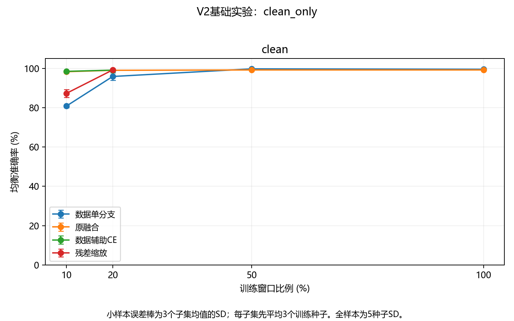
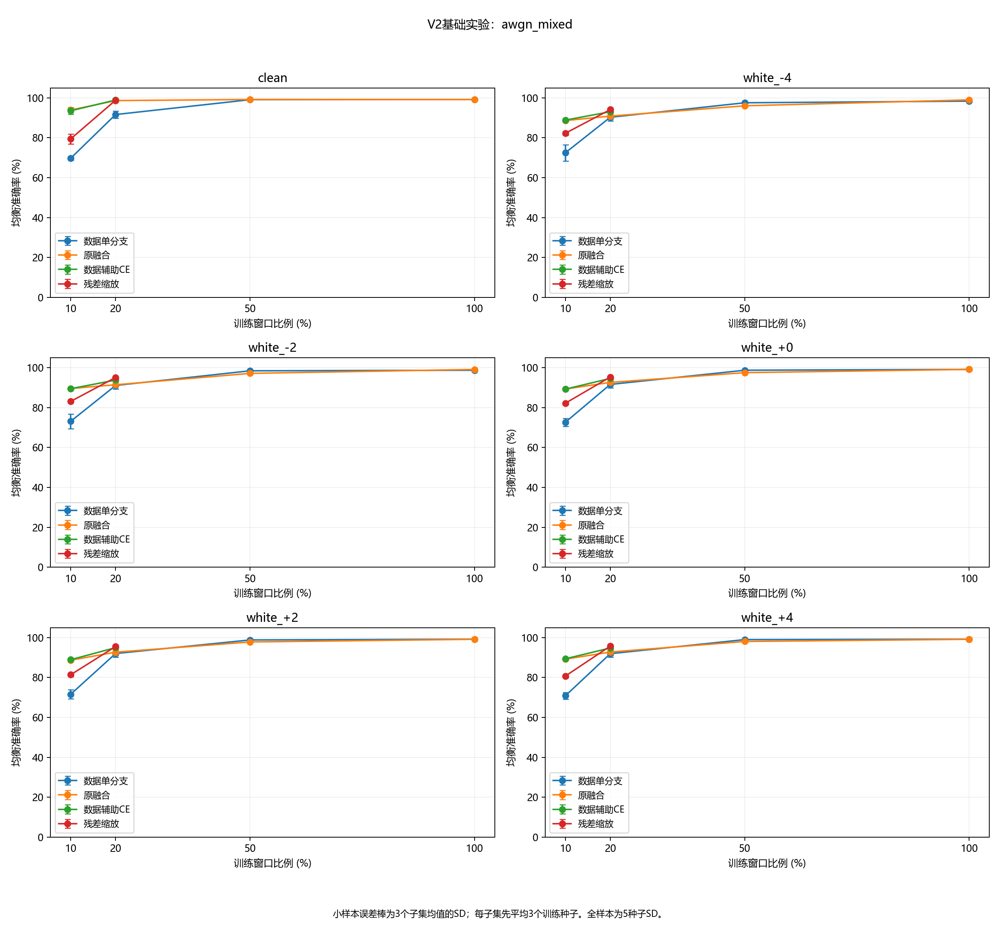

# CWRU_V2 诊断与有限单变量优化报告

完成180个新模型；只读引用20个V1模型的保存测试预测。共2700组逐次指标。全部阶段决策先锁定，再统一测试。

## 阶段结论

未有候选通过预定基础验证门槛，本轮停止跨负载扩展。

负结果同样保留。测试结果不能反过来更改候选是否通过验证门槛。没有强行放宽0.5个百分点波动门槛，没有选择性删除种子或困难原始记录。

[训练、物理特征与融合诊断](diagnosis/REPORT.md) · [小样本基线验证](SMALL_SAMPLE_BASELINE.md) · [完整阶段决策](STAGE_DECISIONS.json) · [数据使用](DATA_USAGE.md) · [协议](PROTOCOL.md)

## 基础实验测试结果

主指标均衡准确率。噪声实例先在每模型内平均，再在每固定子集内计算训练种子均值和样本SD，最后对3子集等权平均。subset_mean_sd描述子集均值之间差异，mean_within_subset_seed_sd为子集内种子SD的平均。这两者不合并为9个独立数据集重复，表中NaN表示只有一个全样本集合。单位均为百分数或百分点。

| domain        | variant         |   ratio | protocol   |   source_load_hp |   target_load_hp | condition   |   balanced_acc_mean |   subset_mean_sd |   mean_within_subset_seed_sd |   max_within_subset_seed_sd |   subset_count |   acc_mean |   recall_OR_mean |
|:--------------|:----------------|--------:|:-----------|-----------------:|-----------------:|:------------|--------------------:|-----------------:|-----------------------------:|----------------------------:|---------------:|-----------:|-----------------:|
| window_random | baseline_data   |     0.1 | awgn_mixed |               -1 |               -1 | clean       |              69.728 |            1.018 |                       11.14  |                      13.282 |              3 |     63.646 |           41.935 |
| window_random | baseline_data   |     0.1 | awgn_mixed |               -1 |               -1 | white_+0    |              72.667 |            2.013 |                        9.726 |                      12.514 |              3 |     67.163 |           55.484 |
| window_random | baseline_data   |     0.1 | awgn_mixed |               -1 |               -1 | white_+2    |              71.626 |            2.325 |                       10.093 |                      12.395 |              3 |     65.912 |           48.602 |
| window_random | baseline_data   |     0.1 | awgn_mixed |               -1 |               -1 | white_+4    |              70.852 |            1.657 |                       10.769 |                      12.893 |              3 |     64.984 |           45.018 |
| window_random | baseline_data   |     0.1 | awgn_mixed |               -1 |               -1 | white_-2    |              73.168 |            3.686 |                        7.321 |                       8.772 |              3 |     67.767 |           62.724 |
| window_random | baseline_data   |     0.1 | awgn_mixed |               -1 |               -1 | white_-4    |              72.461 |            4.111 |                        5.85  |                       7.267 |              3 |     66.926 |           68.244 |
| window_random | baseline_data   |     0.1 | clean_only |               -1 |               -1 | clean       |              80.783 |            0.835 |                        4.863 |                       7.932 |              3 |     76.915 |           61.649 |
| window_random | baseline_data   |     0.2 | awgn_mixed |               -1 |               -1 | clean       |              91.631 |            1.763 |                        2.677 |                       4.283 |              3 |     89.968 |           75.986 |
| window_random | baseline_data   |     0.2 | awgn_mixed |               -1 |               -1 | white_+0    |              91.63  |            1.814 |                        2.635 |                       3.712 |              3 |     89.968 |           78.28  |
| window_random | baseline_data   |     0.2 | awgn_mixed |               -1 |               -1 | white_+2    |              92.024 |            1.845 |                        2.887 |                       4.158 |              3 |     90.442 |           78.136 |
| window_random | baseline_data   |     0.2 | awgn_mixed |               -1 |               -1 | white_+4    |              91.934 |            1.737 |                        2.779 |                       3.943 |              3 |     90.334 |           77.348 |
| window_random | baseline_data   |     0.2 | awgn_mixed |               -1 |               -1 | white_-2    |              91.111 |            1.758 |                        2.18  |                       3.18  |              3 |     89.342 |           80.717 |
| window_random | baseline_data   |     0.2 | awgn_mixed |               -1 |               -1 | white_-4    |              90.252 |            1.853 |                        1.417 |                       1.869 |              3 |     88.306 |           86.452 |
| window_random | baseline_data   |     0.2 | clean_only |               -1 |               -1 | clean       |              95.845 |            1.893 |                        2.372 |                       3.353 |              3 |     95.038 |           90.681 |
| window_random | baseline_data   |     0.5 | awgn_mixed |               -1 |               -1 | clean       |              99.074 |            0.16  |                        0.16  |                       0.481 |              3 |     98.921 |          100     |
| window_random | baseline_data   |     0.5 | awgn_mixed |               -1 |               -1 | white_+0    |              98.753 |            0.134 |                        0.179 |                       0.249 |              3 |     98.533 |          100     |
| window_random | baseline_data   |     0.5 | awgn_mixed |               -1 |               -1 | white_+2    |              98.842 |            0.093 |                        0.209 |                       0.249 |              3 |     98.641 |          100     |
| window_random | baseline_data   |     0.5 | awgn_mixed |               -1 |               -1 | white_+4    |              99.022 |            0.138 |                        0.065 |                       0.196 |              3 |     98.857 |          100     |
| window_random | baseline_data   |     0.5 | awgn_mixed |               -1 |               -1 | white_-2    |              98.466 |            0.248 |                        0.274 |                       0.487 |              3 |     98.188 |           99.928 |
| window_random | baseline_data   |     0.5 | awgn_mixed |               -1 |               -1 | white_-4    |              97.532 |            0.122 |                        0.545 |                       0.659 |              3 |     97.066 |           99.283 |
| window_random | baseline_data   |     0.5 | clean_only |               -1 |               -1 | clean       |              99.722 |            0     |                        0.481 |                       0.481 |              3 |     99.676 |          100     |
| window_random | baseline_data   |     1   | awgn_mixed |               -1 |               -1 | clean       |              99.167 |          nan     |                        0     |                       0     |              1 |     99.029 |          100     |
| window_random | baseline_data   |     1   | awgn_mixed |               -1 |               -1 | white_+0    |              99.167 |          nan     |                        0.118 |                       0.118 |              1 |     99.029 |          100     |
| window_random | baseline_data   |     1   | awgn_mixed |               -1 |               -1 | white_+2    |              99.233 |          nan     |                        0.149 |                       0.149 |              1 |     99.107 |          100     |
| window_random | baseline_data   |     1   | awgn_mixed |               -1 |               -1 | white_+4    |              99.233 |          nan     |                        0.149 |                       0.149 |              1 |     99.107 |          100     |
| window_random | baseline_data   |     1   | awgn_mixed |               -1 |               -1 | white_-2    |              98.743 |          nan     |                        0.25  |                       0.25  |              1 |     98.524 |          100     |
| window_random | baseline_data   |     1   | awgn_mixed |               -1 |               -1 | white_-4    |              98.354 |          nan     |                        0.309 |                       0.309 |              1 |     98.058 |          100     |
| window_random | baseline_data   |     1   | clean_only |               -1 |               -1 | clean       |              99.5   |          nan     |                        0.456 |                       0.456 |              1 |     99.417 |          100     |
| window_random | baseline_fusion |     0.1 | awgn_mixed |               -1 |               -1 | clean       |              93.88  |            1.018 |                        2.197 |                       3.226 |              3 |     92.665 |           86.022 |
| window_random | baseline_fusion |     0.1 | awgn_mixed |               -1 |               -1 | white_+0    |              89.342 |            0.559 |                        0.64  |                       1.409 |              3 |     87.206 |           75.771 |
| window_random | baseline_fusion |     0.1 | awgn_mixed |               -1 |               -1 | white_+2    |              88.7   |            0.31  |                        0.875 |                       1.32  |              3 |     86.429 |           76.703 |
| window_random | baseline_fusion |     0.1 | awgn_mixed |               -1 |               -1 | white_+4    |              89.22  |            0.606 |                        1.374 |                       1.397 |              3 |     87.055 |           79.068 |
| window_random | baseline_fusion |     0.1 | awgn_mixed |               -1 |               -1 | white_-2    |              89.588 |            0.246 |                        0.526 |                       0.857 |              3 |     87.508 |           74.409 |
| window_random | baseline_fusion |     0.1 | awgn_mixed |               -1 |               -1 | white_-4    |              88.589 |            0.085 |                        1.032 |                       1.307 |              3 |     86.408 |           72.616 |
| window_random | baseline_fusion |     0.1 | clean_only |               -1 |               -1 | clean       |              98.271 |            0.56  |                        0.721 |                       1.232 |              3 |     97.95  |           98.925 |
| window_random | baseline_fusion |     0.2 | awgn_mixed |               -1 |               -1 | clean       |              98.629 |            0.269 |                        0.579 |                       0.806 |              3 |     98.382 |           98.925 |
| window_random | baseline_fusion |     0.2 | awgn_mixed |               -1 |               -1 | white_+0    |              92.643 |            0.806 |                        0.786 |                       1.098 |              3 |     91.176 |           81.935 |
| window_random | baseline_fusion |     0.2 | awgn_mixed |               -1 |               -1 | white_+2    |              92.697 |            1.274 |                        1.037 |                       1.539 |              3 |     91.241 |           84.516 |
| window_random | baseline_fusion |     0.2 | awgn_mixed |               -1 |               -1 | white_+4    |              92.769 |            1.656 |                        1.367 |                       1.632 |              3 |     91.327 |           88.172 |
| window_random | baseline_fusion |     0.2 | awgn_mixed |               -1 |               -1 | white_-2    |              91.456 |            0.702 |                        1.105 |                       1.712 |              3 |     89.752 |           76.774 |
| window_random | baseline_fusion |     0.2 | awgn_mixed |               -1 |               -1 | white_-4    |              90.841 |            0.274 |                        1.059 |                       1.672 |              3 |     89.061 |           74.337 |
| window_random | baseline_fusion |     0.2 | clean_only |               -1 |               -1 | clean       |              98.987 |            0.155 |                        0.31  |                       0.466 |              3 |     98.813 |          100     |
| window_random | baseline_fusion |     0.5 | awgn_mixed |               -1 |               -1 | clean       |              99.167 |            0     |                        0     |                       0     |              3 |     99.029 |          100     |
| window_random | baseline_fusion |     0.5 | awgn_mixed |               -1 |               -1 | white_+0    |              97.536 |            0.366 |                        2.499 |                       3.259 |              3 |     97.066 |           95.269 |
| window_random | baseline_fusion |     0.5 | awgn_mixed |               -1 |               -1 | white_+2    |              97.823 |            0.054 |                        2.19  |                       2.283 |              3 |     97.411 |           96.989 |
| window_random | baseline_fusion |     0.5 | awgn_mixed |               -1 |               -1 | white_+4    |              98.073 |            0.31  |                        1.802 |                       2.241 |              3 |     97.713 |           97.706 |
| window_random | baseline_fusion |     0.5 | awgn_mixed |               -1 |               -1 | white_-2    |              97.177 |            0.377 |                        2.84  |                       3.63  |              3 |     96.634 |           93.19  |
| window_random | baseline_fusion |     0.5 | awgn_mixed |               -1 |               -1 | white_-4    |              96.011 |            0.292 |                        3.777 |                       4.148 |              3 |     95.232 |           89.319 |
| window_random | baseline_fusion |     0.5 | clean_only |               -1 |               -1 | clean       |              99.167 |            0     |                        0     |                       0     |              3 |     99.029 |          100     |
| window_random | baseline_fusion |     1   | awgn_mixed |               -1 |               -1 | clean       |              99.167 |          nan     |                        0     |                       0     |              1 |     99.029 |          100     |
| window_random | baseline_fusion |     1   | awgn_mixed |               -1 |               -1 | white_+0    |              99.167 |          nan     |                        0     |                       0     |              1 |     99.029 |          100     |
| window_random | baseline_fusion |     1   | awgn_mixed |               -1 |               -1 | white_+2    |              99.167 |          nan     |                        0     |                       0     |              1 |     99.029 |          100     |
| window_random | baseline_fusion |     1   | awgn_mixed |               -1 |               -1 | white_+4    |              99.167 |          nan     |                        0     |                       0     |              1 |     99.029 |          100     |
| window_random | baseline_fusion |     1   | awgn_mixed |               -1 |               -1 | white_-2    |              99.134 |          nan     |                        0.072 |                       0.072 |              1 |     98.99  |           99.871 |
| window_random | baseline_fusion |     1   | awgn_mixed |               -1 |               -1 | white_-4    |              98.973 |          nan     |                        0.135 |                       0.135 |              1 |     98.796 |           99.613 |
| window_random | baseline_fusion |     1   | clean_only |               -1 |               -1 | clean       |              99.167 |          nan     |                        0     |                       0     |              1 |     99.029 |          100     |
| window_random | data_aux_ce     |     0.1 | awgn_mixed |               -1 |               -1 | clean       |              93.522 |            1.635 |                        2.032 |                       3.259 |              3 |     92.233 |           85.663 |
| window_random | data_aux_ce     |     0.1 | awgn_mixed |               -1 |               -1 | white_+0    |              89.27  |            0.538 |                        1.085 |                       2.108 |              3 |     87.12  |           75.771 |
| window_random | data_aux_ce     |     0.1 | awgn_mixed |               -1 |               -1 | white_+2    |              88.951 |            0.326 |                        1.086 |                       1.391 |              3 |     86.731 |           76.057 |
| window_random | data_aux_ce     |     0.1 | awgn_mixed |               -1 |               -1 | white_+4    |              89.4   |            0.411 |                        1.638 |                       1.684 |              3 |     87.271 |           78.566 |
| window_random | data_aux_ce     |     0.1 | awgn_mixed |               -1 |               -1 | white_-2    |              89.499 |            0.618 |                        0.568 |                       0.894 |              3 |     87.4   |           74.695 |
| window_random | data_aux_ce     |     0.1 | awgn_mixed |               -1 |               -1 | white_-4    |              88.841 |            0.361 |                        0.642 |                       0.904 |              3 |     86.624 |           73.907 |
| window_random | data_aux_ce     |     0.1 | clean_only |               -1 |               -1 | clean       |              98.45  |            0.411 |                        0.734 |                       0.931 |              3 |     98.166 |           98.925 |
| window_random | data_aux_ce     |     0.2 | awgn_mixed |               -1 |               -1 | clean       |              98.898 |            0.269 |                        0.31  |                       0.466 |              3 |     98.706 |           99.642 |
| window_random | data_aux_ce     |     0.2 | awgn_mixed |               -1 |               -1 | white_+0    |              94.633 |            0.164 |                        1.946 |                       2.854 |              3 |     93.571 |           87.025 |
| window_random | data_aux_ce     |     0.2 | awgn_mixed |               -1 |               -1 | white_+2    |              94.973 |            0.215 |                        1.749 |                       2.376 |              3 |     93.981 |           89.677 |
| window_random | data_aux_ce     |     0.2 | awgn_mixed |               -1 |               -1 | white_+4    |              94.794 |            0.874 |                        1.792 |                       2.535 |              3 |     93.765 |           91.398 |
| window_random | data_aux_ce     |     0.2 | awgn_mixed |               -1 |               -1 | white_-2    |              93.808 |            0.296 |                        1.836 |                       2.748 |              3 |     92.578 |           83.441 |
| window_random | data_aux_ce     |     0.2 | awgn_mixed |               -1 |               -1 | white_-4    |              93.036 |            0.271 |                        1.814 |                       2.107 |              3 |     91.65  |           80.645 |
| window_random | data_aux_ce     |     0.2 | clean_only |               -1 |               -1 | clean       |              99.077 |            0.155 |                        0.155 |                       0.466 |              3 |     98.921 |          100     |
| window_random | residual_scale  |     0.1 | awgn_mixed |               -1 |               -1 | clean       |              79.444 |            2.462 |                        6.538 |                       9.3   |              3 |     75.297 |           65.233 |
| window_random | residual_scale  |     0.1 | awgn_mixed |               -1 |               -1 | white_+0    |              82.221 |            0.627 |                        3.503 |                       5.361 |              3 |     78.641 |           78.566 |
| window_random | residual_scale  |     0.1 | awgn_mixed |               -1 |               -1 | white_+2    |              81.417 |            0.851 |                        4.112 |                       6.517 |              3 |     77.67  |           74.409 |
| window_random | residual_scale  |     0.1 | awgn_mixed |               -1 |               -1 | white_+4    |              80.739 |            0.95  |                        5.17  |                       8.364 |              3 |     76.85  |           70.108 |
| window_random | residual_scale  |     0.1 | awgn_mixed |               -1 |               -1 | white_-2    |              83.137 |            0.393 |                        3.137 |                       4.005 |              3 |     79.741 |           84.229 |
| window_random | residual_scale  |     0.1 | awgn_mixed |               -1 |               -1 | white_-4    |              82.245 |            0.959 |                        2.739 |                       3.448 |              3 |     78.792 |           88.1   |
| window_random | residual_scale  |     0.1 | clean_only |               -1 |               -1 | clean       |              87.24  |            1.953 |                        3.147 |                       5.724 |              3 |     84.682 |           78.853 |
| window_random | residual_scale  |     0.2 | awgn_mixed |               -1 |               -1 | clean       |              98.808 |            0.155 |                        0.621 |                       0.931 |              3 |     98.598 |           98.925 |
| window_random | residual_scale  |     0.2 | awgn_mixed |               -1 |               -1 | white_+0    |              95.332 |            0.062 |                        0.948 |                       2.283 |              3 |     94.412 |           88.961 |
| window_random | residual_scale  |     0.2 | awgn_mixed |               -1 |               -1 | white_+2    |              95.529 |            0.323 |                        1.145 |                       2.531 |              3 |     94.649 |           89.534 |
| window_random | residual_scale  |     0.2 | awgn_mixed |               -1 |               -1 | white_+4    |              95.744 |            0.275 |                        1.375 |                       2.905 |              3 |     94.908 |           89.892 |
| window_random | residual_scale  |     0.2 | awgn_mixed |               -1 |               -1 | white_-2    |              95.118 |            0.063 |                        0.962 |                       2.073 |              3 |     94.153 |           88.889 |
| window_random | residual_scale  |     0.2 | awgn_mixed |               -1 |               -1 | white_-4    |              94.096 |            0.5   |                        1.317 |                       2.099 |              3 |     92.923 |           89.032 |
| window_random | residual_scale  |     0.2 | clean_only |               -1 |               -1 | clean       |              99.167 |            0     |                        0     |                       0     |              3 |     99.029 |          100     |

## 计算成本

| domain        | variant         |   ratio | protocol   |   parameters |   epochs_trained |   updates_trained |   total_train_seconds |   train_seconds_per_epoch |   validation_seconds |   fit_seconds |   peak_gpu_mib |   latency_ms |
|:--------------|:----------------|--------:|:-----------|-------------:|-----------------:|------------------:|----------------------:|--------------------------:|---------------------:|--------------:|---------------:|-------------:|
| window_random | baseline_data   |     0.1 | awgn_mixed |        33964 |              100 |               200 |               15.7572 |                    0.1576 |              45.3162 |        0.0011 |        1195.58 |       2.5223 |
| window_random | baseline_data   |     0.1 | clean_only |        33964 |              100 |               200 |               13.472  |                    0.1347 |               7.5656 |        0.001  |        1195.58 |       2.6003 |
| window_random | baseline_data   |     0.2 | awgn_mixed |        33964 |              100 |               400 |               31.9967 |                    0.32   |              45.6305 |        0.0022 |        1195.58 |       2.5032 |
| window_random | baseline_data   |     0.2 | clean_only |        33964 |              100 |               400 |               26.9519 |                    0.2695 |               7.565  |        0.0021 |        1195.58 |       2.5216 |
| window_random | baseline_data   |     0.5 | awgn_mixed |        33964 |              100 |               800 |               63.7198 |                    0.6372 |              45.6565 |        0.0056 |        1195.58 |       2.5041 |
| window_random | baseline_data   |     0.5 | clean_only |        33964 |              100 |               800 |               53.871  |                    0.5387 |               7.5553 |        0.0051 |        1195.58 |       2.562  |
| window_random | baseline_fusion |     0.1 | awgn_mixed |        53068 |              100 |               200 |               17.7851 |                    0.1779 |              60.3552 |        0.0131 |        1196.26 |       8.2369 |
| window_random | baseline_fusion |     0.1 | clean_only |        53068 |              100 |               200 |               15.38   |                    0.1538 |              10.1841 |        0.281  |        1196.26 |       7.5421 |
| window_random | baseline_fusion |     0.2 | awgn_mixed |        53068 |              100 |               400 |               35.4877 |                    0.3549 |              60.4327 |        0.0252 |        1196.26 |       7.5005 |
| window_random | baseline_fusion |     0.2 | clean_only |        53068 |              100 |               400 |               30.4556 |                    0.3046 |               9.9571 |        0.1835 |        1196.26 |       7.6058 |
| window_random | baseline_fusion |     0.5 | awgn_mixed |        53068 |              100 |               800 |               70.9272 |                    0.7093 |              60.5296 |        0.0511 |        1196.26 |       8.3836 |
| window_random | baseline_fusion |     0.5 | clean_only |        53068 |              100 |               800 |               60.8681 |                    0.6087 |               9.928  |        0.2114 |        1196.26 |       7.4939 |
| window_random | data_aux_ce     |     0.1 | awgn_mixed |        53068 |              100 |               200 |               17.823  |                    0.1782 |              59.8578 |        0.0133 |        1196.26 |       7.4921 |
| window_random | data_aux_ce     |     0.1 | clean_only |        53068 |              100 |               200 |               15.3302 |                    0.1533 |               9.8717 |        0.0121 |        1196.26 |       7.4395 |
| window_random | data_aux_ce     |     0.2 | awgn_mixed |        53068 |              100 |               400 |               36.0841 |                    0.3608 |              60.6675 |        0.0254 |        1196.26 |       7.4732 |
| window_random | data_aux_ce     |     0.2 | clean_only |        53068 |              100 |               400 |               30.6995 |                    0.307  |               9.8519 |        0.0246 |        1196.26 |       7.5356 |
| window_random | residual_scale  |     0.1 | awgn_mixed |        53069 |              100 |               200 |               17.6429 |                    0.1764 |              59.6609 |        0.013  |        1196.26 |       7.5211 |
| window_random | residual_scale  |     0.1 | clean_only |        53069 |              100 |               200 |               15.1689 |                    0.1517 |               9.8491 |        0.0125 |        1196.26 |       7.5282 |
| window_random | residual_scale  |     0.2 | awgn_mixed |        53069 |              100 |               400 |               35.2661 |                    0.3527 |              59.6894 |        0.0245 |        1196.26 |       7.532  |
| window_random | residual_scale  |     0.2 | clean_only |        53069 |              100 |               400 |               30.4475 |                    0.3045 |               9.8631 |        0.0248 |        1196.26 |       7.5302 |

静态FLOPs见complexity.csv，仅Conv1d和Linear，未覆盖物理FFT、归一化与逐元素算子。辅助CE增加训练前向及反向成本，推理不启用辅助头；真实成本以训练计时和单样本延迟为准。batch32，CUDA编码器BF16其余FP32；延迟batch1含归一化、在线物理特征及网络，10预热50重复，同步计时，排除磁盘和H2D。

## 研究边界

固定验证集被重复用于候选筛选，属于探索性研究。基础实验训练测试共享记录；测试集此前已有曝光，不能称独立确认性结果。103验证标签在所有小样本预算中保留。训练子集3次抽样与训练种子分开统计，仍不足以估计独立轴承泛化。跨负载方向复用模型和目标记录，也不构成独立轴承重复。不同预算的epoch批次数不同，早停实际更新量可能不同，不声称实际计算预算相同。0.5个百分点为用户稳定性筛选准则，不是显著性检验。此次两候选未检验所有可能改进，失败不等于所有融合方法无效，成功也不能证明所有噪声、类别和负载均受益。