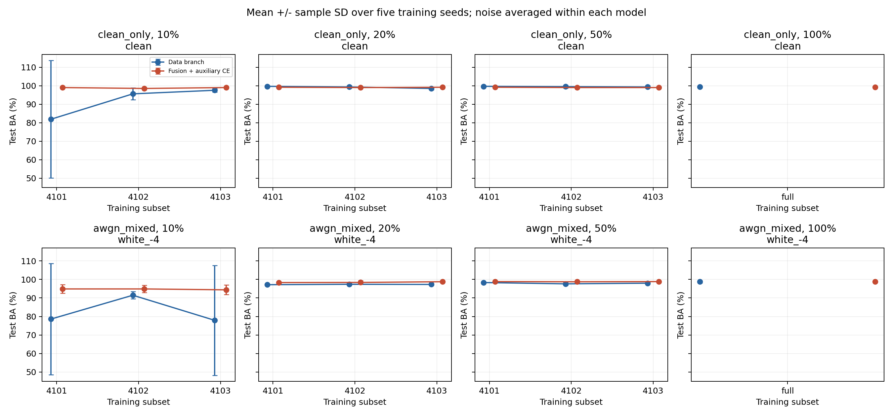
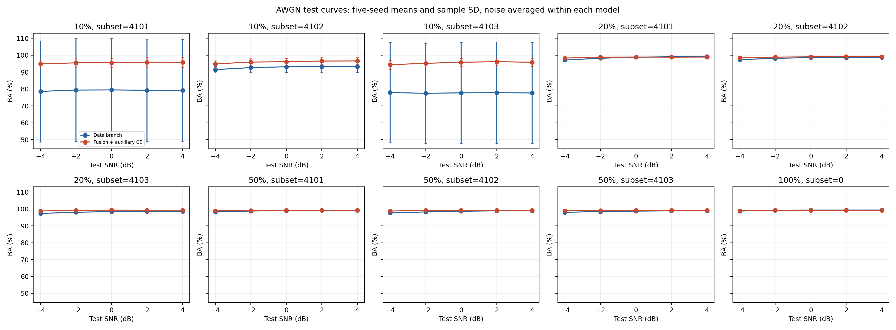
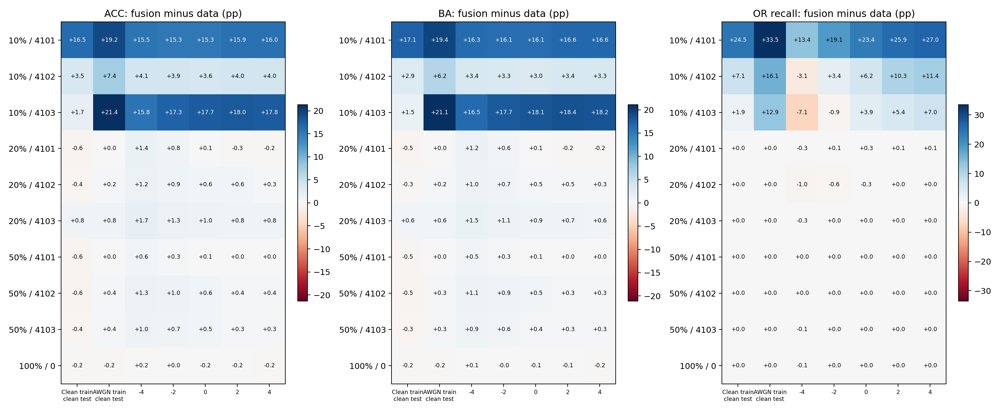

# CWRU_V3随机窗口阶段正式报告

本阶段完成190个新模型的训练和测试，并只读复用已完成选参阶段的10个全样本纯干净模型及其测试预测，共200个模型。统一λ固定为0.3。本阶段未开展按负载划分的迁移实验，也未重新选参。

## 数据和实验范围

全部40条记录切为687个完整窗口，复用固定的记录内70%/15%/15%随机划分。全样本训练481窗、验证103窗、测试103窗。训练比例10%、20%、50%对应49、98、242个训练窗，每档3个固定嵌套子集4101至4103。每子集、训练协议和方法均使用1706至1710五个训练种子。全样本使用同一完整训练池，不设置3份重复全样本子集。

纯干净和AWGN协议均比较数据单分支与原融合加数据分支辅助分类。保留原骨干、门控和共享分类头。40条原始记录没有排除，data只读。所选窗口、逐MAT用量及逐类支持数见splits、dataset_file_usage.csv、training_subset_file_usage.csv和各模型的selected_windows.csv。

|   ratio | role       |   windows |   N |   IR |   OR |   B |
|--------:|:-----------|----------:|----:|-----:|-----:|----:|
|     1   | train      |       481 |  49 |  138 |  147 | 147 |
|     1   | validation |       103 |  10 |   29 |   32 |  32 |
|     1   | test       |       103 |  11 |   30 |   31 |  31 |
|     0.1 | train      |        49 |   5 |   14 |   15 |  15 |
|     0.1 | validation |       103 |  10 |   29 |   32 |  32 |
|     0.1 | test       |       103 |  11 |   30 |   31 |  31 |
|     0.2 | train      |        98 |  10 |   28 |   30 |  30 |
|     0.2 | validation |       103 |  10 |   29 |   32 |  32 |
|     0.2 | test       |       103 |  11 |   30 |   31 |  31 |
|     0.5 | train      |       242 |  25 |   69 |   74 |  74 |
|     0.5 | validation |       103 |  10 |   29 |   32 |  32 |
|     0.5 | test       |       103 |  11 |   30 |   31 |  31 |

λ来自2026年10月22日完整30模型的全样本纯干净选参。五档λ各5种子，另有数据单分支5种子。选择只依据五种子最佳验证普通窗口平均CE的均值，同值选较小λ。所引用结果来源为`D:\Project\MY draft\results\CWRU_V3\run_20261022_2105`。本阶段未重新训练这些模型，未重新计算其测试预测。未入选的20个选参模型不计入本阶段200模型。

## 训练和测试时机

最多200epoch，patience为20，每轮验证并保存最佳权重，最小改善量1e-6。AdamW初始学习率5e-4、权重衰减1e-3、batch size为32、梯度裁剪5。使用200轮单周期余弦衰减至1e-5，无重启。普通CE，标签平滑为0。验证仅使用最终分类输出，不包含辅助损失。纯干净按窗口平均验证CE选模。AWGN使用0.5乘干净验证CE与五档噪声验证CE各0.1之和。以上为固定实验设置，不宣称文献证明其最优，实际epoch和更新量受早停影响。

AWGN每次窗口出现时以50%概率保留干净，否则SNR连续均匀采样[-4,4] dB。融合两分支使用相同观测。纯干净仅用本训练子集干净观测拟合median/IQR。AWGN融合使用本训练子集等量干净和含噪观测拟合。3次固定噪声拟合实现的种子为6301，尺度下限0.05，裁剪[-8,8]。小样本全部从头训练，未使用全样本统计或预训练权重。重复观测不增加独立训练窗口数。

本阶段190个新模型全部选模并固定后才开展新增测试。先前10模型的测试已经完成，本次仅引用。200份模型评价共2700组逐条件指标，其中100个纯干净模型各1组，100个AWGN模型各26组。AWGN测试包括干净与五档SNR各5个噪声实例。验证噪声6201，测试噪声7201至7205，二者分离。所有测试采用相同103窗，类别支持数为正常11、内圈30、外圈31、滚动体31。测试没有用于改变λ、子集、训练设置或选模规则。

## 统计口径

下表为百分比，均值±样本标准差。每个模型先平均同一SNR下的5个噪声实例，再在固定子集内对5个训练种子计算均值及样本标准差，分母为4。纯干净仅1个测试实例。三个子集各自报告，子集五种子均值之间的样本标准差单列，不将15个组合称为15个独立种子。

ACC、BA、Macro-F1和全部四类召回完整保存于evaluation/mean_std.csv。两方法在相同子集、训练协议、种子和测试条件下配对，差值为融合加辅助分类减数据单分支。配对五种子差值及其样本标准差见paired_seed_differences.csv和paired_mean_std.csv。between_subset_summary.csv及paired_between_subset_summary.csv分别报告性能和配对增益在3个子集间的变化。这里没有将SD当作置信区间，也没有根据均值排序宣称统计显著。

原始混淆计数见evaluation/confusion_matrices.csv，聚合计数与逐行百分比见pooled_confusion_matrices.csv。每行按真实类别归一化，行和100%，对角线为召回率。unique_test_support保存独立窗口的类别数，prediction_support是重复预测总数。五种子或噪声重复不会扩大独立测试样本数。

## 干净及强噪声结果

| 训练协议   | 训练比例   |   子集 | 测试条件   | 方法           | ACC         | BA          | Macro-F1    | 正常召回    | 内圈召回    | 外圈召回    | 滚动体召回   |
|:-----------|:-----------|-------:|:-----------|:---------------|:------------|:------------|:------------|:------------|:------------|:------------|:-------------|
| awgn_mixed | 10%        |   4101 | clean      | 数据单分支     | 79.03±27.47 | 79.16±30.34 | 76.50±36.11 | 80.00±44.72 | 75.33±42.33 | 63.87±37.30 | 97.42±4.21   |
| awgn_mixed | 10%        |   4101 | white_-4   | 数据单分支     | 78.33±27.02 | 78.59±29.99 | 75.78±35.93 | 80.00±44.72 | 77.20±43.16 | 74.45±41.89 | 82.71±9.98   |
| awgn_mixed | 10%        |   4101 | clean      | 融合加辅助分类 | 98.25±1.27  | 98.52±1.05  | 98.54±1.04  | 100.00±0.00 | 96.67±0.00  | 97.42±4.21  | 100.00±0.00  |
| awgn_mixed | 10%        |   4101 | white_-4   | 融合加辅助分类 | 93.86±2.86  | 94.88±2.38  | 94.82±2.42  | 100.00±0.00 | 96.80±0.30  | 87.87±8.72  | 94.84±2.09   |
| clean_only | 10%        |   4101 | clean      | 数据单分支     | 82.33±29.21 | 81.89±31.81 | 79.31±37.63 | 80.00±44.72 | 74.00±41.46 | 74.84±42.02 | 98.71±1.77   |
| clean_only | 10%        |   4101 | clean      | 融合加辅助分类 | 98.83±0.43  | 99.01±0.36  | 99.02±0.36  | 100.00±0.00 | 96.67±0.00  | 99.35±1.44  | 100.00±0.00  |
| awgn_mixed | 10%        |   4102 | clean      | 数据单分支     | 91.46±3.97  | 92.85±3.29  | 92.79±3.37  | 100.00±0.00 | 93.33±2.36  | 83.87±14.96 | 94.19±4.21   |
| awgn_mixed | 10%        |   4102 | white_-4   | 数据单分支     | 89.79±2.32  | 91.48±1.94  | 91.32±1.90  | 100.00±0.00 | 95.47±1.45  | 91.48±9.25  | 78.97±3.86   |
| awgn_mixed | 10%        |   4102 | clean      | 融合加辅助分类 | 98.83±0.43  | 99.01±0.36  | 99.02±0.37  | 100.00±0.00 | 96.67±0.00  | 100.00±0.00 | 99.35±1.44   |
| awgn_mixed | 10%        |   4102 | white_-4   | 融合加辅助分类 | 93.86±2.31  | 94.88±1.92  | 94.86±1.91  | 100.00±0.00 | 96.80±0.30  | 88.39±5.00  | 94.32±3.46   |
| clean_only | 10%        |   4102 | clean      | 数据单分支     | 94.76±3.86  | 95.61±3.20  | 95.57±3.28  | 100.00±0.00 | 95.33±1.83  | 91.61±13.99 | 95.48±2.89   |
| clean_only | 10%        |   4102 | clean      | 融合加辅助分类 | 98.25±0.81  | 98.52±0.67  | 98.54±0.67  | 100.00±0.00 | 96.67±0.00  | 98.71±1.77  | 98.71±1.77   |
| awgn_mixed | 10%        |   4103 | clean      | 数据单分支     | 77.28±27.15 | 77.72±29.95 | 73.52±35.24 | 80.00±44.72 | 76.67±42.88 | 87.10±17.67 | 67.10±39.00  |
| awgn_mixed | 10%        |   4103 | white_-4   | 数据单分支     | 77.51±26.70 | 77.90±29.70 | 74.49±35.36 | 80.00±44.72 | 76.00±42.55 | 94.19±7.99  | 61.42±34.99  |
| awgn_mixed | 10%        |   4103 | clean      | 融合加辅助分类 | 98.64±0.53  | 98.84±0.44  | 98.86±0.44  | 100.00±0.00 | 96.67±0.00  | 100.00±0.00 | 98.71±1.77   |
| awgn_mixed | 10%        |   4103 | white_-4   | 融合加辅助分类 | 93.28±3.14  | 94.39±2.61  | 94.32±2.64  | 100.00±0.00 | 96.67±0.47  | 87.10±6.84  | 93.81±3.99   |
| clean_only | 10%        |   4103 | clean      | 数据单分支     | 97.09±1.19  | 97.54±0.99  | 97.55±0.99  | 100.00±0.00 | 95.33±1.83  | 98.06±4.33  | 96.77±0.00   |
| clean_only | 10%        |   4103 | clean      | 融合加辅助分类 | 98.83±0.43  | 99.01±0.36  | 99.02±0.36  | 100.00±0.00 | 96.67±0.00  | 100.00±0.00 | 99.35±1.44   |
| awgn_mixed | 20%        |   4101 | clean      | 数据单分支     | 99.03±0.00  | 99.17±0.00  | 99.18±0.00  | 100.00±0.00 | 96.67±0.00  | 100.00±0.00 | 100.00±0.00  |
| awgn_mixed | 20%        |   4101 | white_-4   | 数据单分支     | 96.62±0.52  | 97.17±0.44  | 97.11±0.44  | 100.00±0.00 | 96.53±0.56  | 98.97±1.62  | 93.16±0.98   |
| awgn_mixed | 20%        |   4101 | clean      | 融合加辅助分类 | 99.03±0.00  | 99.17±0.00  | 99.18±0.00  | 100.00±0.00 | 96.67±0.00  | 100.00±0.00 | 100.00±0.00  |
| awgn_mixed | 20%        |   4101 | white_-4   | 融合加辅助分类 | 98.02±0.35  | 98.33±0.29  | 98.35±0.29  | 100.00±0.00 | 96.67±0.00  | 98.71±0.65  | 97.94±0.54   |
| clean_only | 20%        |   4101 | clean      | 数据单分支     | 99.61±0.53  | 99.67±0.46  | 99.67±0.45  | 100.00±0.00 | 98.67±1.83  | 100.00±0.00 | 100.00±0.00  |
| clean_only | 20%        |   4101 | clean      | 融合加辅助分类 | 99.03±0.00  | 99.17±0.00  | 99.18±0.00  | 100.00±0.00 | 96.67±0.00  | 100.00±0.00 | 100.00±0.00  |
| awgn_mixed | 20%        |   4102 | clean      | 数据单分支     | 98.83±0.43  | 99.00±0.37  | 99.01±0.37  | 100.00±0.00 | 96.00±1.49  | 100.00±0.00 | 100.00±0.00  |
| awgn_mixed | 20%        |   4102 | white_-4   | 数据单分支     | 96.89±0.50  | 97.39±0.41  | 97.32±0.44  | 100.00±0.00 | 96.67±1.41  | 99.87±0.29  | 93.03±1.67   |
| awgn_mixed | 20%        |   4102 | clean      | 融合加辅助分类 | 99.03±0.00  | 99.17±0.00  | 99.18±0.00  | 100.00±0.00 | 96.67±0.00  | 100.00±0.00 | 100.00±0.00  |
| awgn_mixed | 20%        |   4102 | white_-4   | 融合加辅助分类 | 98.10±1.14  | 98.39±0.94  | 98.41±0.94  | 100.00±0.00 | 96.67±0.47  | 98.84±2.25  | 98.06±1.58   |
| clean_only | 20%        |   4102 | clean      | 数据单分支     | 99.22±0.81  | 99.33±0.70  | 99.34±0.69  | 100.00±0.00 | 97.33±2.79  | 100.00±0.00 | 100.00±0.00  |
| clean_only | 20%        |   4102 | clean      | 融合加辅助分类 | 98.83±0.43  | 99.01±0.36  | 99.02±0.36  | 100.00±0.00 | 96.67±0.00  | 100.00±0.00 | 99.35±1.44   |
| awgn_mixed | 20%        |   4103 | clean      | 数据单分支     | 98.25±0.43  | 98.52±0.36  | 98.52±0.37  | 100.00±0.00 | 96.67±0.00  | 100.00±0.00 | 97.42±1.44   |
| awgn_mixed | 20%        |   4103 | white_-4   | 数据单分支     | 96.82±0.62  | 97.31±0.53  | 97.23±0.54  | 100.00±0.00 | 94.80±1.66  | 99.61±0.58  | 94.84±1.37   |
| awgn_mixed | 20%        |   4103 | clean      | 融合加辅助分类 | 99.03±0.00  | 99.17±0.00  | 99.18±0.00  | 100.00±0.00 | 96.67±0.00  | 100.00±0.00 | 100.00±0.00  |
| awgn_mixed | 20%        |   4103 | white_-4   | 融合加辅助分类 | 98.56±0.22  | 98.78±0.19  | 98.77±0.24  | 100.00±0.00 | 96.67±0.67  | 99.35±0.79  | 99.10±0.58   |
| clean_only | 20%        |   4103 | clean      | 数据单分支     | 98.25±0.81  | 98.52±0.70  | 98.52±0.69  | 100.00±0.00 | 96.67±3.33  | 100.00±0.00 | 97.42±1.44   |
| clean_only | 20%        |   4103 | clean      | 融合加辅助分类 | 99.03±0.00  | 99.17±0.00  | 99.18±0.00  | 100.00±0.00 | 96.67±0.00  | 100.00±0.00 | 100.00±0.00  |
| awgn_mixed | 50%        |   4101 | clean      | 数据单分支     | 99.03±0.00  | 99.17±0.00  | 99.18±0.00  | 100.00±0.00 | 96.67±0.00  | 100.00±0.00 | 100.00±0.00  |
| awgn_mixed | 50%        |   4101 | white_-4   | 数据单分支     | 98.02±0.25  | 98.33±0.21  | 98.35±0.21  | 100.00±0.00 | 96.93±0.60  | 100.00±0.00 | 96.39±0.74   |
| awgn_mixed | 50%        |   4101 | clean      | 融合加辅助分类 | 99.03±0.00  | 99.17±0.00  | 99.18±0.00  | 100.00±0.00 | 96.67±0.00  | 100.00±0.00 | 100.00±0.00  |
| awgn_mixed | 50%        |   4101 | white_-4   | 融合加辅助分类 | 98.64±0.24  | 98.85±0.20  | 98.86±0.20  | 100.00±0.00 | 96.80±0.30  | 100.00±0.00 | 98.58±0.71   |
| clean_only | 50%        |   4101 | clean      | 数据单分支     | 99.61±0.53  | 99.67±0.46  | 99.67±0.45  | 100.00±0.00 | 98.67±1.83  | 100.00±0.00 | 100.00±0.00  |
| clean_only | 50%        |   4101 | clean      | 融合加辅助分类 | 99.03±0.00  | 99.17±0.00  | 99.18±0.00  | 100.00±0.00 | 96.67±0.00  | 100.00±0.00 | 100.00±0.00  |
| awgn_mixed | 50%        |   4102 | clean      | 数据单分支     | 98.64±0.53  | 98.83±0.46  | 98.85±0.45  | 100.00±0.00 | 95.33±1.83  | 100.00±0.00 | 100.00±0.00  |
| awgn_mixed | 50%        |   4102 | white_-4   | 数据单分支     | 97.20±0.81  | 97.63±0.68  | 97.66±0.68  | 100.00±0.00 | 94.40±1.01  | 100.00±0.00 | 96.13±1.77   |
| awgn_mixed | 50%        |   4102 | clean      | 融合加辅助分类 | 99.03±0.00  | 99.17±0.00  | 99.18±0.00  | 100.00±0.00 | 96.67±0.00  | 100.00±0.00 | 100.00±0.00  |
| awgn_mixed | 50%        |   4102 | white_-4   | 融合加辅助分类 | 98.52±0.11  | 98.75±0.09  | 98.76±0.09  | 100.00±0.00 | 96.53±0.30  | 100.00±0.00 | 98.45±0.35   |
| clean_only | 50%        |   4102 | clean      | 数据单分支     | 99.42±0.87  | 99.50±0.75  | 99.51±0.73  | 100.00±0.00 | 98.00±2.98  | 100.00±0.00 | 100.00±0.00  |
| clean_only | 50%        |   4102 | clean      | 融合加辅助分类 | 98.83±0.43  | 99.00±0.37  | 99.01±0.37  | 100.00±0.00 | 96.00±1.49  | 100.00±0.00 | 100.00±0.00  |
| awgn_mixed | 50%        |   4103 | clean      | 数据单分支     | 98.64±0.87  | 98.83±0.75  | 98.85±0.74  | 100.00±0.00 | 95.33±2.98  | 100.00±0.00 | 100.00±0.00  |
| awgn_mixed | 50%        |   4103 | white_-4   | 数据单分支     | 97.63±0.57  | 97.99±0.49  | 98.01±0.48  | 100.00±0.00 | 94.67±2.05  | 100.00±0.00 | 97.29±1.24   |
| awgn_mixed | 50%        |   4103 | clean      | 融合加辅助分类 | 99.03±0.00  | 99.17±0.00  | 99.18±0.00  | 100.00±0.00 | 96.67±0.00  | 100.00±0.00 | 100.00±0.00  |
| awgn_mixed | 50%        |   4103 | white_-4   | 融合加辅助分类 | 98.64±0.24  | 98.84±0.20  | 98.86±0.20  | 100.00±0.00 | 96.67±0.00  | 99.87±0.29  | 98.84±0.96   |
| clean_only | 50%        |   4103 | clean      | 数据单分支     | 99.22±0.81  | 99.33±0.70  | 99.34±0.69  | 100.00±0.00 | 97.33±2.79  | 100.00±0.00 | 100.00±0.00  |
| clean_only | 50%        |   4103 | clean      | 融合加辅助分类 | 98.83±0.43  | 99.00±0.37  | 99.01±0.37  | 100.00±0.00 | 96.00±1.49  | 100.00±0.00 | 100.00±0.00  |
| awgn_mixed | 100%       |      0 | clean      | 数据单分支     | 99.22±0.43  | 99.33±0.37  | 99.34±0.37  | 100.00±0.00 | 97.33±1.49  | 100.00±0.00 | 100.00±0.00  |
| awgn_mixed | 100%       |      0 | white_-4   | 数据单分支     | 98.52±0.67  | 98.75±0.57  | 98.71±0.67  | 100.00±0.00 | 97.33±1.70  | 100.00±0.00 | 97.68±1.34   |
| awgn_mixed | 100%       |      0 | clean      | 融合加辅助分类 | 99.03±0.00  | 99.17±0.00  | 99.18±0.00  | 100.00±0.00 | 96.67±0.00  | 100.00±0.00 | 100.00±0.00  |
| awgn_mixed | 100%       |      0 | white_-4   | 融合加辅助分类 | 98.68±0.16  | 98.88±0.13  | 98.89±0.13  | 100.00±0.00 | 96.67±0.00  | 99.87±0.29  | 98.97±0.35   |
| clean_only | 100%       |      0 | clean      | 数据单分支     | 99.22±0.43  | 99.33±0.37  | 99.34±0.37  | 100.00±0.00 | 97.33±1.49  | 100.00±0.00 | 100.00±0.00  |
| clean_only | 100%       |      0 | clean      | 融合加辅助分类 | 99.03±0.00  | 99.17±0.00  | 99.18±0.00  | 100.00±0.00 | 96.67±0.00  | 100.00±0.00 | 100.00±0.00  |

## AWGN负4dB配对差值

下表单位为百分点。正值表示融合方案较高，负值表示融合方案较低。必须同时检查BA和外圈召回，不能用总体均值掩盖某类或某个子集退化。

| 训练比例   |   子集 | ACC差值      | BA差值       | 外圈召回差值   |
|:-----------|-------:|:-------------|:-------------|:---------------|
| 10%        |   4101 | +15.53±27.86 | +16.29±30.67 | +13.42±45.20   |
| 10%        |   4102 | +4.08±3.21   | +3.40±2.68   | -3.10±8.37     |
| 10%        |   4103 | +15.77±26.33 | +16.49±29.36 | -7.10±6.80     |
| 20%        |   4101 | +1.40±0.40   | +1.16±0.33   | -0.26±1.41     |
| 20%        |   4102 | +1.20±1.08   | +1.00±0.90   | -1.03±1.97     |
| 20%        |   4103 | +1.75±0.75   | +1.47±0.64   | -0.26±0.35     |
| 50%        |   4101 | +0.62±0.21   | +0.52±0.18   | +0.00±0.00     |
| 50%        |   4102 | +1.32±0.76   | +1.11±0.63   | +0.00±0.00     |
| 50%        |   4103 | +1.01±0.54   | +0.85±0.46   | -0.13±0.29     |
| 100%       |      0 | +0.16±0.60   | +0.12±0.51   | -0.13±0.29     |

## 训练曲线和计算成本

各模型training.csv、validation_curve.csv保留逐epoch训练和验证记录，parameters.json和training_spec.json保留设置、最优epoch及实际训练量。20组训练曲线展示全部5种子各自的轨迹，不补齐早停后的epoch，也不把仅剩运行种子的均值解释为固定5种子的变化。训练ACC对应实际抽样及增强观测，不能直接当作未经增强训练集的评价准确率。主CE与总训练损失区分，辅助CE不进入验证。

computational_cost.csv列出参数量、单样本推理延迟、每epoch训练时间、拟合时间、验证时间、梯度诊断时间、峰值显存、硬件和精度。单样本推理包括窗口标准化、在线物理特征和网络，10次预热、50次同步测量，不含磁盘和H2D；训练batch size为32，推理测量batch size为1。物理特征未缓存以隐去成本。Conv1d/Linear FLOPs不含FFT，不能宣称完整FLOPs。峰值显存按已分配显存记录，包含首批梯度诊断。10个引用模型的成本为原实测，不计作本阶段新增训练耗时。成本的逐模型测量范围以latency_scope和peak_memory_scope为准。

## 解释边界

本阶段只评价固定40条记录内随机窗口识别。训练、验证和测试共享原始记录，窗口间可能相关，不能据此声称跨记录、跨轴承或跨负载泛化。五训练种子仅描述训练随机性，三个子集仅描述同一训练池的抽样变化，噪声实例也不是独立数据集重复。

小样本每个配置仍使用103个有标签验证窗口，训练窗口数不是总标注预算。统一λ在全样本、全负载随机窗口数据上选定，本阶段的小样本结果评价固定λ下的方案性能，不能解释为完全不借助全样本开发信息的少标签学习。全样本干净验证所选λ不保证在含噪或小样本条件下最优，本阶段遵守统一λ，不逐条件调整。

历史开发已经访问过相关测试数据。2026年10月22日选参30模型还按用户要求提前测试，本阶段无法称为全部研究决策之前从未接触测试的独立确认性实验。旧测试结果只读复用，建立新目录或从头训练不能消除测试曝光。

两组对照只能评价融合加辅助分类这一整体方案与数据单分支的差别，不能分离物理融合和辅助损失各自贡献。即使平均性能提高，也不能据此证明特定物理机制或单独辅助损失带来因果改善。若某些条件下降，须保留并报告，不能用跨条件平均掩盖。

跨负载实验本阶段没有运行。统一λ由全负载随机窗口验证选定，未来目标负载已经参与方法开发。后续单一来源12方向只能按此开发背景作探索性评价，不能声称严格未见域或独立轴承泛化。

## 训练曲线索引

- [training_awgn_mixed_r010_s4101.png](figures/training_awgn_mixed_r010_s4101.png)
- [training_awgn_mixed_r010_s4102.png](figures/training_awgn_mixed_r010_s4102.png)
- [training_awgn_mixed_r010_s4103.png](figures/training_awgn_mixed_r010_s4103.png)
- [training_awgn_mixed_r020_s4101.png](figures/training_awgn_mixed_r020_s4101.png)
- [training_awgn_mixed_r020_s4102.png](figures/training_awgn_mixed_r020_s4102.png)
- [training_awgn_mixed_r020_s4103.png](figures/training_awgn_mixed_r020_s4103.png)
- [training_awgn_mixed_r050_s4101.png](figures/training_awgn_mixed_r050_s4101.png)
- [training_awgn_mixed_r050_s4102.png](figures/training_awgn_mixed_r050_s4102.png)
- [training_awgn_mixed_r050_s4103.png](figures/training_awgn_mixed_r050_s4103.png)
- [training_awgn_mixed_r100_s0.png](figures/training_awgn_mixed_r100_s0.png)
- [training_clean_only_r010_s4101.png](figures/training_clean_only_r010_s4101.png)
- [training_clean_only_r010_s4102.png](figures/training_clean_only_r010_s4102.png)
- [training_clean_only_r010_s4103.png](figures/training_clean_only_r010_s4103.png)
- [training_clean_only_r020_s4101.png](figures/training_clean_only_r020_s4101.png)
- [training_clean_only_r020_s4102.png](figures/training_clean_only_r020_s4102.png)
- [training_clean_only_r020_s4103.png](figures/training_clean_only_r020_s4103.png)
- [training_clean_only_r050_s4101.png](figures/training_clean_only_r050_s4101.png)
- [training_clean_only_r050_s4102.png](figures/training_clean_only_r050_s4102.png)
- [training_clean_only_r050_s4103.png](figures/training_clean_only_r050_s4103.png)
- [training_clean_only_r100_s0.png](figures/training_clean_only_r100_s0.png)
